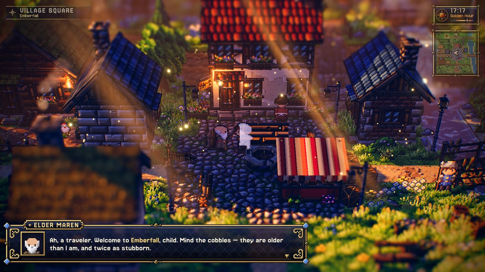
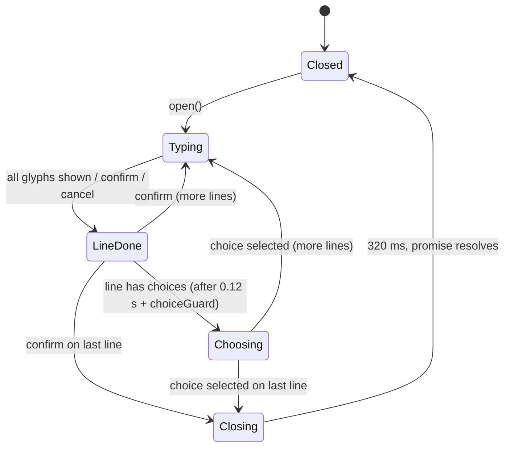
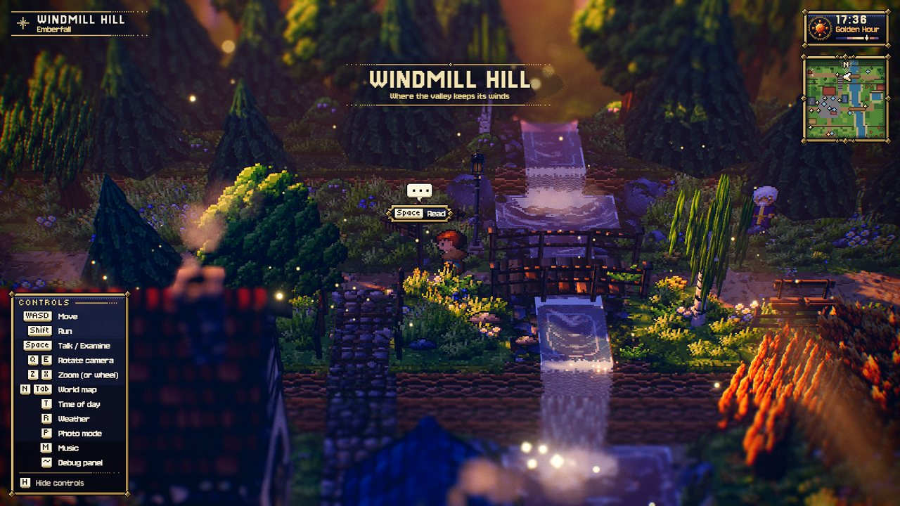
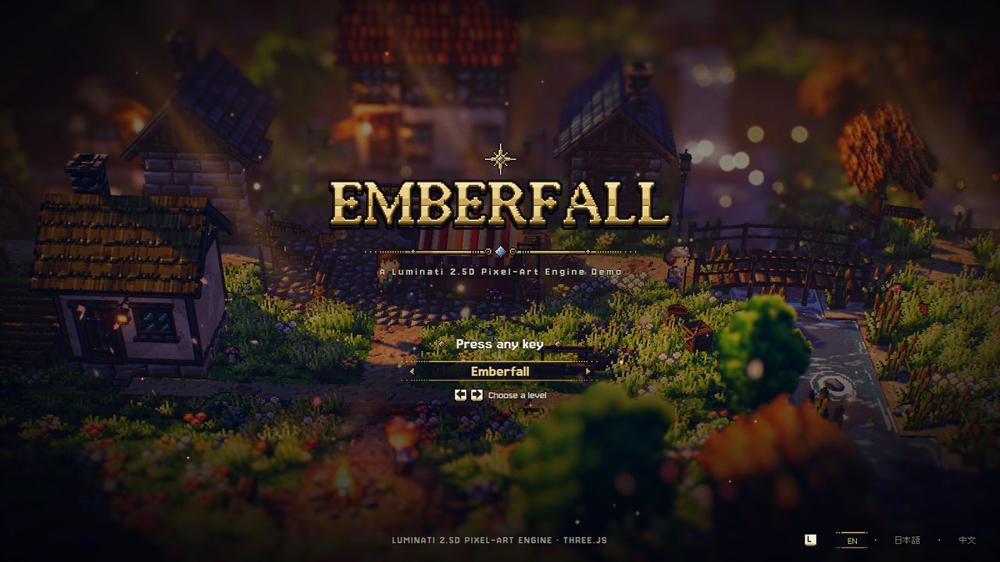
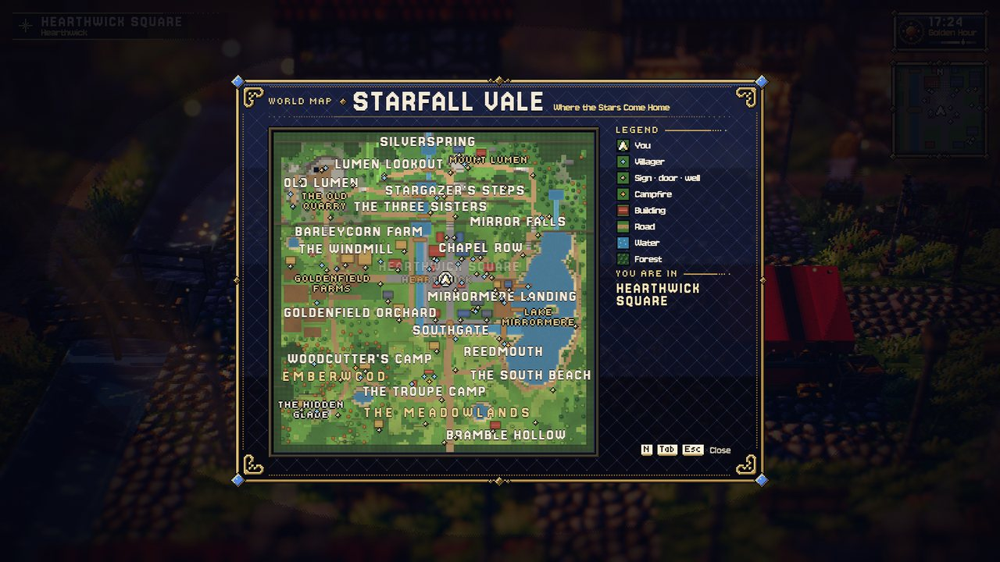

# UI module: overlay, dialog, HUD, maps, debug panel

> **Purpose.** This is the reference for Luminati's DOM overlay, the pixel-art interface drawn over the 3D canvas after mockup **G · Gilded Today** (contract: [PIXEL_UI.md](../../specs/PIXEL_UI.md)), in English, Japanese and Simplified Chinese ([I18N.md](../../specs/I18N.md)). It covers the `UI` root and its components (dialog box, area banner, title screen, HUD clock/location/controls/toasts, interaction prompt, fader, minimap and world map, and the lil-gui debug panel with its stats overlay), the combat UI that combat levels add (vitals, skill bar, loot feed, boss bar, world labels, announcer, death screen), the story UI that story levels add (journal, emote bubbles, cutscene letterbox and skip hint, end card), the party UI the first join adds (tactics panel, party frames, party dots on the maps), plus the pixel UI kit (scale, fonts, art, type and layout) and the layering.
>
> **Audience:** Developers and AI agents who change the in-game interface, add HUD elements, or wire UI into a game loop or test page.
>
> **Source of truth:** [`UI.js`](../../../src/engine/ui/UI.js), [`DialogBox.js`](../../../src/engine/ui/DialogBox.js), [`Banner.js`](../../../src/engine/ui/Banner.js), [`TitleScreen.js`](../../../src/engine/ui/TitleScreen.js), [`HUD.js`](../../../src/engine/ui/HUD.js), [`Minimap.js`](../../../src/engine/ui/Minimap.js) (`Minimap`, `WorldMap`), [`InteractPrompt.js`](../../../src/engine/ui/InteractPrompt.js), [`Fader.js`](../../../src/engine/ui/Fader.js), [`DebugPanel.js`](../../../src/engine/ui/DebugPanel.js) (`DebugPanel`, `DebugStats`), the combat components [`CombatHUD.js`](../../../src/engine/ui/CombatHUD.js), [`BossBar.js`](../../../src/engine/ui/BossBar.js), [`WorldLabels.js`](../../../src/engine/ui/WorldLabels.js), [`Announcer.js`](../../../src/engine/ui/Announcer.js), [`DeathScreen.js`](../../../src/engine/ui/DeathScreen.js), the story components [`Journal.js`](../../../src/engine/ui/Journal.js), [`Emotes.js`](../../../src/engine/ui/Emotes.js), [`EndCard.js`](../../../src/engine/ui/EndCard.js) with [`story.css`](../../../src/engine/ui/story.css), the party components [`PartyPanel.js`](../../../src/engine/ui/PartyPanel.js), [`PartyFrames.js`](../../../src/engine/ui/PartyFrames.js) with [`party.css`](../../../src/engine/ui/party.css), their data types in [`types.d.ts`](../../../src/engine/ui/types.d.ts), [`ui.css`](../../../src/engine/ui/ui.css) (the root) with the components' own [`dialog.css`](../../../src/engine/ui/dialog.css), [`hud.css`](../../../src/engine/ui/hud.css), [`title.css`](../../../src/engine/ui/title.css), [`map.css`](../../../src/engine/ui/map.css), [`combat.css`](../../../src/engine/ui/combat.css), [`worldfx.css`](../../../src/engine/ui/worldfx.css), and the pixel UI kit: [`UiScale.js`](../../../src/engine/ui/UiScale.js), [`FontLoader.js`](../../../src/engine/ui/FontLoader.js), [`GlyphFont.js`](../../../src/engine/ui/GlyphFont.js), [`art/`](../../../src/engine/ui/art/index.js), [`layout/`](../../../src/engine/ui/layout/layout.js) (§12a). Game wiring: [`src/game/Game.js`](../../../src/game/Game.js) and [`src/game/DebugControls.js`](../../../src/game/DebugControls.js). If this page and the code disagree, the code is right.
>
> **Related:** [Module index](README.md) · [core (Input actions)](core.md) · [audio (sfx hooks)](audio.md) · [level (`LevelMap` for the maps)](level.md) · [Input and controls spec](../../specs/INPUT_AND_CONTROLS.md) · [Playing the game](../../user/PLAYING_THE_GAME.md) · [Visual design](../../design/VISUAL_DESIGN.md) · [Game architecture](../GAME.md) · binding contracts: [ARCHITECTURE.md §4.8](../../../ARCHITECTURE.md), [COMBAT.md §13](../../contracts/COMBAT.md) (combat UI) · builder notes: [MODULE_NOTES › ui / scalability](../../contracts/MODULE_NOTES.md)



---

## 1. Responsibilities

| Component | Member of `UI` | What it is |
| --- | --- | --- |
| `UI` | (root) | Builds `#luminati-ui.lu-root` over a container, creates every component, forwards per-frame updates and sets state classes (dialog open, title up, photo mode). |
| `DialogBox` | `ui.dialog` | G's latticed L window, bottom-left: the speaker's portrait, a name plate with an optional title, a typewriter with punctuation pauses (character by character in Japanese and Chinese), `{gold}` markup, a question under the speech (`ask`), a ▼ next mark and an optional choice window. |
| `Banner` | `ui.banner` | Top-centre area title card drawn as G's level-up card: a stepped shade, gold hairlines with a gem, the title in the heading type, the subtitle in the line type. |
| `TitleScreen` | `ui.title` | Full-screen title over the live scene: rising pixel embers, the compass star, the gilded logo (the translated name in Japanese and Chinese), divider, tagline, "Press any key" / the level chooser / a vertical menu, the footer and the language row (EN · 日本語 · 中文). Dismissed by any key, click/tap or gamepad button. |
| `HUD` | `ui.hud` | Place plate (top-left), clock with the phase icon and name (top-right), controls legend with keycaps (bottom-left), toasts (top, clear of the corner panels). |
| `Minimap` | `ui.minimap` | G's M window, north up, onto the level's map at 2 art px per world unit, under the clock (inside the HUD). |
| `WorldMap` | `ui.worldMap` | An L window over the dimmed scene with the map, region names, markers, a legend and "You are in". `setMap(map, { …, origin })`: `origin` ([0, 0]) is where the level's (0, 0) lies on `map` — a campaign's overview of several levels draws the player, villagers and markers shifted by it ([CAMPAIGN_FORMAT.md §6.6](../../specs/CAMPAIGN_FORMAT.md#66-the-world-map)). |
| `InteractPrompt` | `ui.prompt` | A pixel-art speech bubble over a small plate with the keycap and the action's label, projected above a world point every frame. |
| `Fader` | `ui.fader` | Full-screen colour fades with timer-settled promises. |
| `DebugPanel` (+ `DebugStats`) | `ui.debug` (`ui.debug.stats`) | A lil-gui panel in the pixel UI's faces (hidden by default; English only) and a stats overlay in an XS frame: fps, frame ms, draw calls, triangles, geometries, textures, programs, worst frame and an fps graph. |
| `CombatHUD`, `BossBar`, `WorldLabels`, `Announcer`, `DeathScreen` | `ui.combat.hud`, `.boss`, `.labels`, `.announcer`, `.death` | Combat levels only, created by `ui.enableCombat()` from the classes registered with `UI.useCombatUI()` (§10): vitals, skill bar, gold and loot feed; the boss bar; damage numbers, enemy bars and aggro pips, off-screen edge arrows, alerts and the lock-on reticle; level-up and results cards; the death screen. |
| `Journal`, `Emotes`, `EndCard` (+ letterbox, skip hint) | `ui.journal`, `ui.emotes`, `ui.endCard` | Story levels only, created by `ui.useStoryUI({ Journal, Emotes, EndCard })` (§11): the quest and item journal, emote bubbles over characters, the end card; the cutscene letterbox (`ui.setCutscene`) and its hold-to-skip ring (`ui.setSkipHint`). |
| `PartyPanel`, `PartyFrames` | `ui.party.panel`, `ui.party.frames` | Only once someone joins the party, created by `ui.usePartyUI({ PartyPanel, PartyFrames })` (§11a, [PARTY.md §6](../../specs/PARTY.md#6-the-party-ui)): the tactics panel and the party's HUD frames; the maps draw `party` dots. |

```mermaid
flowchart TB
  root["UI root: div luminati-ui, class lu-root, pointer-events none"] --> prompt["InteractPrompt .lu-prompt z4"]
  root --> hud["HUD .lu-hud z2"]
  hud --> mm["Minimap .lu-minimap"]
  root --> banner["Banner .lu-banner z3"]
  root --> dialog["DialogBox .lu-dialog z4"]
  root --> toasts[".lu-toasts z5 (the HUD's, beside it)"]
  root --> title["TitleScreen .lu-title z6"]
  root --> wm["WorldMap .lu-worldmap z7"]
  root --> fader["Fader .lu-fader z8"]
  root --> debug["DebugPanel .lu-debug z9"]
  root -.-> wl["WorldLabels .lu-worldfx z1 (combat)"]
  hud -.-> chud["CombatHUD vitals, skills, loot; BossBar (combat)"]
  root -.-> ann["Announcer .lu-announce z3 (combat)"]
  root -.-> death["DeathScreen .lu-death z7 (combat)"]
  root -.-> emotes["Emotes .lu-emotes z1 (story)"]
  root -.-> lb["letterbox + skip hint .lu-letterbox z2 (story, before the HUD)"]
  root -.-> journal["Journal .lu-journal z7 (story)"]
  root -.-> endcard["EndCard .lu-endcard z7 (story)"]
  hud -.-> pframes["PartyFrames .lu-pframes (party)"]
  root -.-> ppanel["PartyPanel .lu-party z7 (party)"]
```



Dotted: created by `ui.enableCombat()` on combat levels only, by `ui.useStoryUI()` on story levels only, or by `ui.usePartyUI()` once someone joins the party.

**Import side effects.** `UI.js` imports `ui.css` and `layout/base.css` — no font: the UI's faces come from [`FontLoader.js`](../../../src/engine/ui/FontLoader.js) at run time (Google Fonts first, else the `@fontsource` copies built into `dist/`; Cinzel, Crimson Pro and Pixelify Sans left the game UI in phase 3, and only the editor still imports Cinzel). Each component file imports its own stylesheet (`dialog.css`, `hud.css`, `title.css`, `map.css`); the five combat components [`combat.css`](../../../src/engine/ui/combat.css) and [`worldfx.css`](../../../src/engine/ui/worldfx.css), the three story components [`story.css`](../../../src/engine/ui/story.css), the party components [`party.css`](../../../src/engine/ui/party.css). These are the only import-time side effects the engine allows ([ARCHITECTURE §2](../../../ARCHITECTURE.md)).

**Exports.** Everything is in the barrel [`src/engine/index.js`](../../../src/engine/index.js): `UI, DialogBox, Banner, TitleScreen, HUD, InteractPrompt, Fader, DebugPanel, Minimap, WorldMap` and `CombatHUD, BossBar, WorldLabels, Announcer, DeathScreen` (re-exported from their own files, by the barrel and by `UI.js`), `DebugStats`, and `DEFAULT_CONTROLS, TIME_PHASES, timePhase, createKeycaps` from `HUD.js` (`defaultControls`, `phaseName` and `keycapsWidth` are exported by `HUD.js` itself, not the barrel). The story components `Journal`, `Emotes` and `EndCard` are **not** in the barrel nor re-exported by `UI.js`: import them from their own files and hand them to `ui.useStoryUI()`. Likewise the party components `PartyPanel` and `PartyFrames` (import them from their files, or take them from `partyUIClasses()` in `src/game/party/partyUI.js`, and hand them to `ui.usePartyUI()`); they import [`party.css`](../../../src/engine/ui/party.css).

**Combat UI out of peaceful bundles** (KNOWN_ISSUES COMBAT-17). `UI.js` does **not** import the five combat components: `enableCombat()` gets the classes from its caller — registered once with `UI.useCombatUI({ CombatHUD, BossBar, WorldLabels, Announcer, DeathScreen })` (what `CombatSystem.load()` does; it imports them from their own files) or passed as `enableCombat(classes)` — and throws when neither holds them. `vite.config.js` marks the five modules (and the combat FX / sheet modules) side-effect free, so the re-exports put nothing into a chunk that does not use them: in the production build the combat UI and `combat.css` load only with the `CombatSystem` chunk.

**What `UI` deliberately does not do:** it binds **no keys** (the game maps actions to `ui.debug.toggle()`, `ui.hud.toggleHelp()`, photo mode and the map, so there are no double toggles); it does not update the minimap, the world map or the debug stats (the game calls them); and it does not pause gameplay. The game gates input itself: on `ui.dialog.isOpen`, its own `mode` (`'title'` until the title promise resolves, then `'play'`) and its own `mapOpen` flag. A page without such a mode can use `ui.title.visible` and `ui.worldMap.isOpen`.

---

## 2. `UI` (root)

```js
const ui = new UI(container = document.body, { lang, fonts } = {});
```

`lang`: the page's language (`setLang`; without it the root resolves it: `?lang=`, the saved choice, English — [I18N.md §1](../../specs/I18N.md#1-choosing-the-language)). `fonts`: the page's `FontLoader` (default: the one `startFonts()` made, else a new one). Both additive (2026-10-09).

| Member | Description |
| --- | --- |
| `root` | `div#luminati-ui.lu-root`: `position: fixed; inset: 0; z-index: 50; pointer-events: none`. Only the dialog window, the choice list, the title screen and the debug panel take the pointer (the world map and HUD are not clickable). With a container other than `body` it gets `.lu-root--contained` (absolute), and a `static` container is made `position: relative`. |
| `dialog`, `banner`, `title`, `hud`, `prompt`, `fader`, `debug`, `minimap`, `worldMap` | The components (§3–§9). |
| `static useCombatUI({ CombatHUD, BossBar, WorldLabels, Announcer, DeathScreen })` | Registers the combat UI classes once for `enableCombat()` (additive, 2026-09-28). `UI.js` does not import them itself, so a peaceful level's bundle does not hold them; `CombatSystem.load()` registers them. |
| `enableCombat(classes = registered)` → `ui.combat` | Creates the combat components (§10) from the registered classes (or `classes`, when given; throws when neither holds them), adds `.lu-root--combat` to the root, registers the HUD panels the world labels keep out of (`labels.setPanels`) and pre-renders the death screen (`death.prime`). Idempotent; peaceful levels never call it. |
| `disableCombat()` | Disposes the combat components and drops `.lu-root--combat` (a campaign leaving a combat level for a peaceful one; `CombatSystem.dispose` calls it). No-op without them; additive, 2026-10-07. |
| `combat` | `{ hud, boss, labels, announcer, death }` after `enableCombat()`, else `null`. |
| `useStoryUI({ Journal, Emotes, EndCard })` → `{ journal, emotes, endCard }` | Creates the story UI (§11) from the given classes (throws when one is missing), the letterbox with the skip hint, and `.lu-root--story`. Idempotent; levels without a story never call it (additive, 2026-10-07). |
| `disableStoryUI()` | Disposes the story components, removes the letterbox and drops the cutscene state and the story classes. No-op without them. `dispose()` calls it. |
| `journal`, `emotes`, `endCard` | The story components after `useStoryUI()`, else `null`. |
| `usePartyUI({ PartyPanel, PartyFrames })` → `{ panel, frames }` or null | Creates the party UI (§11a): the tactics panel (a root child, z 7) and the party frames (inside the HUD). Once; a later call returns the first; null (nothing made) when a class is missing. On a combat level it adds the frames to the world labels' keep-out panels. Additive, 2026-10-08 ([PARTY.md §6](../../specs/PARTY.md#6-the-party-ui)). |
| `party` | `{ panel, frames }` after `usePartyUI()`, else `null` (a game nobody joins). |
| `setCutscene(on)` → bool, `cutscene` | Story UI only (a no-op returning `false` before `useStoryUI()`): `.lu-root--cutscene` — solid ink bars (8 · round(artH · 0.11 / 8) art px, a 1-art-px hairline on the inner edge) slide in at the top and bottom in 8-px steps; the HUD panels (location plate, clock, legend, minimap, combat HUD), the interaction prompt and the combat world labels step aside; the toasts stay (they paint over the top bar), the dialog, banner and emotes stay. Leaving it also hides the skip hint. |
| `setSkipHint(on, progress = 0, { key })` | Story UI only: a 15 × 15 ring of 12 segments that light with `progress` (0–1), then "Hold {key} to skip" with a keycap (`t('story-ui.skip.hold')`), at the bottom right, centred on the bottom bar. `key` changes the keycap. Cheap every frame (the DOM changes only when the state or the number of lit segments changes). |
| `setHudVisible(on)`, `hudVisible` | Hides / shows the HUD panels only (`.lu-root--nohud`; the toasts stay) — unlike `setVisible`, which hides the dialog and everything else too. Works with or without the story UI (its rule is in `ui.css`). |
| `container` | The element passed in. |
| `fontsReady` | A promise that resolves (and never rejects) once the language's pixel UI fonts have loaded or failed — `fonts.ready`: the Latin set, the CJK set, the Jersey aliases and the pixel glyphs (§12a). `Game` starts the wait at `init` and awaits it in `_buildLevel`, after the world and the villagers, before the HUD's first layout. |
| `lang`, `fonts` | The page's language ('en' / 'ja' / 'zh') and its font loader (§12a). |
| `scale`, `px`, `fpx`, `shrink`, `cornerShrink`, `artW`, `artH` | The art scale (§12a): one art pixel and one half-size font pixel (⌈px / 2⌉) in device pixels, the corner groups' shrink (1 from 1024 × 600 device px up; `shrink` is the same value), the root's size in art px. |
| `on('scale', fn)` → unsubscribe, `off('scale', fn)` | The art scale changed (`fn(scale)`); also while the UI is hidden. Emitted once the fonts follow the new scale (a Japanese or Chinese page's Jersey aliases rebuilt: `measure()` is right in the listener); one event per change. |
| `UI.of(el)` (static) → `UI \| null` | The UI whose root `el` is in, else the page's newest. A component made with only its parent element follows the scale through UiScale.js `onScale(parent, fn)` / `currentScale(parent)` (§12a). |
| `measureHost` | An always-laid-out, invisible `div.lu-measure` in the root where `lineCount` lays text out. |
| `visible` / `setVisible(bool)` | Photo mode: `.lu-root--hidden` fades out **everything except the fader**, including the debug panel. |
| `update(dt, { camera, input })` | See below. Call once per frame **after** the camera rig moved (the game uses the engine's `'lateUpdate'` event). |
| `dispose()` | Disposes every component, stops following the window's size and removes the root. |

`update` does this, in order:

1. With the story UI: `endCard.update(dt, input)` while the end card is active (input only while the overlay is visible), then `journal.update(dt, input)` while the journal is open; with the party UI, `party.panel.update(dt, input)` while the tactics panel is open; each takes the input from the dialog for that frame.
2. `dialog.update(dt, input)`. The input is passed only while the overlay is visible and no title is showing.
3. It toggles `.lu-root--dialog` (while `dialog.isOpen`: the controls legend steps away, the prompt hides, the place plate, clock and minimap dim to 0.55) and `.lu-root--title` (while `title.visible`: the HUD and prompt are hidden and the clock animations paused).
4. `prompt.update(camera)` when a camera is given, then `emotes.update(camera)` with the story UI and `combat.labels.update(dt, camera)` on combat levels.
5. `hud.update(dt)` (a no-op hook; the HUD is event driven).

---

## 3. `DialogBox`

```js
const choice = await ui.dialog.open({ speaker, lines, portraitColor, sheet, title });
```

The window is drawn after mockup G (sizes in [PIXEL_UI.md §5](../../specs/PIXEL_UI.md#5-component-recipes)): A's latticed L window in navy glass anchored bottom-left (x 10, 496 art px wide, at least 62 tall, growing with its text), the speaker's **portrait** (frame (0, 0) of the character sheet passed as `sheet`, G's crop in a gilt frame), the **name plate** on the top rim (the speaker's gem, the name in capitals, a divider, the speaker's `title`), the text in the body role and the **choices** in a small window above the window's right end (the gilt selection band and a nudging gem cursor; long labels wrap). The window never shrinks with the corner groups: on a narrow screen it narrows (at least 240 art px, clear of a shown skill bar) and its text reflows (`_width`).

| Member | Description |
| --- | --- |
| `open({ speaker = '', lines = [], portraitColor, sheet, title, hold })` → `Promise<number \| undefined>` | `lines` is a string or an array of strings and `{ speaker?, text, choices?, sheet?, title?, ask? }` objects (`DialogLine`; a choice list may have a single item; confirm then picks index 0). `speaker` is the default name plate for lines that don't set their own; `speaker: null` hides the plate for that line. `portraitColor` (any CSS colour) tints the gem on the name plate through `--lu-portrait`. `sheet` (a character sheet's canvas: `npc.sheet.canvas`) and `title` (the speaker's small title) are the window's defaults, applied only to its own speaker's lines; without a sheet there is no portrait and the text starts at the left. `ask` (additive, phase 3) is a question shown under the speech — a gap, a gold gem, the question in the selection colour — typed after the speech; when `open()` continues a held window with the same speaker and text plus an `ask` or `choices`, the speech shows at once and only the question types. Callers pass translated text ([PIXEL_UI.md §8.1](../../specs/PIXEL_UI.md#81-component-interfaces)). The promise resolves **after the close animation** with the index of the last choice made, or `undefined`. A new `open()` interrupts the current dialog, whose promise resolves at once with its choice so far. An empty `lines` resolves `undefined` immediately. |
| `update(dt, input)` | Handles input first, so a press acts on what the player sees, then advances the typewriter and activates pending choices. Call it every frame (`UI.update` does). |
| `close()` | Starts the animated close (320 ms). |
| `skip()` | Reveals the current line at once. |
| `isOpen` | True from `open()` until the close animation **ends**. Gate talking and movement on it. |
| `isTyping`, `isChoosing` | The typewriter is running / the choice list is active. |
| `isHeld`, `heldLine` | `open({ …, hold: true })` keeps the window after its last line (the promise resolves when that line is dismissed) until the next `open()`, which goes on in it without the close and open animations, or `close()`: `isHeld` is true meanwhile and `heldLine` a copy of the line it shows (with the window's speaker and colour where the line has none; else `null`) — a story's `choice` after a block puts its options on it (STORY_SCRIPT.md §4). |
| `speed` | Characters per second. The default is `45`, the game sets `55`, and `≤ 0` means instant. |
| `cjkPace` | Japanese and Chinese type at `speed × cjkPace` (default `0.7`; additive, phase 2). |
| `inputGuard` | `0.15` s after `open()` during which confirm is ignored, so the Talk press doesn't skip text. |
| `choiceGuard` | `0.25` s after the choices appear during which input is ignored, so mashing confirm doesn't pick the pre-selected first choice. |
| `onChar(char)` | Called for every visible (non-space) character the typewriter reveals. Characters revealed at once by confirm, cancel, `skip()` or `speed ≤ 0` do not trigger it. The game plays a `blip` on every second call. |
| `onSound(name)` | `'open' \| 'close' \| 'confirm' \| 'blip'`, matching `AudioSystem.playSfx` names (`blip` is played only when the choice cursor actually moves). |
| `element`, `dispose()` | |

**Input.** It uses `input.consumeAction(name)` when the Input has it (the engine's does), so the press is swallowed for the rest of the frame, and falls back to `actionPressed` otherwise.

| Action | While typing | Line complete | Choices active |
| --- | --- | --- | --- |
| `confirm` (Space / Enter / F / gamepad A) or a click on the window | Completes the line | Next line, or close after the last | Selects the highlighted choice |
| `cancel` (Escape / Backspace / gamepad B) | Completes the line | — | — |
| `up` / `down` (W/S, arrows, D-pad) | — | — | Moves the cursor (wraps); on a one-item list nothing moves and no blip plays (the press is still consumed) |
| Mouse over / click a choice | — | — | Highlights / selects |

**Typewriter and markup.** `{word}` renders the word in gold (`.lu-hl`) and `\n` forces a line break. Each glyph is a `<span>` inside a per-word span, built once per line; Japanese and Chinese are set one character at a time (no word spans: they break between characters, by the strict line-break rules, with `cjkCharClass` on each character's span). Punctuation followed by a space, a line end or a closing quote/bracket adds a pause: `,` 0.12 s, `;` `:` 0.16 s, `—` 0.14 s, `.` `!` `?` 0.22 s, and `…` or `...` 0.42 s; a full-width mark (`、` `。` `！` `？` …) pauses whatever follows it. A 0.06 s breath comes before the first character; a question (`ask`) waits at least 0.3 s after the speech. After the text finishes, choices appear 0.12 s later. Arrows and ♪ in the text are pixel glyphs (§12a). The ▼ mark bobs in steps (a breathing gold gem on the last line) and hides while the choices are open.



---

## 4. `Banner`

```js
await ui.banner.show(title, subtitle = '', { duration = 3.5 });
```

- `duration` is the time from `show` until the fade-out **starts** (at least 1.2 s). The fade-out adds about 1.1 s (`FADE_OUT`).
- The promise resolves when the fade has finished, or when a new `show()` replaces the banner.
- `hide()` starts the fade now. `visible` is true while the banner is on screen, fade included.
- The card is G's level-up card (PIXEL_UI.md §5): no panel, a stepped radial shade, gold hairlines fading at both ends above and below with a gem on the top one, the title in the heading role in capitals (at most 520 art px, then an ellipsis), the subtitle in the line role. The rules open from the gem in steps, the title settles by two art px, the subtitle follows; it fades out rising two art px. It is a `tc` group from y 48 in a stage over the root (`.lu-banner`), built on `show()` and again on a scale change while shown. Callers pass translated text.
- `box` (additive, phase 3): while the banner is on screen, the card's keep-out — `{ x, y, w, h, fit }` in the 640 × 360 frame, from the gem's top to the lower rule — else `null`. Every change is announced on the element as a bubbling `lu-banner` event (`detail`: the box, or null once the card is gone): the HUD's toasts go under the card, the world labels keep out of it.
- The element is its own compositor layer from the start (`will-change: opacity`): promoting it when the fade-out began cost a one-time GPU stall (215–264 ms in the first UI).

The game shows the level name when play starts (`duration 3.2`), and a region's banner the first time the player enters a `region` object whose `banner` subtitle is set (`duration 2.6`).



---

## 5. `TitleScreen`

```js
ui.title.onDismiss = (source) => audio.unlock();   // runs synchronously inside the user gesture
const how = await ui.title.show({ title, subtitle, prompt, credit, titleSource,          // defaults: t('title.*')
                                  destinations, current, destinationPrompt, menu,      // optional rows
                                  languages, lang, onLanguage });                      // the language row
// → 'key' | 'pointer' | 'gamepad'
```

Drawn after mockup G (PIXEL_UI.md §5): today's smooth vignette with pixel embers rising in whole art pixels, the compass star, the title as A's gilded Roman capitals (`logoFit`: scale 3, else 2, else two lines) — in Japanese and Chinese the translated name drawn from the language's face (`textLogoFit`) with the English name (`titleSource`) as a small wordmark under it —, the divider, the tagline, the menu, the footer in capitals and, with `onLanguage`, the language row in the bottom-right corner. Everything is placed in art px of G's frame and laid out again on a scale change and once the fonts for its texts are in; on a screen narrower than G's frame the logo and tagline fit the room instead of the title being scaled down.

- The promise resolves **as soon as the player presses**. The screen then fades out over about 1.15 s, and `visible` stays true until the fade ends. `hide()` fades out and resolves a pending `show()` with `undefined`.
- Input is accepted after `armDelay` (0.45 s).
- The key listener runs in the capture phase with `stopPropagation`, so the dismissing key doesn't reach gameplay input. Modifier keys, `Tab`, `CapsLock`, `F5`, `F11` and `F12` are ignored, as are key repeats.
- A click or tap (`pointerdown`) also dismisses.
- Gamepads are polled with `requestAnimationFrame` only while the title is visible. Only a button newly pressed after the first poll counts.
- While hidden the element is `display: none` (`.is-gone`), so its motes and shimmer animations stop.

**Destinations** (optional, COMBAT.md §13.3): `show({ …, destinations: [{ value, label, detail? }], current })` adds the level chooser under the prompt — a plate with ◀ ▶ and the key hint ("← → Choose a level", `t('title.chooseLevel')`); while another entry is selected the prompt line reads the keycaps and "Travel to <label>" (`destinationPrompt`, a template with `{label}`, default `t('title.travelTo')`). `destinationHint` still replaces the hint's words and the legacy `destinationVerb` the prompt's verb; the game no longer passes either (phase 2).

- Only ArrowLeft / ArrowRight, d-pad left / right (standard-mapping buttons 14 / 15) and clicks on the ◂ / ▸ glyphs cycle the selection; the glyph clicks stop propagation, so they never dismiss. A / D and the sticks never cycle.
- While the selection differs from `current`, the label brightens and the prompt line reads the Enter / A keycaps and "Travel to <label>". Only a confirm (Enter, Space, pad A, or a click on the label) resolves with that selection.
- Any other key, button or click first resets the selection to `current`, then dismisses as usual.
- The getter `title.destination` returns the selected `value` (read it once the promise has resolved): `current` unless a changed selection was confirmed, `null` without `destinations`. A `current` missing from the list stays the result unless the player picks an entry.
- Without `destinations` the title is unchanged: no row is created (a row from an earlier call is removed) and there is no new key handling.

**Menu** (`menu: true`, additive, phase 2): the destinations as a vertical menu — the selected entry on a plate fading at both ends with a nudging cursor gem, each entry's `detail` as a second line, the key hints ↑ ↓ Choose · Space Start. ↑ / ↓ (also ← / →, W / S, the d-pad) cycle, a confirm (Enter, Space, pad A or Start) or a click on an entry starts; a menu takes only its own keys, and no prompt shows. A campaign's title uses it for Continue (its `detail` the save line) and New journey.

**Language row** (additive, phase 2): `languages` (`[{ code, label }]`, default `TITLE_LANGUAGES`: EN · 日本語 · 中文 — the labels drawn as 12-dot bitmaps, the same on every page), `lang` (the current one, lit) and `onLanguage(code)`. **L** or a pad shoulder button (LB / RB) gives the row the focus on the current language (pressed again, it moves on), ← / → choose, Enter or pad A calls `onLanguage` (the game saves the choice and reloads), Esc or pad B goes back; a click on a plate switches at once. On a title with the row, L no longer starts the game. The getter `title.language` → `{ current, selected, focused }` (null without the row).

**Long titles** fit by the logo's rule (`logoFit` / `textLogoFit` to `min(560, artW − 32)` art px; every shipped title fits on one line, `sandbox/ui_art.html?page=titles`); a centred group is scaled only when the art itself does not fit.

`TitleScreen.js` also exports `TITLE_LANGUAGES`. (`SVG_DIVIDER` is gone: the divider is `art/pieces.js divider()`.)

The game shows it unless the URL has `?autostart=1`, with texts from the level's `environment.title` or defaults (see [LEVEL_FORMAT.md](../../specs/LEVEL_FORMAT.md)).



---

## 6. `HUD`

Drawn after mockup G (sizes in [PIXEL_UI.md §5](../../specs/PIXEL_UI.md#5-component-recipes)): each panel is a group anchored to its corner of the 640 × 360 art frame, painted from canvases with its text in the type roles, and laid out again when its text, the language's fonts or the root's scale change (also after `relayout()`). The **place plate** (top-left, G's `placePlate`) keeps the two-line height whatever it shows, so what hangs under it never moves; the **clock** (top-right) is an XS window with the phase icon, the time and the phase name (`t('hud.clock', { time, phase })`), as wide as the language's longest phase name; the **legend** (bottom-left) is an XS window of keycap rows that turns into two columns on a short screen; the **toasts** are the title's plate band with fading ends. While a dialogue is open the plate and the clock dim to 0.55 and the legend steps away; under the boss bar and the death screen the legend steps aside.

| Member | Description |
| --- | --- |
| `setTime(hours)` | Cheap every frame: the DOM changes only when the minute changes, with no string allocation for digits. It also sets the clock's `data-phase`, phase name, icon and track mark. |
| `setLocation(name, subtitle = '')` | The place plate (translated by the caller). It is hidden when `name` is empty and replays a swap animation when the name changes; with no subtitle the name is centred. |
| `setControls([{ keys, label, id?, pad? }])` | Replaces the legend. `keys` is a string (`'WASD'` → one cap, `'Q/E'` → two caps, `'Shift+Space'` → caps joined by `+`) or an array; `label` arrives translated; `id` (additive) is a stable id written on the label element as `data-id`, so tests find a row in any language. A footer "`helpKey` Hide controls" is added when `helpKey` is set (default `'H'`; `''` hides the footer). The footer is built here, so set `helpKey` before calling `setControls`. |
| `showHelp(bool)`, `toggleHelp()` → new state, `helpVisible` | Legend visibility. The legend is also hidden by CSS on windows shorter than 540 px. |
| `relayout()` | Lays every panel out again (additive; the panels also do it on the root's `'scale'` event and once the fonts are in). |
| `toast(text, seconds = 2.5, { kind })` → element | A message near the top, shown for at least 0.5 s. At most `maxToasts` (3) are stacked; the oldest goes first. The container (`hud.toastElement`, `.lu-toasts`) is a child of the UI root **beside** `.lu-hud` (KNOWN_ISSUES UI-06), so the toasts paint over the banner and the dialog; they hide with `hud.visible = false` and while the title is up, and stay through `setHudVisible(false)` and cutscenes. **Placement** (phase 3): the stack starts at y 10, toasts 2 art px apart, 8 clear of the corner panels (the plate and what hangs under it, the clock, the minimap), on the screen's centre line where it fits, moved only as far as needed; the text wraps to the free span (at most 400 art px, an error 460); a toast that would reach the area banner's card goes under it (`Banner.box`, the `lu-banner` event); beside a long place plate the stack starts under the plate. **Keycaps:** `{Key}` in the text (`{G}`, `{Esc}`, `{P}`, `{1}` …) draws G's keycap on a one-line toast; on a wrapped or an error toast the braces fall back to gold keyword text. `kind`: `'quest'` (a scroll icon), `'item'` (a chest), `'error'` (a flag, ruby, for story script errors in development); without a kind (or an unknown one) a plain toast. |
| `visible` (get/set) | Whole-HUD visibility (fades). |
| `clockElement`, `hours`, `phase`, `element` | The clock panel (the minimap and debug panel anchor below it), the last hour, and the phase id. |
| `locationElement`, `helpElement` | The location plate (`.lu-loc`) and the controls legend (`.lu-help`) — additive getters, used as the world labels' keep-out panels (§10). |
| `update()`, `dispose()` | |

**Clock phases** (`timePhase(h)`, `TIME_PHASES`): `night` (h < 4.75 or h ≥ 20.5), `dawn` (< 7), `morning` (< 11), `midday` (< 14), `afternoon` (< 16.5), `golden` "Golden Hour" (< 18.75), `dusk`. `TIME_PHASES` stays English (ids → the source names); the clock shows `phaseName(id)`, the page's language (`hud.phase.<id>`). These are independent of `LightingSystem.phaseName`, which names the nearest palette keyframe.

**Helpers.** `DEFAULT_CONTROLS` (`{ id, keys, label }`, English: tests find rows by them) is the legend used until `setControls` is called; `defaultControls()` gives the same rows translated (`hud.control.<id>`). It follows the engine's default bindings, including `Z/X` (Zoom (or wheel)) and `N/Tab` (World map). The game ([`Game.js`](../../../src/game/Game.js) `CONTROLS`) replaces it with its own list, translated (Talk / Examine, and the journal on story levels). `createKeycaps(keys)` returns a `span.lu-keys` of keycaps — A's 11-art-px cap drawn in CSS at `--px` — with labels such as `Backquote` → `~`, `Escape` → `Esc` and the mouse buttons `Mouse0` / `Mouse1` / `Mouse2` → `LMB` / `MMB` / `RMB` (combat bindings); `keycapsWidth(keys)` is their width in art px. The arrow keys (`ArrowLeft` … or the glyphs `←↑→↓`) are a drawn arrow (an SVG path in the keycap's colour, `aria-label` such as "Left arrow", no text).

---

## 7. `Minimap` and `WorldMap`

Both are pixel art at the root's `--px`, after mockup G ([PIXEL_UI.md §5](../../specs/PIXEL_UI.md#5-component-recipes)). Both draw a map image made once per level by [`renderLevelMap(level)`](level.md#7-levelmapjs) (`{ canvas, pixelsPerTile, width, depth }`) — the minimap G's flat tile map instead when the game passes the level (`setMap(map, { level })`: `art/minimap.js renderPixelMap(level, …, { objects: true })`, the tiles with the level's buildings, bridges, trees, wells and windmill), else the painted map turned into art pixels — plus live markers. The marker state object passed to `update` is shared by both:

```js
const markers = {
  player: { x, z },            // required
  facing: { x, z },            // arrow direction (default +Z)
  view: { x, z },              // camera look direction on the ground (minimap view wedge)
  npcs: [{ x, z }, …],         // villager dots
  markers: [{ x, z, kind: 'sign' | 'door' | 'well' | 'fire' | 'object'
                       | 'waystone' | 'chest' | 'boss',          // the last three: combat levels
              hidden? }, …],                                     // true: not drawn
  enemies: [{ x, z }, …],      // optional (combat levels): red #e0674f dots
  party: [{ x, z }, …],        // optional (a party, PARTY.md §6.3): teal #3fcfae dots in a light rim
};
```

`party` dots are drawn over the villagers and enemies, under the player's arrow; while the world map draws a party its legend has a *Companion* row. Without `party`, or with an empty one, both maps draw exactly what they drew before (canvas hashes, `sandbox/party_ui.json`, `map_ui.json`). `markers`, `enemies` and `party` are read on every draw, so a game may push into or splice those arrays at runtime (combat adds a chest's marker once it is discovered and removes the boss marker on defeat). A marker whose `hidden` is true is skipped: the game's live story props (`World.mapMarkers`) carry a getter that is true while their story group is absent. The markers are G's pixel gems and dots (`art/minimap.js` `marker`, `MARKER_ORDER`: doors, signs, wells and campfires under chests and waystones, under villagers, under foes and the boss, under the party), drawn without per-frame allocation.

**`Minimap`**, created by `UI` inside the HUD: G's M window (76 × 76 art px, gold corner gems, the trio, side studs), anchored top-right at (554, 50) under the clock (pushed down only when the clock grows within 7 art px of it), 'N' over its top edge, a 70 × 70 art-px map at 2 art px per world unit:

| Member | Description |
| --- | --- |
| `setMap(map, { view, level })` | Sets or clears the map. `view` is the world units across the window (default `34`; the game passes 34). `level` (additive): the level object, for G's flat tile map. The map's edge colour is read once per painted map canvas — a campaign sets a level's map again each time the player comes back to a level set aside. |
| `enabled` (get/set) | Whether the level allows the minimap. The game sets it to `environment.minimap !== false`. |
| `visible` | `!!map && enabled`. Hidden otherwise (`.is-empty`), and hidden by CSS on windows shorter than 560 px. |
| `update(markers)` | Redraws around the player: the cached map, G's muted wash, the dithered view wedge (64 steps), the stepped vignette, the markers (pushed aside from the arrow; foes beyond the window as pips on its edge) and the player's 9 × 9 arrow in eight facings. The window is clamped to the map, so near an edge the arrow moves off-centre instead of showing empty space. A map smaller than the window is centred on its edge colour. |

**`WorldMap`**, a full-screen overlay (z 7): an L window like the tactics panel (lattice, beads, the trio, side studs) on the dimmed scene (the tactics veil), sized to its content and to the screen without being scaled (narrower at 1024 × 768). Header: WORLD MAP ◆ the title · the subtitle over a dim rule; the map in a dim socket at a whole number of art px per tile; the legend column (11 × 11 chips: the minimap's own markers), YOU ARE IN and the region, the key hints N · Tab · Esc Close. It opens with a stepped fade, rising 2 art px. It is laid out when it opens (a level's load only stores its map; the first open costs ≈ 200 ms, during the fade):

| Member | Description |
| --- | --- |
| `setMap(map, { title = '', subtitle = '', regions = [], combat = false, origin })` | Title, subtitle and region names arrive translated. `regions` are `{ name, minX, maxX, minZ, maxZ }` (the game passes the level's `region` objects). Only the first region of each name gets a label. The window takes the level's aspect ratio. `combat: true` adds the legend rows Enemy, Waystone and Chest; without it they are not there. |
| `open()` / `close()` / `toggle()` → isOpen, `isOpen` | Fades in or out (0.35 s). `open()` does nothing without a map. The game (`Game.toggleMap`) opens it only while playing, outside a conversation and photo mode, freezes the player and camera input while it is open, toggles it with the `map` action (N, Tab, gamepad Back/View) and also closes it with `cancel` (Esc, Backspace, gamepad B). |
| `setRegion(name)` | The "You are in" line under the legend (hidden when empty). |
| `update(dt, markers)` | Redraws while open: the markers, villagers, the party and the player's arrow on a canvas **over** the region names. It lays the window out again when the screen's size changed. |

**Region names** (laid out in art px, no layout reads; run on `open()` and when the screen changed). Names are set in the name role with an ink outline (Japanese and Chinese in the `small` role: the CJK name role covered the map); a region that contains the centre of a smaller region is an **area** (airier type). Each name tries its centre, then just below, then just above, keeping clear of the markers (the player's arrow, the waystones and the boss first) and of the names already placed; else its compact form (smaller, on two lines: the `small` role, in English at an even `--px` the `line` role — Tiny5 under a one-art-px outline read 'GINDERWATGH PASS'; CJK names break at spaces and U+200B only), else the centre. A name over the player's arrow fades. Ink, line pitch and the legend's width follow `fpx`.



---

## 8. `InteractPrompt`

| Member | Description |
| --- | --- |
| `show(target, label = t('dialog.prompt.talk'), { offsetY = 0, key })` | Safe to call every frame (callers pass the label translated — the game's `promptLabel(it)`: `t('game.prompt.<id>')` for a built-in verb, also an exit's or event's data label that is one, else an exit's or event's own label by the key its object holds, `loc(textKeyOf(it.object, 'label'), label)`) (the DOM changes only when the label changes). A `Vector3` is **copied**; an `Object3D` is **followed** through its world position. `offsetY` is in world units (a sprite's origin is its feet, so the game uses about 2.35, or 1.9 for children). `key` overrides `keyHint` for this prompt. Switching to another `Object3D` replays the pop-in. |
| `hide()` | Hides it and drops the in-view state, so a later `show()` never flashes at the old position. |
| `update(camera)` | Projects the anchor (it calls `camera.updateMatrixWorld()` itself) and hides the prompt behind the camera or off-screen. It writes the transform only when the rounded pixel position changes. |
| `keyHint` | A keycap before the label (the game sets `'Space'`). `null` for none. |
| `visible`, `element`, `dispose()` | |

Drawn after mockup G's `interact`: today's pixel speech bubble (24 × 18 art px, its three dots blinking in turn) 2 art px over a small cartouche (G's S plate, notch 3) holding the keycap and the label in the line role, the cartouche's bottom 2 art px above the projected point. It pops up 3 art px in steps and is placed on whole device pixels, at the root's `--px` (no private scale). z 4: over the banner and the barks, under the toasts. The story's barks read its box to keep clear of it.

---

## 9. `Fader`, `DebugPanel`, `DebugStats`

**`Fader`.** `fadeOut(seconds = 0.6, color = '#000')` and `fadeIn(seconds = 0.6)` return promises settled by a **timer** (duration + 20 ms), so they resolve even when `transitionend` never fires (a hidden tab or `display: none`). A new fade resolves the previous promise and continues from the current computed opacity. `set(opacity, color?)` jumps instantly. `opacity` is the target opacity and `busy` is true while fading. The fader stays visible in photo mode. The game fades to black around the innkeeper's rest (`fadeOut(1.0)` … `fadeIn(1.1)`).

**`DebugPanel`** (`new DebugPanel(parent, { anchor = null, title = 'Luminati · Debug' })`; `UI` anchors it to the clock). A developer tool, English only, drawn in the pixel UI's faces and sized in whole art px (`hud.css`): a column 146 art px wide, 7 under the clock; lil-gui's rows, numbers, colour codes and buttons in Jersey 10 at the line role's size, its title in Jersey 15 capitals, its folders G's Tiny5 section headings:

| Member | Description |
| --- | --- |
| `gui` | A lil-gui `GUI` themed by `hud.css`. |
| `addFolder(name)` | Returns a lil-gui folder. The game's folders are in [`src/game/DebugControls.js`](../../../src/game/DebugControls.js): Time & Weather, Post FX, Lighting, Camera, Atmosphere, Render. |
| `toggle()` → new state, `visible` (get/set) | Hidden by default. When shown it is placed 7 art px below the anchor. The game toggles it on the `debug` action (`` ` `` or F1). |
| `syncListening()` | Pauses `listen()`ing controllers while hidden (they otherwise refresh every animation frame). Call it after adding listening controllers to a hidden panel. |
| `stats` | The `DebugStats` overlay. |

**`DebugStats.update(renderer, dt)`.** Call it once per frame **after all rendering** (the game uses `'afterRender'`). On the first call it sets `renderer.info.autoReset = false`, and after that it reads `render.calls`, `render.triangles`, `memory.geometries`, `memory.textures` and `programs.length` and calls `info.reset()` every frame, so multi-pass PostFX and shadow frames are counted in full. fps and frame ms are measured with `performance.now()` (not the engine's clamped, time-scaled dt; `dt` is only used where `performance` is missing) and refreshed every `interval` (0.25 s). "Worst" is the longest frame of the last interval. The box is an XS frame with gold corner gems, 76 art px tall, the numbers in Jersey and the labels in Tiny5; the fps graph is pixel art, colour-coded (≥ 50, ≥ 30, lower). The DOM only updates while the panel is visible, but the counter reset happens every frame. Readable fields: `fps`, `frameMs`, `calls`, `triangles`.

---

## 10. Combat UI (combat levels only)

`ui.enableCombat()` ([COMBAT.md §13](../../contracts/COMBAT.md)) creates five components — from the classes registered with `UI.useCombatUI()` or passed to it (§2) — and returns them as `ui.combat = { hud, boss, labels, announcer, death }`; it also adds `.lu-root--combat` to the root, hands the world labels the HUD panels to keep out of (`labels.setPanels([location plate, clock, minimap, controls legend, vitals, skill bar, boss bar])`, a panel counting only while shown) and pre-renders the death screen (`death.prime(…)`, once the fonts are in, with the translated texts). It is idempotent. Peaceful levels never call it, so none of these DOM nodes exist there (`ui.combat` stays `null`). `UI.update` calls `combat.labels.update(dt, camera)` right after `prompt.update(camera)`, and `UI.dispose` disposes the five components before the rest. Combat code writes the DOM only through these APIs.

| Component | Element (parent, z) | Placement at 1600 × 900 | Hidden by |
| --- | --- | --- | --- |
| `CombatHUD` vitals | `.lu-vitals` (in `.lu-hud`) | A `tl` group at (10, 36) art px (42–43 in CJK): under the place plate at a **fixed** place | Title, photo (with the HUD). Dimmed to 0.55 while a dialog is open and to 0.35 by `setCalm(true)` |
| `CombatHUD` skill bar | `.lu-skills` (in `.lu-hud`) | A `br` group (500, 284, 140, 76): 3 skill slots, the draught slot, the purse above | Title, photo; dimmed to 0.55 in a dialog, hidden (`is-tight`) where the dialog window would overlap it (below 632 art px wide) |
| `CombatHUD` loot feed | `.lu-loot` (in `.lu-hud`) | Right edge above the purse, 8 pooled rows 13 art px apart | Title, photo |
| `BossBar` | `.lu-bossbar` (in `.lu-hud`) | A `bc` group, the bar at y 340, up to 334 × 11 art px (narrower on a small screen) | Title, photo, dialog |
| `WorldLabels` | `.lu-worldfx` (root child, z 1, inserted **before** the prompt) | World-anchored | Title, photo, dialog, death screen |
| `Announcer` | `.lu-announce` (root child, z 3) | A `tc` group: the level card from y 48 (compact) or 78, under a showing area banner at 108; the results card at 96 (104) (its own element, never the Banner) | Photo, death screen |
| `DeathScreen` | `.lu-death` (root child, z 7) | Full screen | — (not even photo mode) |

All five are drawn after mockup G ([PIXEL_UI.md §5](../../specs/PIXEL_UI.md#5-component-recipes) has every size) and placed in art px of its 640 × 360 frame; their texts arrive translated (combat's `combat` and `worldfx` strings; HP, MP, SP, Lv, G and key names stay Latin). While the boss bar shows (and 600 ms after `hide()`) the root carries `lu-root--boss`, and the controls legend steps aside (`combat.css`), as it does under the death screen.

### `CombatHUD` (`ui.combat.hud`)

`new CombatHUD(hudElement, { anchor })`: `anchor` is the location plate (`.lu-loc`). Every setter can be called every frame; it writes the DOM only when a value changes (bar fills compare the fraction rounded to 1/1000, numbers compare integers, text goes through `nodeValue`).

| Member | Description |
| --- | --- |
| `setVitals({ hp, hpMax, mp, mpMax, sp, spMax, level, xp, xpNext, winded })` | On G's fading band (at least 155 × 32 art px): "Lv" in `tiny` over the level numeral in `numL`; HP / MP / SP in gold-ringed banded bars (71 × 7 / 7 / 6 art px) whose fills and pale lag fills are DOM `scaleX` layers quantised to whole art px (the lag drains 0.35 s after a loss); `hp/hpMax` and `mp/mpMax` in `num` (HP rounds up, so a sliver never shows 0); the SP bar flashes while `winded`; the thin gilt XP bar along the bottom. HP at or below 25 % pulses its number (`.is-low`). |
| `configureSkills([{ id, label, keys, padKeys, icon, unlock? }])` | Builds one slot per entry, in order: a 22 × 22 XS socket with gold corner gems and a 16 × 16 pixel icon (`'whirl'`, `'bolt'`, `'nova'`, `'draught'`), keycaps from `keys` and `padKeys` (both built once; `padKeys` defaults to `keys`) across its foot, and the name under it in the line role (translated; at an odd px an English name and a keycap digit take G's 5-art-px cap in Jersey 15, so 'Radiant' no longer runs into 'Healing'). `unlock` (additive): the level that unlocks it, shown on a "Lv N" plate over a locked slot. The `'draught'` slot also shows the carried count (`×3`). Slots stand 30 art px apart, more only where their names need it. |
| `onSlotPress` | `(index) => void` or null (additive). The slot boxes catch the pointer (`pointer-events: auto`, one delegated `pointerdown` listener; the context menu is suppressed on them), so a click on a slot never reaches the canvas as an attack; combat sets it to press the slot's skill / draught through the combat input (buffer, guards and refusals as for a key). |
| `setDevice('keyboard' \| 'gamepad')` | Shows every slot's `keys` or `padKeys` (one class on `.lu-skills`; `'mouse'` counts as keyboard). `device` reads it back. |
| `setSkill(i, { cooldown, seconds, locked, affordable, left })` | `cooldown` (remaining fraction) scales a 16 × 16 veil with a gold-dotted top edge; `seconds` shows in `big` while cooling down (one decimal under a second, `left`: the exact seconds, additive); the slot flashes once when it is ready again; `locked` shows the lock glyph, `affordable: false` dims the icon. |
| `setPotions(n, max)`, `setGold(n)` | Draught count (×N in `num`; the slot dims at 0); the purse at the skill bar's top right (a pixel coin, the number in `num`, G; the coin pops when the value rises). |
| `setCalm(on)` | Dims the vitals to 35 % (combat calls it after 5 s calm at full HP / MP). |
| `refuse(i)` | A refused press on slot `i` (locked, cooling down, not enough MP, no draught): the slot shakes once with a red rim (two identical keyframes toggled, like the ready flash). Added at integration (COMBAT.md §27.1 I8). |
| `loot(text, kind)` | One feed row (`'gold'`, `'heart'`, `'mana'`, `'draught'`, `'upgrade'`, `'core'`: a 9 × 9 pixel icon and the text on an 11-art-px fading band). The newest row sits at the bottom; older rows step up one row; each row slides in and fades out over 3.4 s. The 9th row reuses the oldest. |
| `vitalsElement`, `skillsElement`, `dispose()` | (`skillsElement`: the `.lu-skills` bar, one of the world labels' keep-out panels.) |

**Fixed vitals place.** The vitals sit under G's place plate, whose box always has the two-line height: at y 36 art px in English, 42–43 in Japanese and Chinese (the plate's two rows' ink). Region names, a missing subtitle, the plate's `is-empty` state and its swap animation therefore never move the vitals (the sandbox check measures the same top for all of them). `CombatHUD.js` also exports `anchorGroup(el, at, x, y, w, h, sc)` — anchors an element the component keeps as `layout.js group()` anchors a new one, then fits it (`setGroupFit`); `Announcer`, `BossBar` and `DeathScreen` use it.

### `BossBar` (`ui.combat.boss`)

| Member | Description |
| --- | --- |
| `show({ name, epithet = '', phases = 1 })` | Slides the bar in at full HP and phase 1 (the chip snaps, so it never drains from the previous fight) and sets the root's `lu-root--boss`. The name (translated) in tracked capitals on a ruby-cornered cartouche, the epithet on its baseline (a long name is cut to keep room for it and the gems), and `phases > 1` draws that many phase gems. |
| `set(hpFrac, phase)` | Every frame; writes on change. The fill and the pale chip band are `scaleX` layers in whole art px over the painted rims (the chip trails 0.7 s after 0.45 s); a hit flashes. Gems up to `phase` are ember, the current one breathes in hard steps, the rest dark sockets. |
| `hide()`, `visible`, `dispose()` | `lu-root--boss` stays until the fade-out of `hide()` has ended (600 ms); `dispose()` clears it at once. |

Drawn after G's `bossPanel`: no panel, a stepped radial shade behind A's 11-art-px bar between a double gold rule, ruby gems at both ends and ticks at the phase boundaries, so it stays legible over lava, snow or grass. It is 334 art px wide, narrower (max(220, artW − 260)) on a screen under 594 art px wide, so it clears the skill bar.

### `WorldLabels` (`ui.combat.labels`)

World-anchored labels in one layer. They are DOM elements: 0 draw calls, crisp and not blurred by the DOF, but not depth-occluded (by design). Anchors are read **live**: `anchor(vec3, offsetY)`, `alert(vec3, offsetY)` and `reticle(vec3, offsetY)` keep the vector (not a copy) and add `offsetY` **world units** to its y every frame, like `InteractPrompt` and the enemy defs' `labelY`. The scale is the root's `--px` / `--fpx` (`onScale`); no corner shrink. The look is G's ([PIXEL_UI.md §5](../../specs/PIXEL_UI.md#5-component-recipes)): numbers in the type roles (`roles()`) with G's eight-way `ol8` outline, moving in whole art px with `steps()`; the art (bars, pips, the alert, the reticle's four brackets, 8 pre-drawn edge-arrow octants) painted once per page with the kit's painter into CSS `url()` values on the layer.

| Member | Description |
| --- | --- |
| `number(x, y, z, text, kind = 'dmg')` | A floating number at a world point, its ink centred on the anchor: `big` for a hit, a companion's hit, a heal, MP and the player's hurt, a crit Jersey 10 at twice the half-size font pixel (a 4 : 3 step over a hit at an odd px), and the words `guard` / `perfect` — translated (`worldfx` strings: Guard ガード 格挡, Perfect! ジャスト回避！ 完美闪避！) — in `name`; G's `ol8` outline. Motion over 0.8 s (CSS, wall clock): it appears 2 art px low, hops 1 up, rises 10 art px one at a time and fades in 3 steps; a crit and Perfect! pop for two frames at twice the size. A seeded scatter (its own `RNG(0x6d6e)`, never the combat RNG); numbers stay on screen horizontally. **Stacking:** a number spawned within 0.52 s of live numbers at the same anchor (±0.8 u) starts one line higher per earlier one and alternates left / right, so a combo's hits and a hit's `Guard` never fuse ("2319"). Colours: G's tokens (`--g-hit`, `--g-crit`, `--g-mint`, `--g-heal`, `--g-mp3`, `--g-hp3`). Pool 40: the 41st reuses the oldest. Combat spawns enemy numbers above the HP bar (`labelY` + 0.4 u, elites + 0.3 more for the name plate). |
| `bar(slot)` → handle | Slots 0..31; the handle is persistent (the same object each call; an out-of-range slot gets a no-op handle). `anchor(vec3, offsetY)`, `set(frac, { elite, level, name, pip })`, `show()`, `hide()`; each returns the handle. The bar is a 34 × 4 art-px pixel bar (an ink outline, the trough rows, the fill's ramp, a pale chip trailing it) with its bottom on the anchor, the fill quantised to its 32 inner art px. `elite: true` adds a 38 × 8 gilt ring and the line "Lv 3 BRAMBLE GOBLIN CAPTAIN" above it — "Lv" in `tiny`, the level in `num`, the name (translated, `CombatSystem.displayName`) in tracked `small` capitals (`line` with an art-px outline in CJK). `pip: true` draws only a 7 × 7 ruby, the aggro pip for enemies hidden behind roofs or crowns. A slot that changes its anchor or is shown again snaps its chip instead of draining it. |
| `edge(slot)` → handle | Slots 0..7: `anchor(vec3, offsetY)`, `set({ windup })`, `show()`, `hide()`. An ember arrowhead, one of 8 pre-drawn 17 × 17 octant cells, 12 art px inside the viewport border where the line from the screen centre to the anchor crosses that inset rectangle; two foes in one direction get arrows at least 19 art px apart along the border. Anchors behind the camera use the lateral direction of their clip coordinates. It nudges one art px toward its enemy and flashes a hot frame in two steps while `windup` is true. It hides itself while the anchor is inside the inset rectangle (combat assigns slots only to off-screen enemies). |
| `alert(vec3, offsetY)` | A 7 × 12 art-px `!` in the ember ramp that pops above the anchor and follows it for 0.8 s (pool 8; the oldest is reused). |
| `reticle(vec3 \| null, offsetY)` | The lock-on reticle: G's four 14 × 14 brackets, their corners 15 art px from a 7 × 7 ruby heart gem, stepping one art px in and out every 0.7 s, centred on the anchor. `null` hides it. |
| `update(dt, camera)` | Called by `UI.update`. One `camera.updateMatrixWorld()` and one view-projection multiply per frame, then each live label is projected with that matrix. |
| `setPanels(list)` | The HUD panels the labels keep out of (additive, 2026-09-28, KNOWN_ISSUES COMBAT-07): each an `HTMLElement` or `{ el, shown(), box(), merge }` (a panel counts only while `shown()` is true; `box()` the element measured; `merge: false` a zone never merged with a near panel's — the boss bar). `UI.enableCombat()` calls it. See **Keep-out** below. |
| `clear()` | Hides every number, bar, pip, edge arrow, alert and the reticle. |
| `liveNumbers`, `element`, `dispose()` | |

**Keep-out.** The label layer sits under the HUD, so a number, bar, pip, alert or the reticle that
would land under a shown panel moves to the nearest spot on screen clear of it (6 px gap), and an
edge arrow slides inward along its ray and keeps pointing at its enemy. A label's box is its drawn
art and its role's line box at every step of its motion (measured advance, pop and rise), so the
check holds at px 2 and px 3; a panel CSS hides (`visibility: hidden`: the legend under the boss
bar or the death screen) does not count, and while it shows the area banner's card counts too
(`PanelSpec.box`). Panels less than 48 px apart
count as one zone when their union box is at most 1.5 × their summed areas (plate + vitals ≈ 1.2 and
clock + minimap ≈ 1.1 merge; the legend and the boss bar, ≈ 3.1, do not — a merged box would push
labels in the open lower middle aside). The boss bar never merges (`merge: false`): with the skill
bar beside it the union measured 1.39–1.50 at 1024 × 768 and in Chinese at 1280 × 720 (KNOWN_ISSUES
UI-25). Panel rects are measured only in a `ResizeObserver`
callback, re-armed by panel class / style changes, `transitionend` / `animationend` and viewport
resizes — never in the frame loop. The sandbox (`ui.html?combat=1`, `panelProbe()` /
`panelOverlaps()`) checks 0 overlaps with every panel shown and with the legend hidden, and ≤ 0.5 px
drift for labels in the open; in the game's boss fight numbers stay within 0.6 px of their anchors.

**Performance rules** (COMBAT.md §13.2), as implemented:

- Every element is created in the constructors: numbers 40, bars 32, edge arrows 8, alerts 8, loot rows 8. Nothing is created or removed while playing; the sandbox counts the same 486 / 40 / 125 nodes (world labels / loot / skills) before and after a full exercise.
- `translate3d` is written only when the rounded pixel changes (an edge arrow switches octant cells, it never rotates). Bars fill with `transform: scaleX()` in whole art px over a lagging second fill.
- No layout reads in the frame loop: the viewport size comes from a `ResizeObserver` (`WorldLabels`) or a `resize` listener (the vitals offset). The sandbox counts 0 calls to `offset*` / `client*` / `getBoundingClientRect` / `getComputedStyle` during 1 s of combat UI frames.
- CSS animations restart by toggling between two identical keyframe names (`is-a` / `is-b`): no `void offsetWidth` per hit. `will-change` is set up front; no `backdrop-filter`; a number's crisp edge filter sits on its inner text (`.lu-num__x`) and is painted inside the moving layer. The art is canvas-painted `url()` values in custom properties on the layer (`--lu-wf-*`), not DOM.
- Historical desktop sandbox measurement (30 bars, 8 edge arrows, the reticle and 40 numbers live): `WorldLabels.update` 0.14 ms mean per frame with the panel keep-out (0.04 ms mean and 0.2 ms max before it). These observations are hardware-dependent; use the [profiling procedure](../PERFORMANCE.md#4-how-to-measure) for the current build.

### `Announcer` (`ui.combat.announcer`)

`announce(title, sub = '', { duration = 2.4, kind = 'level', compact = false, y })` → `Promise`. `compact` (additive): the level card at G's place high on the screen (top at y 48 art px instead of 78) — combat passes it for a level-up while engaged, so the card does not cover the enemies ahead of the player. `y` (additive, phase 3): the card's top in art px, a number or a function read when the card shows — combat puts a level card under a showing area banner (108) and a results card at 104 (`CombatSystem._announceAt`). Announcements are **queued**: each starts when the previous one has ended, and its promise resolves when it has finished. `duration` is the whole time on screen including the fades (in 0.45 s, out 0.55 s; at least 1.2 s), on the wall clock. `kind: 'level'` is the level-up card, G's `levelUp` (no panel, a stepped radial shade, gold hairlines fading at both ends with a gem, the title in the heading role in capitals, the gains in the line role; a Japanese or Chinese gains line has the numbers' one-art-px outline). `kind: 'results'` is the boss results card: A's framed M window with gold corners and the trio at y 96, the title in the heading role, a hairline with a gem, the line in the body role; while it shows the root carries `lu-root--results` (the controls legend stays aside: the boss bar, whose `lu-root--boss` set it aside, hides 2 s after the kill, the card stays 7 s). Fades are in hard steps. The title's text stays as given (English capitals are CSS), so tests and bots read it as they did. `visible` is true while one is on screen. `clear()` drops every queued announcement and hides the current one (their promises resolve at once); the combat `reset()` test hook calls it.

### `DeathScreen` (`ui.combat.death`)

`show({ title, subtitle = '', prompt = '', armDelay = 1.0 })` → `Promise<'key' | 'pointer' | 'gamepad' | undefined>`. Drawn in the pixel UI's family: an ember vignette in hard steps with dithered seams (painted at 2 art px a pixel), the title in the heading role at twice its size (its ink centre at y 136 art px), A's divider with ruby gems (at least 219 wide), a subtitle and the prompt in tracked capitals between ember gems (at 228), blinking in hard steps once input is accepted; the `mc` group is fitted to small screens (`setGroupFit`). Texts arrive translated. Input is accepted after `armDelay`, when the prompt appears: a key (window capture-phase listener; modifier keys, `Tab`, `CapsLock`, `F5`, `F11`, `F12` and key repeats are ignored, and the dismissing key is `stopPropagation`ed so it does not also act in the game), a pointer press on the overlay, or a gamepad button (polled with `requestAnimationFrame`; only a button newly pressed after the first poll counts). Keys before `armDelay` are not captured. The screen stays up until `hide()` (the game fades to black first). A new `show()` or `hide()` resolves a pending promise with `undefined`. While it is shown, the root has `.lu-root--death`, which hides the world labels, the prompt, the announcer and the banner. `visible` is true from `show()` until `hide()`.

`prime({ title, subtitle, prompt })` (additive, 2026-09-28, KNOWN_ISSUES COMBAT-02) pre-renders the hidden screen: it shows it for 3 frames at opacity 0.004 (`.lu-death.is-prime`) with those texts — so the browser builds its styles, gradients and masks — then returns it to `display: none`; a `show()` during priming takes over. `primed` is true afterwards. `UI.enableCombat()` calls it once `fontsReady` has resolved, with `t('combat.death.title')` / `t('combat.death.prompt', { place })` (the English `'You Have Fallen'` / `'Press any key to rise at the camp'` on a page without the combat strings); the vignette costs about 18 ms per screen size. Unprimed, the first show cost two long frames (45–73 ms) and 4–6 ms of style / layout; primed, every frame of it stays at 16–18.7 ms.

---

## 11. Story UI (story levels only)

`ui.useStoryUI({ Journal, Emotes, EndCard })` creates three components from the classes the caller imports from their own files, plus the cutscene letterbox and its skip hint, and adds `.lu-root--story`. It is idempotent and returns `{ journal, emotes, endCard }`. A level without a story never calls it, so none of this DOM exists there (`ui.journal`, `ui.emotes`, `ui.endCard` stay `null`) and none of the code or CSS loads (below). `ui.disableStoryUI()` removes it all again. The game binds the keys (the journal key, the skip key): the story UI binds none.

| Component | Element (parent, z) | Placement | Hidden by |
| --- | --- | --- | --- |
| `Emotes` | `.lu-emotes` (root child right after the prompt, z 1) | World-anchored bubbles | Photo mode (the title screen covers them). Not by dialogs or cutscenes |
| letterbox + skip hint | `.lu-letterbox` (root child **before** the HUD, z 2: the HUD's toasts paint over the top bar) | Solid ink bars at the top and bottom, 8 · round(artH · 0.11 / 8) art px; the hint bottom-right, centred on the bottom bar | Photo mode |
| `Journal` | `.lu-journal` (root child, z 7 — the world map's layer; the game never opens both) | The tactics panel's window: 608 × 328 art px at (16, 20), anchored centre (480 wide at 1024 × 768) | Photo mode |
| `EndCard` | `.lu-endcard` (root child, z 7, under the fader) | Full screen | Photo mode |

The three components, the letterbox and the skip hint are drawn in mockup G's family ([PIXEL_UI.md §5](../../specs/PIXEL_UI.md#5-component-recipes)); their own strings are the `story-ui` namespace (registered by the components' constructors), the story's texts arrive translated (StoryRunner), and they lay out again when a language's font slices arrive and on a scale change.

**Out of bundles without a story.** `UI.js` does not import the three classes (the letterbox and skip-hint markup, a few hundred bytes, is built by `useStoryUI` itself); the classes import `story.css`; `vite.config.js` lists them in `STORY_PURE` (side-effect free, like `COMBAT_PURE`), so even a future re-export cannot pull them into a chunk that does not use them. Checked on 2026-10-07: the production build (`index.html` — the game's page then, `game.html` now — and `editor.html`) holds no story module and no story rule; a scratch build with `sandbox/story_ui.html` as a third entry put the three modules into that entry's chunk and `story.css` into its own stylesheet (15.2 kB, 3.8 kB gzip), linked only by that page; Emberfall in the game shows 0 story nodes, 0 story CSS rules, no story module requested and 57 programs.

### `Journal` (`ui.journal`)

| Member | Description |
| --- | --- |
| `setData({ quests, items, gold })` | Replaces the contents (`JournalData`, `types.d.ts`); re-rendered at once while open, else on the next `open()`. `quests: [{ id, title, state: 'active' \| 'done' \| 'failed', text, log: string[], goals: [{ text, done }] }]`, `items: [{ id, name, count, text, key }]`. Untrusted: every field is optional, wrong shapes are dropped (a non-object entry, a non-array list, a goal without text, a non-numeric count or gold), `title` / `name` fall back to the id, an unknown `state` is `'active'`. The selection stays on the same id while it exists. |
| `open(tab = 'quests')` → `true`, `close()` → `false`, `isOpen` | Fades in / out (0.3 s). `tab`: `'quests'` or `'items'` (anything else: quests). |
| `update(dt, input)` → bool | Reads actions like the dialog (`input.consumeAction?.(name)`, else `actionPressed`): `camLeft` / `camRight` or `left` / `right` switch tabs, `up` / `down` move the selection (wrapping), `cancel` closes. Returns `true` when the journal closed itself during this update (cancel, or a click outside the window since the last update) and then calls `onClose`. `UI.update` calls it while the journal is open; a game that wants the return value calls it earlier in the frame itself (the engine Input's `consumeAction` leaves nothing for the second call). |
| `tab`, `selectedId` | The tab shown; the selected entry's id (`''` on an empty list). |
| `onClose`, `onSound` | Hooks: `onClose()` after a close by the journal itself; `onSound(name)` with `'open'`, `'close'`, `'blip'` (selection) and `'confirm'` (tab), `AudioSystem.playSfx` names. |
| `element`, `dispose()` | |

**The window.** A's large window at the tactics panel's place (crown, lattice, beads) over the tactics veil, reflowed rather than scaled on a small screen. The header line: JOURNAL (日誌 / 日志) in the heading role, a gem, the tabs **Quests** and **Items** as small tracked capitals between their Q / E keycaps (the chosen one lit with A's underline gem, a count plate on the quest tab), the gold on the Items tab, the key hints at the right; a dim rule under it. The list box at the left (rows 16 art px tall on the selection band with the nudging cursor), the detail box at the right; both scroll with 2-px pixel scroll marks.

**Quests tab.** The list shows an *Active* group (gold gem) and a *Concluded* group — done (check mark) and failed (a red cross, struck through) quests, dimmed — in the given order, each heading with its count. The details: the title in name capitals, the state (*In progress*, *Completed*, *Failed*) in the small role, the text in the body role, the *Objectives* with pixel checkboxes (ticked and struck through when done) and the *Log* (latest last, the latest bright). **Items tab.** *Key Items* (a key mark, no count unless > 1) first, then *Items* with `×count`; the details show the name, the count, *Key Item* and the text (*Nothing more is known of it.* without one); the gold sits in the header (a coin, the number, G). **Empty tabs** show no columns: the tab's icon (a scroll, a chest) in engraved gold, its line (*No quests yet.*, *Your pack is empty.*) in the name role and a hint in the line role, centred under the header. The list scrolls to keep the selection (and its group heading) in view; the wheel scrolls the list and the details (the overlay has `data-input-ignore`, so Input's wheel zoom ignores it). Tabs and entries are clickable. Every text is set as escaped text; `{word}` renders in gold like the dialog.

### `Emotes` (`ui.emotes`)

| Member | Description |
| --- | --- |
| `show(target, icon, seconds = 1.6, { offsetY = 2.3 })` | Pops a bubble over an `Object3D` (followed through its world position; a `Vector3` is copied) `offsetY` world units above its origin (2.3: over a 2-unit character whose origin is at its feet). One bubble per target: a new `show()` replaces it and pops again. After `seconds` (`Infinity`: until `clear()`) it pops out (0.22 s). |
| `clear(target?, instant = false)` | Pops out the target's bubble, or every bubble; `instant` removes without the animation. |
| `update(camera)` | Projects every bubble like the prompt (`UI.update` calls it) and expires old ones; a bubble behind the camera, off screen or over an invisible target (itself or a parent) is hidden. |
| `count`, `outSeconds`, `element`, `dispose()` | Bubbles shown (incl. popping out); the pop-out time. |

Icons: `'!'`, `'?'`, `'…'` (the three dots appear in turn; `'...'` is accepted), `'♪'`, `'♥'`, `'zzz'`, `'#'` (the anger mark), `'💧'` (sweat), `'✦'` (idea) — the values of the story language's `EMOTES` table; any other string is drawn as text (at most 4 characters). The bubble is the existing 16 × 14 pixel art with an 8 × 7 icon, recoloured to G's keycap cream and ink, at the root's `--px` (the prompt's bubble size: 2 up to 1919 px wide); it pops in and out in whole art pixels (stepped). Elements are pooled (a released one is detached and reused).

`bark(target, text, …)` pops a **line of speech** the same way (the story's `bark` command): G's speech bubble painted to the text's size — the body role, at most 136 / 144 / 132 art px wide (en / ja / zh), lines starting on whole pixels and balanced (Journal.js `wrapLines`), `{word}` in gold, at most 160 characters —, 4 art px inside the screen, its tail following the speaker. It keeps clear of a shown interaction prompt: lifted 2 art px over it, or turned over under the speaker's feet (tail on top, `is-flipped`) when there is no room above. A bark from before a conversation steps aside while the dialog is up; one the conversation's script says (`is-indialog`) stays. A bark and an emote over the same target replace each other.

### `EndCard` (`ui.endCard`)

| Member | Description |
| --- | --- |
| `show({ title, subtitle, text, prompt = t('story-ui.end.prompt'), guard = 2 })` → `Promise<void>` | Fades to a navy vignette in four hard steps with the title in the heading role at twice its size (once, wrapped, when wider than 560 art px), A's divider (219), the subtitle in gold name capitals and the text in the body role (at most 400 wide, lines broken explicitly — strict CJK rules — and centred one by one on whole pixels). After `guard` seconds the prompt ("PRESS {key} TO CONTINUE", `{key}` drawn as a keycap) appears between two gems, blinking in steps, and the card accepts input. On a screen under 640 art px wide the content reflows (16 art px each side) rather than being scaled. The promise resolves when the player dismisses it, then the card fades out (1 s) by itself. A new `show()` or `hide()` resolves a pending promise. |
| `update(dt, input)` → bool | Counts the guard down by `dt` and reads `confirm` / `cancel` (swallowed during the guard too) or a queued pointer press on the card; returns `true` on the dismissal. `UI.update` calls it while the card is active. |
| `hide()` | Fades it out now. |
| `visible`, `active` | `visible`: from `show()` until the fade-out ended; `active`: until dismissed or hidden (it takes input meanwhile). |
| `onSound`, `outSeconds`, `element`, `dispose()` | `onSound('confirm')` on the dismissal. |

---

## 11a. Party UI (once someone joins)

`ui.usePartyUI({ PartyPanel, PartyFrames })` (the classes from `partyUIClasses()` of the party chunk) creates the tactics panel and the party frames once, as `ui.party`; the contract is [PARTY.md §6](../../specs/PARTY.md#6-the-party-ui) (`PartyPanelLike`, `PartyFramesLike`, `PartyFrameEntry` in `src/game/party/types.d.ts`). A game nobody joins never calls it: `ui.party` stays `null` and none of the code or `party.css` loads (`PARTY_PURE` in `vite.config.js`, like the story UI; the production build puts them into the `partyUI` chunk and stylesheet). The party UI binds no key.

| Component | Element (parent, z) | Placement | Hidden by |
| --- | --- | --- | --- |
| `PartyPanel` | `.lu-party` (root child, z 7 — the journal's layer; the game never opens both) | A centred L window, 608 × 328 art px at (16, 20) (up to 342 tall when the content needs it), on G's stepped veil; reflowed (480 wide at 1024 × 768), the body scrolling only when it must, and then keeping the focused card or row in view | Photo mode |
| `PartyFrames` | `.lu-pframes` (inside the HUD, a `tl` group with the corner shrink) | Top-left, 4 art px under the vitals on a combat level, else under the place plate, at their left edge; compact (HP only) on short or wide windows (`max-height: 680px`, `min-aspect-ratio: 2/1`), clear of the controls legend | The title, `setHudVisible(false)`, cutscenes, photo mode, `setVisible(false)`; dims to 0.55 in a dialog |

### `PartyPanel` (`ui.party.panel`)

| Member | Description |
| --- | --- |
| `open({ members, focus, presets, fields, closeKey })` | Shows the members (`{ id, name, color, cls, clsHelp, rule, clsId?, role?, weapon?, portrait? }` — the last four additive: the class id for its icon, role and weapon lines, the member's sheet canvas for the portrait; texts arrive translated), `PARTY_PRESETS` and `RULE_FIELDS` (all data: untrusted text via `textContent`, own-key lookups, rules made full against the fields, colours parsed into `#rrggbb`). Fades in on `focus` (else the first member) with the focus on its current preset card. While open, a new `open()` shows the new data: the focus row kept, and the member shown kept when `focus` names none that is there (the first member when it left). No member: nothing opens. |
| `close()`, `isOpen` | Fades out; `onClose()` runs whenever it was open (whoever closed it). |
| `update(dt, input)` → bool | Reads `input.consumeAction?.(name) ?? actionPressed(name)`: `up` / `down` move between the rows (the preset grid's two rows, then the seven fields; wrapping), `left` / `right` move between the cards on the grid or change a field's value (wrapping), `confirm` picks the focused card or takes a field's next value, `camLeft` / `camRight` the previous / next member, `cancel` closes. Returns `true` when it closed itself this update (cancel, a click outside the window since the last update). `UI.update` calls it while open. |
| `setRule(id, rule)` | Shows a member's new rule (the story changed it); no `onRule`. |
| `onRule(id, rule)`, `onClose()`, `onSound(name)` | Hooks: every change by the player at once with a copy of the full rule; the close; `'menuOpen'`, `'menuClose'`, `'menuMove'` (the focus moved), `'menuSelect'` (a change, a member) — the game maps them to `open`, `close`, `blip`, `confirm`. |
| `memberId`, `focus`, `focusedPreset`, `rule`, `element`, `dispose()` | Test getters: the member shown, the focused row (`'presets'` or a field key), the focused card, a copy of the shown rule. |

The window (mockup G's tactics screen in A's arrangement, sizes in [PIXEL_UI.md §5](../../specs/PIXEL_UI.md#5-component-recipes)): *PARTY ◆ TACTICS* and the member pips (Q / E); the left column (140 art px) with the member's 68-px portrait from its character sheet, the name, the class icon, role · weapon, the class's help, PARTY n/3 with three 40-px slots and the note box (the focused row's help; a rule's hint whole when its row cuts it, or every hint on a narrow window); the right column with the presets — a 2 × 3 grid of cards (label, help; the member's preset gilt with a check; *Custom* when the rule matches none) — and the seven 19-px *Rules* rows (`LABEL ◀ value ▶ hint`, pips under the value), then the key hints. The focus is the gilt selection band and nudging cursor (a gold ring on a card). Mouse: a pip shows that member, a card picks it, ◀ / ▶ change a value, a row takes the focus, a click outside closes; the overlay has `data-input-ignore`. A member's name is lightened toward cream where its colour would be too dark on the panel. The first open paints the large window frame and the veil (≈ 60–180 ms); later opens reuse them.

### `PartyFrames` (`ui.party.frames`)

| Member | Description |
| --- | --- |
| `update(list)` | `PartyFrameEntry[]` (`{ id, name, color, cls, tactic, level?, hp?, hpMax?, mp?, mpMax?, down?, fighting? }`; `level` additive), in order; `[]` hides the frames. Writes the DOM only on a change (frames made / removed / moved when the ids change; texts; a bar when its value rounded to 1/1000 changes): every frame with the same list costs a few µs and no write. |
| `setVisible(on)`, `visible` | Fades out / in; `visible`: members shown and not hidden. |
| `element`, `dispose()` | |

A frame is G's `partyFrame`: a band with a hairline, the member-colour gem, the NAME in small capitals (cut with an ellipsis when long), Lv and level, `sep()` class · tactic; with `hp` / `hpMax` (combat levels) HP 48 × 4 over MP 48 × 3 art px — canvases repainted in place — and the numbers; 22 art px tall (24 in CJK), 13 without bars, 16 (18) compact. `down` shows DOWN in red; HP ≤ 25 % blinks the empty bar red; `fighting` blinks a bright gem; lost HP shows a pale chip for 0.35 s (stepped). The frames' place is measured (the vitals' bottom on a combat level — the root has `lu-root--combat` —, else the place plate's) when they first show, when the combat comes or goes, on a scale change and when the anchor's size changes (a ResizeObserver); never per frame.

---

## 12. Stylesheets, palette and layering

**The palette.** Mockup G's tokens, verbatim: `art/palette.js` `PALETTE` (123 tokens: the golds `g1`–`g5`, the glass, the ink, the text tones `tx1`…, the gems, the bars' ramps, the plates `plate0` / `plate1`, the dims `dm1`… — read them in [`palette.js`](../../../src/engine/ui/art/palette.js)), mirrored on the root as CSS custom properties `--g-<token>` (`applyPalette(root)`; `layout/base.css` declares the same on `.lu-root`). Canvases paint from `PALETTE`, CSS reads `var(--g-<token>)`; nothing else defines a colour.

**Root tokens** (written by `UI.js` on every scale change; defaults in `base.css`):

| Token | Value / role |
| --- | --- |
| `--px`, `--fpx` | One art pixel and one half-size font pixel in CSS px (whole device pixels: px / dpr, ⌈px / 2⌉ / dpr). Every size is `calc(var(--px) * n)`. |
| `--shrink`, `--shrink-corner` | The corner groups' scale (1 from 1024 × 600 device px up); `data-lu-scale` is `crisp` while it is 1, else `shrunk`. |
| `--lu-dpx` | One device pixel in CSS px (`txt()` rounds positions to it). |
| `--lu-font`, `--lu-font-w`, `--lu-font-name`, `--lu-font-line`, `--lu-font-num`, `--lu-font-tiny` (+ `-w`) | The roles' font stacks in the page's language (`type.js fontTokens()`), for CSS that sets text outside `txt()`; `--lu-font` is the root's own font. |
| `--lu-font-j15`, `--lu-font-j10`, `--lu-font-t5` | Jersey 15, Jersey 10 and Tiny5 with their pixel glyphs (the debug panel, the loading screen), sized by the caller on their grids. |
| `--lu-ease`, `--lu-ease-out` | The fades' curves (most motion is `steps()`). |

`base.css` also keeps the old face and gold names as aliases (`--lu-serif`, `--lu-display` → Jersey 15, `--lu-pixel` → Tiny5, `--lu-gold-hi`, `--lu-gold-line`, `--lu-gap`) for stylesheets outside the game UI; no component reads them.

**Files.** `ui.css` holds the root itself (where it sits, its font from the tokens above, photo mode, reduced motion) and `layout/base.css` the shared rules (the palette, the layers of placed canvases and text, the text rules per language, the edge filters on text only, the shrink of corner groups and the fit of centred ones, the stepped idle motion `.bob`, `.nudge`, `.blink`, `.breathe`, `.step`). Each component's rules are in its own file, imported by its module: `dialog.css` (DialogBox, InteractPrompt), `hud.css` (HUD, keycaps, toasts, Banner, Fader, DebugPanel), `title.css` (TitleScreen), `map.css` (Minimap, WorldMap); on combat levels `combat.css` and `worldfx.css` (WorldLabels); `story.css` and `party.css`. Rules are scoped `.lu-root .lu-<component> …`, so they win over `base.css`'s `.lu-root .g` whatever the load order.

**Shared pieces:** the art is canvases from `art/` placed with `layout.js` (`win()` for a frame of G's family, `key()` / `keyHints()` for keycaps, `put()` for a canvas), the text `txt()` / `txc()`; `.lu-panel` and `.lu-gem` are gone (phase 2). `createKeycaps` (HUD.js) builds the DOM keycaps the legend and the toasts use.

**Layering** inside `#luminati-ui` (the z-index values in the CSS are authoritative): HUD 2 (minimap inside) · banner 3 · dialog 4 · prompt 4 (over the banner; hidden in a dialog) · toasts 5 · title 6 · world map 7 · fader 8 · debug 9. Combat levels add the world labels at 1 (before the prompt in the DOM), the vitals / skills / loot / boss bar inside the HUD, the announcer at 3 and the death screen at 7. Story levels add the emotes and barks at 1, the letterbox and skip hint at 2 (before the HUD in the DOM, so the toasts paint over the top bar), and the journal and end card at 7. The party UI adds the tactics panel at 7 and the frames inside the HUD. The root itself is `z-index: 50` over the canvas. `.lu-toasts` is the HUD's but a child of the root beside `.lu-hud` (whose `z-index: 2` makes it a stacking context): so its `z-index: 5` counts at root level and the toasts paint over the banner (3) and the dialog (4) (UI-06). Inside a component the placed pieces have their own layers (`base.css`: a frame 0, placed canvases and text 1–2, ornaments 3, keycaps 4, a keycap's label 5).

**State classes:** `.lu-root--hidden` (photo mode; the death screen is exempt), `.lu-root--dialog`, `.lu-root--title`, `.lu-root--contained`, `.lu-root--combat` (after `enableCombat()`), `.lu-root--boss` (while the boss bar shows), `.lu-root--results` (while the Announcer's results card shows: the legend stays aside), `.lu-death.is-prime` (the death screen while `prime()` renders it), `.lu-root--death` (while the death screen is up), `.lu-root--story` (after `useStoryUI()`), `.lu-root--cutscene` (`setCutscene(true)`), `.lu-root--nohud` (`setHudVisible(false)`), and on components `is-open`, `is-closing`, `is-on`, `is-hidden`, `is-empty`, `is-gone`, `is-leaving`, `is-tight`, `is-flipped`, `is-indialog`. The scale is an attribute, not a class (`data-lu-scale`, a group's `data-fit`): the root's class list is the UI's state, which tests compare.

**Responsive and accessibility:**

- Small screens keep px 2 and reflow (§12a); `.lu-help` is hidden below 540 px of height and `.lu-minimap` below 560 px; the party frames turn compact below 680 px or wider than 2 : 1.
- `prefers-reduced-motion: reduce` shortens every UI CSS animation to 0.01 ms and a single iteration (transitions are unchanged).
- The dialog has `role="dialog"`, and the text and banner are `aria-live="polite"`; drawn keycaps carry an `aria-label`.

---

## 12a. The pixel UI kit: scale, fonts, art, type and layout

The foundations of the UI after mockup G ([PIXEL_UI.md](../../specs/PIXEL_UI.md) — the contract,
with the full API in its §2.1 — and [I18N.md](../../specs/I18N.md)). Every component above is
built on them.

- **Scale** ([`UiScale.js`](../../../src/engine/ui/UiScale.js)): `artScale({ w, h, dpr })` →
  `{ px, fpx, shrink, cornerShrink, artW, artH, dpr, W, H, cssPx, cssFpx }`. One art pixel is `px`
  whole device pixels, `max(2, ⌊min(W / 640, H / 360)⌋)` (2 up to 1919 px wide, 3 at 1920 × 1080,
  4 at 2560 × 1440); a half-size font pixel is `fpx = ⌈px / 2⌉` (`fpxFor`). **Small screens keep
  px 2:** the corner groups hang unscaled while the screen holds 512 × 300 art px (1024 × 600
  device px) and shrink about their corners below it (`cornerShrink`); a centred group is scaled
  only when it does not fit (`fitScale`, layout.js `setGroupFit`), and the big windows reflow to
  `artW` / `artH` instead. The root writes `--px`, `--fpx`, `--shrink`, `--shrink-corner`,
  `--lu-dpx`, the font tokens and `data-lu-scale` (§12); components follow the scale of the root
  they live in by element: `onScale(parent, fn)` → unsubscribe, `currentScale(parent)`.
- **Fonts** ([`FontLoader.js`](../../../src/engine/ui/FontLoader.js), I18N.md §5): Jersey 10,
  Jersey 15 and Tiny5 always, DotGothic16 + Noto Sans JP (ja) or Noto Sans SC (zh) for that
  language only, each set from Google Fonts first and from the @fontsource copies built into
  `dist/` when that fails (a failure remembered for a day: the next loads go straight to `dist/`);
  the CJK stacks' Jersey aliases rebuilt per scale, each at the whole-pixel Jersey face and size
  nearest G's proportion; `ensure(text)` loads a new string's glyphs before it is measured and
  `fontsIn(text, font)` tells whether they are in (never `document.fonts.check`). `src/main.js`
  starts it at the top of boot; `?fonts=` / `localStorage['luminati.fonts']` force a path;
  `window.__luminati.fonts` reports it.
- **Pixel glyphs** ([`GlyphFont.js`](../../../src/engine/ui/GlyphFont.js)): ← ↑ → ↓ ↔ ↕ ↖ ↗ ↘ ↙
  and ♪ drawn on the grids of Jersey 15, Jersey 10 and Tiny5 and built at run time as TrueType
  fonts ("Lu Glyph 15 / 10 / 5"); every role's stack carries the one on its grid.
- **Art** ([`art/`](../../../src/engine/ui/art/index.js)): mockup G's painters on a 2D-context
  painter (not `PixelCanvas`: the art needs rgba colours and source-over blending) — the palette
  (`PALETTE`, `--g-<token>`), gems and gilt, the frame family with `frameCanvas(style, w, h)`
  (painted per size, cached, copied), bars, glyphs, keycaps, stepped alpha bands, hairlines, the
  bubble, star, halo, day bar, coin, divider, the veil (`veilCanvas`), the logo (A–Z, 0–9,
  punctuation and accented capitals in A's hand, `logoFit` to a width, a Jersey 10 fallback;
  `textLogoFit` for a translated title), portraits from the real character sheets
  (`portraitCanvas`), the maps (`art/minimap.js`), and the icons split by chunk (core / combat /
  party, with the clock's dawn and dusk). `combat.js`, `party.js`, `icons/combat.js` and
  `icons/party.js` are in `COMBAT_PURE` / `PARTY_PURE`.
- **Type and layout** ([`layout/`](../../../src/engine/ui/layout/layout.js)): G's type roles per
  language and scale (`type.js`: `roles()` / `rolesAt`, `FONT`, `measure`, `txt`, `txc`,
  `lineCount`, `textHtml` / `styleText` for pooled elements, `cjkCharClass`, `trackArt` /
  `trackCss`, `fontTokens` …) and placement (`layout.js`: `group` — its parent covers the root,
  `.lu-stage` —, `anchorEl`, `box`, `setGroupFit`, `put`, `win`, `key`, `keyHints`, `section`,
  `numPair`), and `base.css`.
- **Strings**: the core string tables `src/engine/i18n/strings/{hud,dialog,map,title,game}.js`,
  one per owner, registered by the root (`registerCoreStrings()`); the features' own namespaces
  (I18N.md §2).

The art is checked against a hash baseline: `sandbox/ui_art.html` draws every painter case —
frames and ornaments, glyphs, keycaps, bars, the boss bar, brackets, pips, bands and plates, fades,
the logo (`textLogo` in Japanese and Chinese too), portraits, the sprite crop, the minimap, every
icon in its three colourings — and compares each canvas's hash (FNV-1a over size and RGBA) with
`sandbox/ui_art.hashes.json`. The baseline was recorded while the port still matched G's own code
canvas for canvas, so it holds G's art (except the icons dawn, dusk and golden and the two objects
minimaps, which G never had: they are the engine's own). 276 cases in English, 277 in Japanese and
Chinese with that language's `textLogo`, 278 in the baseline; the portrait, sprite-crop and minimap cases read `public/levels/cinderwatch-pass.json` and the traveler preset, so a change to either means re-recording those cases. After an intentional
art change, re-record the baseline from `__uiArt.hashes()` run in en, ja and zh and merged (each
`textLogo` from its own language), as the file's `comment` says. (While the mockup was in the repository, G's four screens rebuilt on this kit were also
pixel-identical to G's page in English and Chinese; in Japanese at px 2 the names and dialogue
differed, because the game sets them in Noto Sans JP where G has DotGothic16: PIXEL_UI.md §9 D3.)

---

## 13. How the game wires it

```js
// src/game/Game.js (condensed; every text the game hands the UI is translated: t() for its own words,
// loc(key, english) for the level's prose and term(name) for names — PIXEL_UI.md §8.1, I18N.md §4.8)
const ui = new UI(document.body, { lang, fonts });       // the page's language and FontLoader (src/main.js)
ui.hud.setControls(controls);                            // rows { keys, label: t('game.controls.<id>'), id }
ui.hud.setLocation(...this._levelPlate());              // [term(level.name), loc(textKeyOf(level, 'subtitle'), level.subtitle)]
ui.hud.showHelp(false);
ui.prompt.keyHint = 'Space';
ui.dialog.speed = 55;
ui.dialog.onSound = (name) => audio.playSfx(name, { volume: 0.7 });
engine.events.on('lateUpdate', (dt) => ui.update(dt, { camera, input: engine.input }));   // after the rig
engine.events.on('afterRender', (dt) => ui.debug.stats.update(renderer, dt));
// maps: ui.minimap.setMap(renderLevelMap(level), { view: 34, level }) and ui.worldMap.setMap(…, translated names),
// then per frame in play: ui.minimap.update(m); if (mapOpen) ui.worldMap.update(dt, m)
// talk: ui.dialog.open({ speaker: villagerName(npc), sheet: npc.sheet.canvas, title: speakerTitle(npc), lines })
// fonts: await ui.fontsReady in _buildLevel (after the world and the villagers), before the HUD's first layout
// keys: debug → ui.debug.toggle(), help → ui.hud.toggleHelp(), map → toggleMap() (worldMap.open/close),
// photo → a toast, then ui.setVisible(false) 1.2 s later (ui.setVisible(true) on return)
// every frame: ui.hud.setTime(lighting.timeOfDay)
```

Title flow: `ui.title.onDismiss = () => audio.unlock()`, then `await ui.title.show({ title, titleSource, subtitle, prompt, credit, destinations, current, languages: TITLE_LANGUAGES, lang, onLanguage })` (a campaign's `titleOptions()` adds `menu: true` and the Continue entry's `detail`; `onLanguage` is `Game.setLanguage`: save the choice and reload), then `ui.banner.show(...this._levelPlate(), { duration: 3.2 })` (the name a term, the subtitle by its key) and `ui.hud.showHelp(true)`. The title's own texts come from `_titleTexts()` (by their keys; blank ones the UI strings `game.default.*`).

---

## 14. Extension points

| You want to… | Do this |
| --- | --- |
| A new HUD element | Follow [TASK_PLAYBOOKS §9](../../ai/TASK_PLAYBOOKS.md#9-add-a-ui-component) and [PIXEL_UI.md](../../specs/PIXEL_UI.md): a component class taking `(parent)`, its art from `art/` (a frame of G's family with `win()`, gems, bars, keycaps) and its text with `txt()` in the type roles, placed in art px with `group()` / `anchorEl()` at its corner of the 640 × 360 frame; follow the scale with `onScale(parent, fn)` (and lay out again once a new string's fonts are in: `fonts.ensure`); its words in a string table (`t()`), never English literals; give it a `z-index` in the documented layer order, create it in `UI`'s constructor and add it to `dispose()`. If it needs per-frame work, either forward it from `UI.update` or let the game call it (the maps do the latter). |
| Restyle | Colours are G's palette (`PALETTE` / `--g-<token>`); sizes are art px. Component rules are namespaced `lu-<component>__<part>`. Check the result against [PIXEL_UI.md](../../specs/PIXEL_UI.md) in the three languages and at 1280 × 720, 1920 × 1080 and 1024 × 768 (the component's sandbox). An intentional change to the art kit fails `sandbox/ui_art.json` until the baseline is re-recorded (`__uiArt.hashes()` in en, ja and zh, merged: §12a). |
| New UI text | A key in the component's string table (`src/engine/i18n/strings/<ns>.js` or the feature's `strings.js`) in en, ja and zh; level / story text arrives translated from the caller — prose by its key (`loc`), names as terms (`term`) — ([I18N.md](../../specs/I18N.md), [TASK_PLAYBOOKS §27](../../ai/TASK_PLAYBOOKS.md#27-add-a-display-site-or-a-translatable-field)). |
| Another dialog sound or effect | Use the `onSound` / `onChar` hooks rather than editing `DialogBox`. |
| Rebind keys | Change the game's action checks and the Input bindings ([INPUT_AND_CONTROLS.md](../../specs/INPUT_AND_CONTROLS.md)); UI has no key handling except the title's "any key". Update the controls legend (`setControls`). |
| Debug controls | `ui.debug.addFolder('My system')` → lil-gui controllers. Call `syncListening()` after adding `.listen()` controllers while hidden. |

---

## 15. Example: the UI in a sandbox page

```js
import { UI } from '../src/engine/ui/UI.js';   // imports CSS (the fonts load at run time): run it through Vite
// assumes a three.js renderer, scene, camera and an NPC sprite (Object3D, origin at the feet) already exist

const ui = new UI(document.body);
await ui.fontsReady;
ui.title.onDismiss = () => { /* unlock audio here */ };
await ui.title.show({ title: 'My Village', subtitle: 'A Luminati demo' });
ui.banner.show('Village Square', 'Where the roads meet');
ui.hud.setLocation('Village Square', 'My Village');
ui.prompt.show(npcSprite, 'Talk', { offsetY: 2.35 });

// a minimal input object: anything with actionPressed(name) (consumeAction optional)
const pressed = new Set();
const KEYS = { Space: 'confirm', ArrowUp: 'up', ArrowDown: 'down' };
addEventListener('keydown', (e) => { if (KEYS[e.code]) pressed.add(KEYS[e.code]); });
const input = { actionPressed: (n) => pressed.has(n) };

const answer = ui.dialog.open({ speaker: 'Mira', lines: ['Welcome to {My Village}!', { text: 'Tea?', choices: ['Yes', 'No'] }] });
renderer.setAnimationLoop(() => {
  renderer.render(scene, camera);
  ui.update(1 / 60, { camera, input });   // dialog input, prompt projection
  pressed.clear();                        // one press = one frame
  ui.debug.stats.update(renderer);        // after all rendering
});
console.log(await answer);   // 0 or 1: the index of the last choice made (resolves after the close animation)
```

`sandbox/ui.js` does the same with a local stub input (`StubInput`) and keyboard shortcuts.

---

## 16. Gotchas

1. **Gate gameplay on UI state.** `dialog.isOpen` stays true through the 320 ms close animation, `title.visible` stays true through the 1.15 s fade, and while a dialog is open the dialog consumes W/S/arrows only when a choice list is active. The game must freeze movement and talk checks itself.
2. **Input can leak around the title.** A key pressed during the 0.45 s arm delay reaches Input, and a gamepad button that dismisses the title is also seen by Input's own polling. Ignore gameplay input while the title is up (the game does it through its `mode`, which stays `'title'` until the title promise resolves; elsewhere use `ui.title.visible`).
3. **Call `ui.update` after the camera moved**, or the prompt lags a frame.
4. **Call `debug.stats.update` every frame.** It turns off `renderer.info.autoReset` on the first call. Calling it only sometimes makes the counters accumulate between calls, and every other `renderer.info` reader sees the manual reset.
5. **Only the game toggles.** UI binds no keys; binding debug/help/photo in two places cancels out.
6. **`WorldMap.open()` needs a map** (`setMap` first). The minimap needs `enabled` and a map.
7. **Debug panel overlap.** Its column (146 art px under the clock) can overlap the right part of an open dialog on a small screen. This is accepted for a dev tool.
8. **Arrow glyphs in text** are pixel art in every role and language (the run-time glyph fonts, §12a); `createKeycaps` still draws arrow keys as an SVG path (UI-03) with an `aria-label`.
9. **No backdrop blur on the dialog.** `backdrop-filter` inside an element whose opacity animates switches on abruptly when the fade ends, so the panel is more opaque instead.
10. **Continuous CSS animations** (▼ bob, choice cursor, prompt dots, clock rays, title motes and shimmer) cost a little every frame. The title's are stopped by `display: none` when hidden.
11. **Never `document.fonts.check()` for CJK.** It answers true for a slice that is not loaded when the family is installed on the system (Noto Sans SC on many Chinese machines); use `fonts.ensure(text)` before measuring and `fontsIn(text, font)` to ask (I18N.md §5).
12. **Measure, don't guess, CJK widths with paired punctuation.** Canvas `measureText` ignores the `halt` and spacing trim the browser applies; `measure()` lays such text out in the measure host instead (PIXEL_UI.md §4).

---

## 17. Sandbox pages and checks

| Page | What it shows | Hooks / scripts |
| --- | --- | --- |
| [`sandbox/ui.html`](../../../sandbox/ui.html) | A small golden-hour diorama in raw three.js with every UI component. Keys (bound in the page's own `StubInput`): any key dismisses the title · Space / Enter / F talk/advance · ↑/↓ or W/S choices · `` ` `` or F1 debug · H help · P photo mode · T advance time · B banner · G toast · V fade (the file's header comment says F, but F is a confirm key; the binding is `KeyV`). | `window.__ui` (the `UI`), `window.__sandbox` (`startDialog`, `setTime(h)`, `showDebug(v)`, `skipIntro()`, `results`, `dispose()`). Script: `ui.actions.json` (choice index, onChar, fader promises, click-to-advance, title pointer dismissal; toasts hit-tested over the banner and the dialog, `DEFAULT_CONTROLS`, drawn arrow keycaps). |
| [`sandbox/story_ui.html`](../../../sandbox/story_ui.html) | The story UI over nine pixel-art villagers (the engine's character sheets on `THREE.Sprite`s, raw three.js) with a painted minimap. Keys: J journal (Q/E or ←/→ tabs, ↑/↓ or W/S select, Esc close) · 1–9 an emote over that villager, 0 all nine · C cutscene (hold Esc to skip, the ring fills in 1.2 s) · D a dialog · K the end card · T the three toast kinds · H `setHudVisible`. | `window.__ui`, `window.__story` (`journal(open, tab)`, `emote(i, icon, s)`, `emoteAll`, `cutscene(on)`, `dialog`, `endCard`, `toasts`, `hud(on)`, `info()`, `expect(actual, expected, label)` — a mismatch throws a page error). Script: `story_ui.json` (no story DOM before `useStoryUI`, toast kinds, nine emotes in view, pooling and replacement, expiry, hidden behind the camera and with an invisible target, journal keys / wrap / tab and entry clicks / wheel scroll / Esc and outside-click closes with the flag and `onClose`, empty states, hostile data as text, the cutscene with a dialog and what it hides, the skip ring and a held-Esc skip, `setHudVisible`, the end card's guard, key and click dismissal and fade-out, `disableStoryUI`). |
| [`sandbox/party_ui.html`](../../../sandbox/party_ui.html) | The party UI over a meadow path with the player and three companions (warden, ranger, mystic; three colours, one custom rule) and a painted minimap / world map with party dots; `?combat=1` adds the combat UI (the frames under the vitals, with bars). Keys: G the tactics panel (↑/↓ choose, ←/→ change, Space pick, Q/E member, Esc or G close) · N the world map · 1–3 hurt a member, 4 heal all, 5 member 2 down / up, 6 fighting (combat) · T a dialog · H `setHudVisible` · P photo mode. | `window.__ui`, `window.__party` (`menu(open, focus)`, `members`, `state` — every `onRule` with its `valid` flag, the sounds, the closes —, `panelOpts`, `frameList`, `hurt`, `healAll`, `setDown`, `fighting`, `dialog`, `info()`, `mapHashes()`, `frameWrites(list, n)`, `expect`). Script: `party_ui.json` (no party DOM before `usePartyUI`; frames in the HUD, their placement, bars on combat levels only, no DOM write without a change, a member leaving, reordering, `[]`, `setVisible`, `setHudVisible`; the panel by keys — rows, cards, values, wrapping, members, presets, full valid rules —, by mouse — cards, ◀ / ▶, rows, tabs, a click outside —, `setRule`, the closes and `onClose`, the four sounds, no member, hostile members; low HP, down, fighting; the dialog dim; the maps' hashes with no / an empty / a party; `dispose`). |
| [`sandbox/ui.html?combat=1`](../../../sandbox/ui.html) | The same diorama plus the combat UI: 30 enemy cubes (bars, pips, elites), a painted fake minimap with enemies, waystone, chest and boss markers, the world map's combat legend, and the title with the destination row. Keys: J numbers, K damage, U casts Whirl Slash. | `window.__sandbox.combat` (`setup`, `numbers(n)`, `bars(n, pips)`, `hitBar`, `edges(n)`, `edgeBoxes`, `reticle(i)`, `alerts`, `damage`, `heal`, `cast`, `unlock`, `drink`, `addGold`, `loot`, `device`, `boss`, `bossHit`, `announce`, `death`, `vitalsTop`, `titleCase`, `installFakePad`, `padPress`, `nodes`, `perf(frames)`, `layoutReads(ms)`). Script: `ui.combat.actions.json`: every title case (D then W keeps `current`; ArrowRight + Enter travels; ArrowRight + W resets and dismisses; wrap-around; glyph and label clicks; a click elsewhere resets; pad d-pad + A travels, d-pad + B resets; no row without destinations), vitals fixed while the plate changes, 40 numbers, 30 bars with 10 pips, lag fills, 8 edge arrows on the inset border, loot, skills and `setDevice`, boss bar, the announcer queue with a results card, dialog / photo hiding, the death screen by key, pointer and pad, update cost, 0 layout reads, pools that do not grow. |
| [`sandbox/title_ui.html`](../../../sandbox/title_ui.html) | The title screen on a real UI root over the title backdrop (`docs/assets/screenshots/ui-backdrop-title.jpg`), in one state, in the page's language: `?state=menu` (Continue with its save line / New Journey; the default), `chooser`, `changed` (the "Travel to" prompt), `plain`; `&langs=1` with the language row, `&focus=1` focused; `&name=cinderwatch\|ferryman\|interiors\|brightwater\|long`. | `window.__titleUi` (`checks()`: every key, pad and pointer path of the chooser, the menu and the language row, texts inside their plates, nothing over another, the logo and rows inside the screen, no `data-fit` shrink from 512 × 360 art px up — a failure throws). Script: `title_ui.json`. |
| [`sandbox/map_ui.html`](../../../sandbox/map_ui.html) | The minimap and the world map fed from a shipped level's file as the game feeds them, in the page's language: `?case=emberfall` (default), `cinderwatch` (the combat legend, foes, the boss, a companion), `campaign` (two levels side by side with an origin), `painted` (no level: the painted map in art pixels); `?map=1` opens the world map. | `window.__map` (`ready`, `info()`, `open(on)`, `face(x, z)`, `party(n)`, `hashes()`, `at(where)`, `clear()`). Script: `map_ui.json` (the minimap's party hashes, the Companion legend row, the world map not laid out before it opens, the markers over the names, both maps shot). |
| [`sandbox/ui_art.html`](../../../sandbox/ui_art.html) | The pixel UI kit (§12a) on a real UI root over the UI backdrops (`docs/assets/screenshots/ui-backdrop-*.jpg`): `?page=frames` (every frame style of G's family), `?page=pieces` (glyphs, gems, keycaps, bars, the boss bar, the reticle, pips, bands, the bubble, star, halo, day bar, coin, divider, the minimap on Cinderwatch Pass, every icon), `?page=type` (every type role in the page's language — `?lang=` or the harness's `--lang` —, its sample strings an inline en / ja / zh table, outlines, wrapping, key hints, portraits of the traveler and Sela from their real sheets, the logo), `?page=logo` (the logo's alphabet, figures, punctuation, accented capitals, scales 3 / 2 / 1, a two-line fit, the fallback font), `?page=titles` (every shipped title fitted to 560 art px). The scale follows the window (1280 × 720 px 2, 1920 × 1080 px 3). | `window.__uiArt` (`ready`, `show(page)`, `checks()` — every painter case (frames and ornaments, glyphs, dim and gem glyphs, keycaps, bars, the boss bar, brackets, pips, band / plate, fades, hairlines, `selBand`, the bubble, star, halo, day bar, coin, divider, `logo`, `logoFit`, `textLogo` in ja / zh, portraits and the sprite crop from real character sheets, the minimap of a real level, every icon in its three colourings) drawn and hashed (FNV-1a over size and RGBA, as `sprite_art.js`) and compared with the baseline `sandbox/ui_art.hashes.json`, recorded while the cases still matched mockup G's own code: a hash that differs or that the baseline lacks fails; the palette's CSS tokens; the Jersey aliases' widths (ja / zh); the scale table and `fitScale`; every shipped title in the logo's own capitals within 560 art px; `canLogo` — throws on a difference, `hashes()` (the page language's current hashes, to re-record the baseline from after an intentional art change — en, ja and zh merged, as the baseline's `comment` says; the portrait, sprite-crop and minimap cases read `public/levels/cinderwatch-pass.json` and the traveler preset, so a change to either means re-recording those cases), `info()`, `pause()`). Script: `ui_art.json`. |

```bash
npm run check -- --page=sandbox/ui_art.html --query= --out=ui_art --fps=0 --width=1280 --height=720 --script=sandbox/ui_art.json   # also --lang=ja / zh, --width=1920 --height=1080
npm run check -- --page=sandbox/ui.html --out=ui --script=sandbox/ui.actions.json
npm run check -- --page=sandbox/ui.html --out=ui_1280 --width=1280 --height=720
npm run check -- --page=sandbox/ui.html --query=combat=1 --out=ui_combat --script=sandbox/ui.combat.actions.json
npm run check -- --page=sandbox/story_ui.html --query= --out=story_ui --fps=0 --script=sandbox/story_ui.json
npm run check -- --page=sandbox/story_ui.html --query= --out=story_ui_720 --fps=0 --width=1280 --height=720 --script=sandbox/story_ui.json
npm run check -- --page=sandbox/party_ui.html --query= --out=party_ui --fps=0 --script=sandbox/party_ui.json
npm run check -- --page=sandbox/party_ui.html --query=combat=1 --out=party_ui_combat_720 --fps=0 --width=1280 --height=720 --script=sandbox/party_ui.json
npm run check -- --page=sandbox/title_ui.html --query=state=plain --out=title_ui --fps=0 --wait=1500 --script=sandbox/title_ui.json   # also --lang=ja / zh, 1280 × 720, 1920 × 1080, 1024 × 768
npm run check -- --page=sandbox/map_ui.html --query=case=cinderwatch --out=map_ui --fps=0 --script=sandbox/map_ui.json   # also case=emberfall / campaign, --lang=ja / zh
```

Every UI check also runs in Japanese and Chinese with `--lang=ja` / `--lang=zh` (the harness seeds the page's language; checks that compare English text are English-only), and at the three reference sizes 1280 × 720 (px 2), 1920 × 1080 (px 3) and 1024 × 768 (px 2, unscaled corners). The game's own UI suites (`combat.hud.tour.json`, `story.journal.json`, `party_ui.shots.json`) are listed in [TESTING_AND_VERIFICATION.md §8.2](../../development/TESTING_AND_VERIFICATION.md#82-scripted-suites).

To capture the world map in the real game, save this action script and run `npm run check -- --page=game.html --query="level=starfall-vale&autostart=1" --out=sv_map --script=<path>`:

```json
[
  { "eval": "window.__game.map(true)" },
  { "wait": 800 },
  { "shot": "map" }
]
```

The builder verified the sandbox with 0 page errors, console errors, warnings and failed requests at 1280×720, 1600×900 and 2560×1440.

---

## 18. Design notes

- **Core UI.** Built against [ARCHITECTURE §4.8](../../../ARCHITECTURE.md). Additions beyond the contract: component constructors take `(parent)`, `fontsReady`, the `onSound` hook, `TitleScreen.onDismiss` and `credit`, `HUD` helpers and `DebugStats`. The title promise resolves on the press (not after the fade), and `Banner` `duration` counts to the start of the fade.
- **Emberfall review.** The first banner fade-out stalled for 215–264 ms. It was fixed by baking the flourish shadow into the SVG, adding `will-change`, and animating a transform instead of letter-spacing.
- **Combat (Cinderwatch Pass).** `ui.enableCombat()` and the five combat components (§10) per [COMBAT.md §13](../../contracts/COMBAT.md); `Mouse0/1/2` keycaps; enemy dots, waystone / chest / boss markers and the combat legend on the maps; the title's destination row. Callers that do not pass the new options see no change (the Emberfall HUD, the world-map legend and the plain UI sandbox were compared before and after). Interpretations of the contract: `offsetY` is in world units; the world-art scale `--lu-px` follows the viewport height; an `announce` duration includes its fades; `show()` / `hide()` resolve a pending death-screen promise with `undefined`; `.lu-root--death` hides the labels, prompt, announcer and banner under the death screen.
- **Combat known-issues pass (2026-09-28).** `DeathScreen.prime()` pre-renders the death screen at load (COMBAT-02); `WorldLabels.setPanels()` keeps numbers, bars, pips, alerts, the reticle and edge arrows out of the HUD panels (COMBAT-07; a first version merged every panel pair under 48 px apart, so the legend + boss-bar box pushed labels in the open lower middle aside in the boss fight — merges now need a compact union); `UI.useCombatUI()` and the split into `combat.css` keep the combat UI out of peaceful bundles (COMBAT-17). A first version made `enableCombat(classes)` require the classes (a contract change); the review restored the no-argument call through the registry and the `UI.js` re-exports, so the change is additive. New getters `HUD.locationElement` / `helpElement`, `CombatHUD.skillsElement`, `DeathScreen.primed`.
- **Story UI (2026-10-07).** `ui.useStoryUI()` with `Journal`, `Emotes` and `EndCard` (§11), the cutscene letterbox and skip hint (`setCutscene`, `setSkipHint`), `setHudVisible` and the toast kinds — all additive: a page without `useStoryUI` (every level without a story) gets no new DOM, CSS or module, and a toast without a kind is unchanged. Story CSS in `story.css`, the modules in `STORY_PURE` (`vite.config.js`). Verified in `sandbox/story_ui.html` at 1600 × 900 and 1280 × 720, in Emberfall (no story DOM / CSS / requests, 57 programs) and with `combat.peaceful.json`.
- **Party UI (2026-10-08).** `ui.usePartyUI()` with `PartyPanel` and `PartyFrames` (§11a, [PARTY.md §6](../../specs/PARTY.md#6-the-party-ui)), `party` dots and the *Companion* legend row on the maps, the panel's input in `UI.update`, the frames among the world labels' keep-out panels — all additive: a game nobody joins gets no new DOM, CSS, module or binding (Emberfall: 231 draw calls, 57 programs, no party node / rule / request), and the maps draw the same pixels without `party` (canvas hashes). Party CSS in `party.css`, the modules in `PARTY_PURE` (`vite.config.js`). Verified in `sandbox/party_ui.html` (both variants) at 1600 × 900, 1280 × 720, 1024 × 768 and 1920 × 1080, and in Emberfall with three villagers joined through `__game.party`.
- **Pixel UI foundations (2026-10-09).** The pixel UI kit (§12a) after mockup G: the art scale on the root (`--px`, `--fpx`, `--shrink`, `ui.on('scale')`), the font loader (Google first, dist/ second; the Jersey aliases), the art, type and layout ported from G (checked canvas for canvas and screen for screen against G), the core string tables, `new UI(container, { lang, fonts })`, and the CSS split of `ui.css` into one file per component and of `combat.css` into `worldfx.css` (moves only). All additive: the components draw as before (computed styles compared before and after), and the suites pass unchanged.
- **Pixel UI, phase 2 (2026-10-09).** Every component redrawn in the Gilded Today style (PIXEL_UI.md §8): the HUD, banner and keycaps; the dialogue (portrait, name plate, title, choice window, CJK typewriter) and the prompt; the minimap and world map; the title (the translated logo, the menu, the language row) and the loading screen; the combat HUD, boss bar, announcer and death screen; the world labels; the party frames and tactics panel; the journal, barks, end card, letterbox and skip hint — in English, Japanese and Chinese, every text through the string tables or `tc()`. Class names, getters and test hooks kept; additions only (`DialogLine.sheet / title`, `title.language`, `TITLE_LANGUAGES`, `defaultControls`, `phaseName`, `keycapsWidth`, `hud.relayout()`, legend row ids, `setMap(…, { level })`, `PartyPanelMember.portrait` …). The world-anchored layers dropped their private `--lu-px` for the root's scale.
- **Pixel UI, phase 3 (2026-10-10).** After six review lenses: `fpx = ⌈px / 2⌉`; small screens keep px 2 (corners shrink only below 512 × 300 art px, centred groups only when they do not fit, the big windows reflow); Japanese names and dialogue in Noto Sans JP at px 2; the pixel glyph fonts; Cinzel, Crimson Pro and Pixelify Sans removed from the game; `fontsIn` and per-character `ensure`; CJK paired punctuation measured in the DOM; data-only speaker titles; `DialogLine.ask`; toasts clear of the panels and the banner with `{Key}` keycaps; the legend aside under the boss bar (`lu-root--boss`); level and results cards below a showing banner; the world map's markers over its names and its layout on `open()`; barks clear of the prompt; the empty journal; the debug panel in G's faces ([PIXEL_UI.md §9](../../specs/PIXEL_UI.md#9-deviations) lists the deviations).
- **Content text by key (2026-10-10, [Content translation keys](../../specs/I18N.md)).** No component changed: the callers now translate level, campaign and story prose by stable keys (`loc`) and names as terms (`term`) instead of `tc()`, and the defaults for blank data and the prompt's built-in verbs are UI strings. Game's `shown()` is gone; `promptLabel(it, scope)` and `speakerTitle(npc, scope)` took the scope of the object's file, `villagerName(npc)` gives the plate.
- **Text keys as GUIDs in the data (2026-10-10, [Text keys](../../specs/I18N.md)).** No component changed: the callers read each text's key from the data it shows (`textKeyOf`, `pageKeyOf`, `dialogueKeyOf`, `choiceKeyOf`, a script node's `tk`) instead of building positional keys; `promptLabel(it)` and `speakerTitle(npc)` (`def.titleKey`) lost their scope parameter.
- **UI mockups removed (2026-10-10, [Pixel UI reference](../../specs/PIXEL_UI.md)).** No component changed. `sandbox/ui_art.html` lost `?mode=g` and `__uiArt.showG`; `checks()` compares every painter case with a hash baseline (`sandbox/ui_art.hashes.json`) recorded while it still matched G's own code, instead of importing the mockup's code; portraits, the sprite crop and the minimap take real character sheets and a real level. The sandboxes' backdrops moved to `docs/assets/screenshots/ui-backdrop-*.jpg`.
- **Starfall Vale.** `Minimap` and `WorldMap` were added, with the `map` input action (N, Tab, gamepad Back; photo mode moved to the right-stick click). Review passes added the edge clamp of the minimap window, label fallback spots inside region rects, compact area labels, fading labels over the player arrow, a fixed-width legend column and `DebugPanel.syncListening()`.

See the [architecture overview](../OVERVIEW.md) for the current module relationships.
