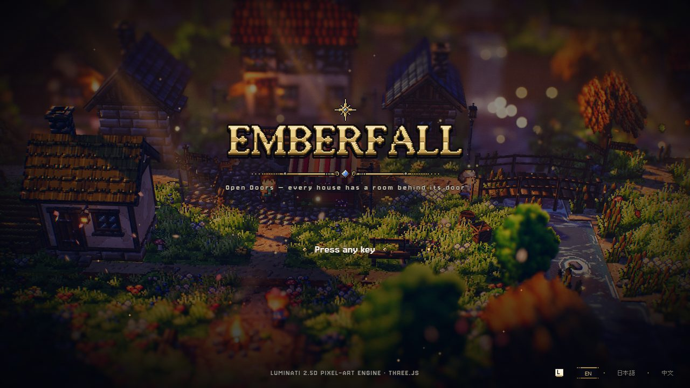
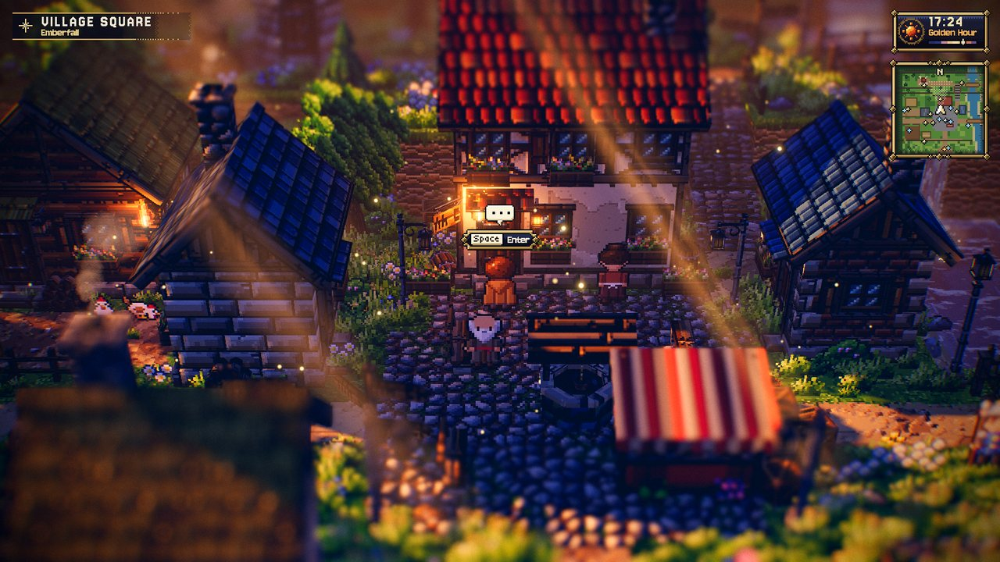
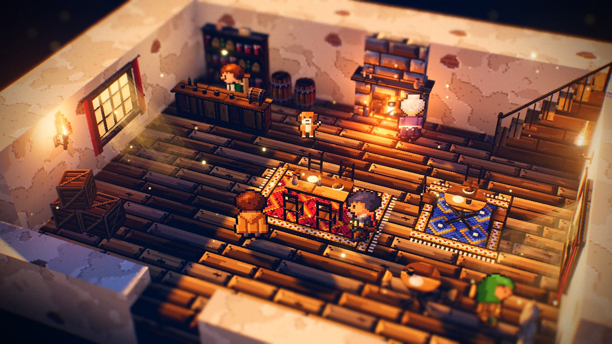
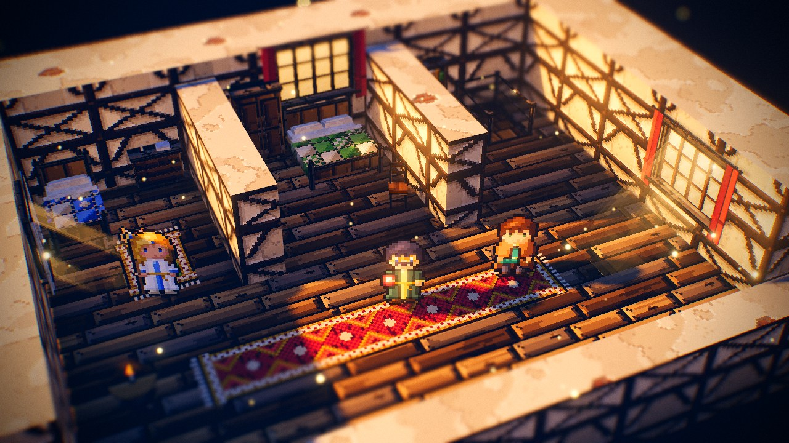
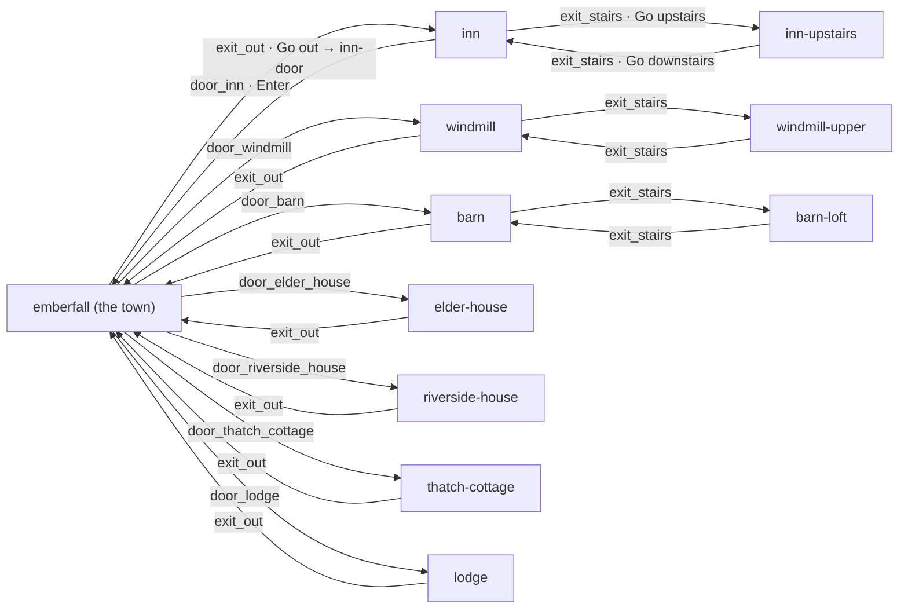
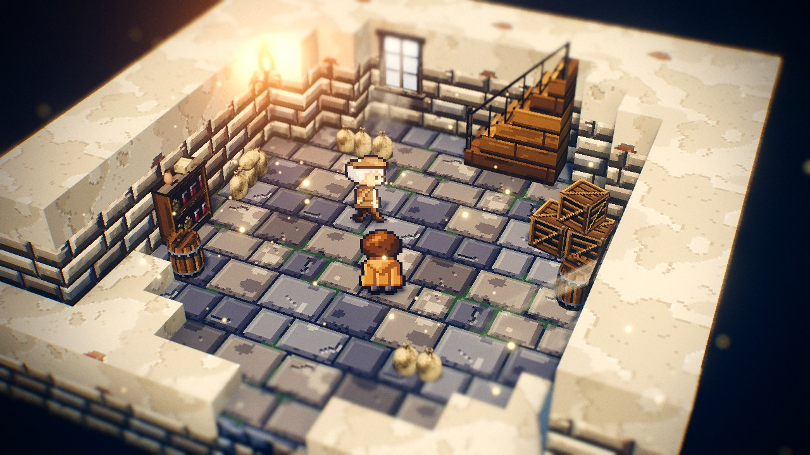
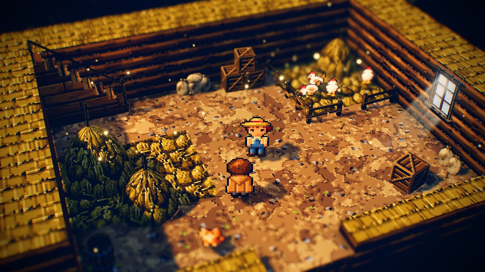
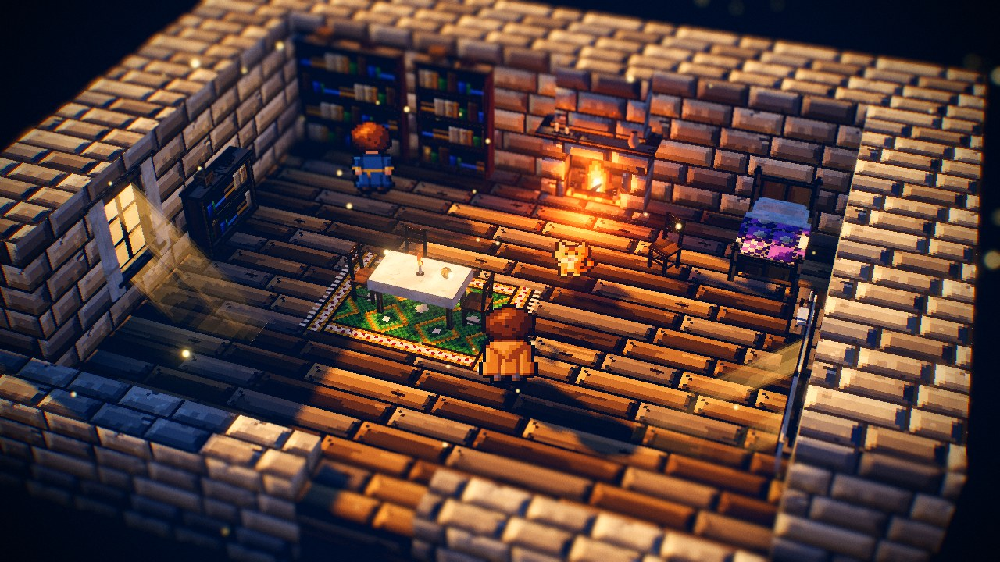

# Emberfall — Open Doors

The design document of **Emberfall — Open Doors**, the rooms demo: Emberfall, the reference
village, exactly as it is — with every door open. Each of its seven buildings has a furnished room
behind the door, and the three tall ones a floor above: ten rooms in all. It exists to show
**rooms** ([CAMPAIGN_FORMAT.md §6.3](../../specs/CAMPAIGN_FORMAT.md#rooms-the-levels-set-aside)) —
small campaign levels flagged `environment.interior` that the player walks in and out of in about
the time of the fade, because the town stays set aside while they are inside and the last room
after they leave — and the interior furniture ([OBJECT_CATALOG.md § Interior](../../specs/OBJECT_CATALOG.md#interior)):
every one of its eleven types is placed somewhere. It is **generated** by a deterministic script
that checks the whole campaign before it writes.

| | |
| --- | --- |
| **Audience** | Designers and AI agents building rooms, houses with upper floors or furniture; anyone testing travel around rooms. |
| **Source of truth** | [`tools/make-emberfall-interiors.mjs`](../../../tools/make-emberfall-interiors.mjs) (the generator — edit this), [`public/campaigns/emberfall-interiors/`](../../../public/campaigns/emberfall-interiors/campaign.json) (its output — never hand-edit), [`public/levels/emberfall.json`](../../../public/levels/emberfall.json) (the town it reads; never written by it) |
| **Related docs** | [Campaign format](../../specs/CAMPAIGN_FORMAT.md) · [Object catalog: Interior](../../specs/OBJECT_CATALOG.md#interior) · [Level format §9 (`interior`, `backdrop`)](../../specs/LEVEL_FORMAT.md#92-optional-fields) · [Emberfall](../levels/emberfall.md) · [The Ferryman's Lantern](ferrymans-lantern.md) |

```bash
node tools/make-emberfall-interiors.mjs              # regenerate (≈ 1 s); refuses to write if a check fails
node tools/make-emberfall-interiors.mjs --check      # write nothing; exit 1 unless all twelve files match byte for byte
node tools/make-emberfall-interiors.mjs --out=<dir>  # write the campaign elsewhere
node tools/make-emberfall-interiors.mjs --verbose    # also list the town's own composition warnings (Emberfall's)
npm run level:check -- --campaign=emberfall-interiors
```

Play it: `game.html?campaign=emberfall-interiors` (`&new=1` starts over, `&autostart=1` skips the
title). Walk up to a door and press Space at **Enter**; inside, **Go out** at the door gap in the
low south wall, **Go upstairs** / **Go downstairs** at the foot of a staircase. Edit a room:
`editor.html?open=emberfall-interiors/inn`. The tour:
`npm run check -- --page=game.html "--query=campaign=emberfall-interiors&autostart=1&new=1" --wait=1500 --fps=0 --script=sandbox/campaign.open-doors.json --out=<name>`.



---

## The town

`levels/emberfall.json` **is** Emberfall: the generator reads `public/levels/emberfall.json` with
`parseLevel` and keeps its name (the terrain noise is seeded from it), tiles, heights, water,
environment, spawn and every object — its eight villagers keep their hand-written `script`
conversations from `src/game/dialogue.js`. It changes two things, and the generator checks that it
changed nothing else (field by field and object by object against the original):

- the six houses lose their Knock `text`, so Space at the door is *Enter* (the windmill never had
  one);
- every building gets a `use` exit "Enter" over its door step (1.8 across the door, from 0.7 toward
  the door to 0.5 out) to the room's entrance `front-door`, and an entrance on the step 0.6 out of
  the door, facing away from it, for the way back.

| Building | Door step (x, z) | Door faces | Exit → room | Town entrance |
| --- | --- | --- | --- | --- |
| The Ember & Oak (`inn`, 2 storeys) | (18.15, 17) | south | `door_inn` → `inn` | `inn-door` |
| Elder's cottage (`elder_house`, rotation π/2) | (14.75, 19.35) | east | `door_elder_house` → `elder-house` | `elder-door` |
| Riverside house (`brick_house`, rotation −π/2) | (24.5, 18.35) | west | `door_riverside_house` → `riverside-house` | `riverside-door` |
| Thatched cottage (`thatch_cottage`) | (11.65, 30.1) | south | `door_thatch_cottage` → `thatch-cottage` | `cottage-door` |
| Woodcutter's lodge (`lodge`) | (44.4, 15) | south | `door_lodge` → `lodge` | `lodge-door` |
| Tobin's barn (`barn`) | (5.15, 17.5) | south | `door_barn` → `barn` | `barn-door` |
| The windmill (`windmill`, rotation 0.12) | (11.688, 7.988) | south | `door_windmill` → `windmill` | `windmill-door` |

The house door steps are where the game puts their door interactables (measured in the game:
`world.interactables`, 0.9 in front of the wall). The windmill has no door interaction: its door is
on the tower's local +Z facet, 1.505 from the axis (`buildWindmill`, `facet(0.5) + 0.02`), so its
step is 0.9 further out, 2.405 from the axis, turned by the windmill's rotation.

The town plays and looks exactly like Emberfall: the tour hashes its static scene, colliders,
light descriptors, emissives and build stats and finds them equal to `game.html?autostart=1`
(57 programs, 12 lights, ≈ 230–238 draw calls). Its `level:check` warnings are Emberfall's own 39
(roofs over path tiles, a lamppost by the riverside door, hand-placed trees, overlaps); the doors add
none.



## The rooms

Every room is one level built by `roomLevel` (the layout of the editor's File › New › Room,
`src/editor/rooms.js`): a floor at height level 1; walls of a custom legend tile `W` two tiles
thick on the north, west and east, 6 levels (3 units) above the floor; a low south wall one level
up with a door gap the camera looks over. The look: `interior: true`, `clock: false` with an hour of
its own, `backdrop: "#0d0b12"`, `minimap: false`, `border: "none"`, `outerScenery: false`,
`godRays: false`, a camera at distance 20, pitch 38° whose focus bounds are a 1 × 0.8 rect over the
middle of the room — the whole room stays in view from the door, the stairs and every corner.

**Walls.** The wall tile's `side` is the building's own wall texture and so is its `top` — the cut
top of a 2-tile wall seen from 38° must read as the top of a wall (a cobble or plank cap reads as
more floor, the problem of the furniture test room): `plaster` (the inn, the cottage), plaster over
`timber_frame` (the inn's upper floor, the lodge), `stone_brick` (the elder's cottage), `brick` (the
riverside house), `log_wall` with a thatch cap (the barn and its loft), `stone_brick` with a plaster
`lip` and cap (the windmill's base). Any library texture can be a tile side; each new one adds a
material. Partitions (`+`, a level below the walls) divide the inn's guest rooms; a half wall (`=`,
1.5 high) separates the riverside kitchen from the bed; the windmill's floors are octagons (corner
tiles cut on the diagonal, the south ones only as high as the south wall).

**Floors.** Custom legend chars (no ground foliage): `wood_deck` planks, `stone_tiles` flags (the
windmill, the riverside kitchen), `dirt` earth with `hay` straw patches (the barn), straw over the
hayloft's planks.

**Furniture.** Wall pieces stand with their back on a wall — rotation 0 on a north wall, π/2 on a
west wall, −π/2 on an east wall, never π — at the catalog's distances (`z = wall + depth / 2`);
chairs face their tables (π south of one, its back to the camera). The generator checks that no
prop's collider reaches into a wall or partition tile (`wallClips`: every collider of the level
checks' model sampled every 0.1 inside a 0.03 margin); the level checks find no overlaps, no
unreachable pocket and every exit reachable (the only ground no walk reaches is a few nodes in the
corners behind a haystack or the stairwell). (A crate stack placed with `barrel: false` gets the builder's exact collider
in the level checks' model now — `levelgen.mjs` reserved room for a barrel at both ends.)

| Room | Size | Hour | What it holds | Villagers | Lights |
| --- | --- | --- | --- | --- | --- |
| `inn` — The Ember & Oak, the Taproom | 18 × 13 | 16:48 | the bar (`counter` style bar) with a pantry `shelf` and two kegs behind it, a lit `hearth` with the pot, a rect table with a candle and four chairs on a red `rug`, a round table with three chairs on a blue rug, a small round table with two stools, a `staircase` up in the north-east corner, two warm `wallWindow`s and two wall torches, a crate stack and `sacks` along the south wall, a dog | Garrick (the barkeep, behind the counter, talk across it), Old Nan (the cook, at the hearth), Sir Brannoc, Fenna | hearth, 2 wall torches, 3 `light`s (6) |
| `inn-upstairs` — The Guest Rooms | 18 × 13 | 16:48 | three rooms off a corridor (partitions): a single bed, drawers, a rug and a window; a double bed under a window, a `wardrobe`, a chair; the landing with the stairwell (`staircase` down) and a bookshelf; a runner rug and a candle table in the corridor, a cat | Master Ivo (a cartographer), Sister Ada | 4 `light`s |
| `windmill` — The Millstone Floor | 14 × 13 | 11:30 | an octagonal stone-flagged floor: a `staircase` up, sacks along three walls, a pantry shelf, barrels, a crate stack, two daylight windows, flour dust (`dust` emitter) | Miller Hesk | a wall torch, a `light` (2) |
| `windmill-upper` — The Cap Floor | 13 × 12 | 11:30 | an octagonal plank floor: the stairwell down, sacks, a pantry shelf, crates, a barrel lying on its side, a small work table, two windows, sparrows | Tam (greases the gears) | 1 `light` |
| `barn` — Tobin's Barn | 18 × 13 | 15:30 | an earth floor with straw: the ladder `staircase` up (rising west), haystacks, sacks of feed, crates, a barrel, a fenced chickens' pen with a gate and its own haystack, a window, hay dust, a cat | Hilde (a farmhand) | 3 `light`s |
| `barn-loft` — The Hayloft | 16 × 11 | 15:30 | straw over planks, three haystacks, the hatch (a two-pane `wallWindow` low on the east wall), sacks, a crate, the stairwell down, two cats and sparrows | Wendel (a tinker who sleeps in the hay) | 2 `light`s |
| `elder-house` — Elder's Cottage | 16 × 12 | 16:30 | two bookshelves and a low one, a lit hearth, a bed (plum quilt), drawers, a clothed table with a candle and three chairs on a green rug, a reading chair, two windows, a cat | Linden (the elder's apprentice) | hearth, 2 `light`s (3) |
| `riverside-house` — The Kettle Sings | 16 × 12 | 09:30 | a flagstone kitchen (hearth with the pot, pantry shelf, a table and two chairs, sacks, a barrel) behind a half wall from the bedroom (a double bed, drawers, a blue rug, two windows) | Auntie Bryony | hearth, 1 `light` (2) |
| `thatch-cottage` — Fresh Bread | 14 × 11 | 08:30 | one room: a lit hearth, a two-pane window with flowers, a bed (ochre quilt), a wardrobe and drawers, a round table with a candle and two chairs on a red rug, a pantry shelf, a cat | Posy (the baker) | hearth, 1 `light` (2) |
| `lodge` — Woodcutter's Lodge | 16 × 11 | 17:00 | a wide lit hearth, a pantry shelf, two beds (father's and son's), a wardrobe, firewood crates and sacks, a table with two chairs and a stool on a red rug, a barrel, a window, a dog | Rowan (the woodcutter, humming his song about axes), Kit (his son) | hearth, 1 `light` (2) |

Every interior type appears (the generator's coverage: `bed`, `table` rect and round, `chair` and
stool, `shelf` books and pantry, `hearth` lit, `counter` bar, `rug`, `staircase` up and down,
`wardrobe` and chest of drawers, `wallWindow`, `sacks` — a new `interior: true` type fails the
generator until a room places it). The villagers are new — none of Emberfall's outdoor eight —, use
existing presets with `spec` touches (hair, hats, aprons, outfits) and plain `dialogue` of two
pages. Light descriptors: 1–6 per room (the town 12); the game's fixed pool always has 12 lights.





## Doors and stairs



- **Into a room:** the town's exit names the room's entrance `front-door`, just inside the door
  gap facing north (the room's player start too).
- **Out:** each ground-floor room's `exit_out` ("Go out") covers the door gap and the row inside it;
  it names the town's entrance of that building.
- **Stairs:** a `staircase` marks the way (`stairLink`): the `use` exit, 1.2 × 1.2, sits at
  `staircaseFoot()` of the staircase ("Go upstairs" at an up flight, "Go downstairs" at a
  stairwell) and names the other floor's entrance `stairs`, which stands 0.7 from that floor's
  stair foot, away from the stair, facing south — so an arrival never lands inside the way back.
- `campaign.json` places only the town (`at: [0, 0]`); the rooms are unplaced (they never join at a
  seam, and the world map shows a room on its own). The start is the town's player start
  (Emberfall's spawn, 19.5, 24.2).





## Measurements

On the reference desktop GPU (`campaign.open-doors.json`, harness, 1600 × 900), from the fade-out to the
fade-in (the fade-out is 0.35 s of it):

| Travel | Time |
| --- | --- |
| A level set aside attached again — out to the town, back into the last room, floor to floor once both floors were visited (50 travels) | 0.38–0.42 s (median 0.39 s; 5–35 ms of work) |
| A room's first visit, built ahead while the player stood by the door or the stair (18 travels) | 0.44–0.47 s (median 0.46 s: the room's last build steps ≈ 10–15 ms, its villagers, five warm-up frames ≈ 60 ms) |
| The first room of a session | ≈ 0.56–0.59 s (the furniture's one new program compiles: 57 → 58, and the villagers' sheets are painted) |

No program compiles after any arrival (58 from the first room on). The town alone after a full
tour and after a second one has the same GPU memory (146 geometries, 191 textures), 58 programs and
the same scene (24 children, 316 objects): nothing leaks. In a room: 12 point lights for 1–6
descriptors and ≈ 41–80 draw calls (the taproom the most; the town ≈ 160–240 depending on where
the player stands).



## How it was made

The generator reads Emberfall, adds the doors and checks the town against the original; each room
is a `roomLevel` (tiles from a small shape function: walls, partitions, octagon corners, floor
patches), furniture put with `put` at catalog distances, `frontDoor` and `stairLink` for the ways
out and up. Before writing it checks: the town equal to Emberfall but for the doors, every interior
type placed, every room flagged `interior` with ≤ 12 light descriptors, no prop collider in a wall,
every level's `normalizeLevel` / `validateLevel` / byte-stable round trip, and `checkCampaign`
(every level's `checkLevel` and the links). The first drafts failed the wall check with five crate
stacks and a haystack in the walls (one was the level checks' crate-stack collider, which reserved
a barrel at both ends even with `barrel: false`), the checks with two overlaps in the barn, and the
screenshots with walls whose blue cobble caps read as floor, a dark barn, rooms that scrolled out of
view from the door, and stair arrivals inside the way back — all fixed. It now reports 0 errors
and no warning in any room.

## How to modify it safely

- Change the generator, run it, then `--check`. The other generators are unaffected.
- Emberfall changes reach the town on the next run (the town is read from
  `public/levels/emberfall.json`); a moved house needs its door step in `DOORS` moved with it — the
  game's door interactable (`world.interactables`, `door:<id>`) is where to measure it.
- New furniture: put it in a room at the catalog's distances; the generator refuses a collider in a
  wall. Keep a room's light descriptors at 12 or fewer (a lit hearth, a wall torch and a `light`
  are one each).
- A room's hour is its own (`clock: false`): the campaign clock pauses inside and goes on outside.
- Run `sandbox/campaign.open-doors.json` and read its room screenshots after any change.

## Known limits

- The very first room of a session takes ≈ 0.15 s longer than the others (one furniture program
  compiles behind the fader; KNOWN_ISSUES CMP-01 for what a travel still does at the travel).
- Rooms are bigger inside than their houses outside (a room needs space for the camera and
  furniture); the floors above are separate levels reached by the stairs, not stacked over the
  ground floor.
- The windmill's sails, gears and millstones are not modelled inside (no catalog type for them):
  its floors read as a mill by their sacks, flour dust and octagonal walls.
