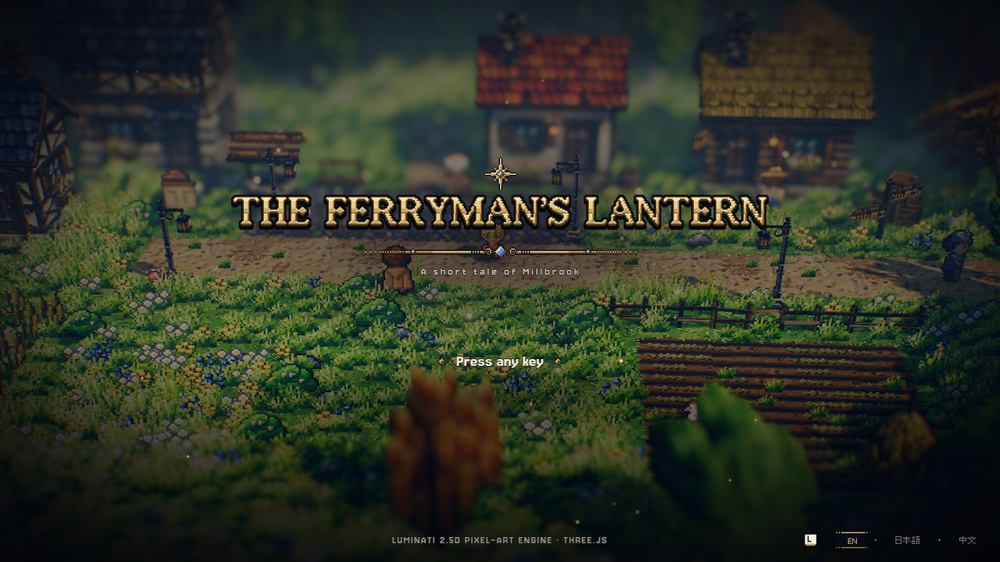
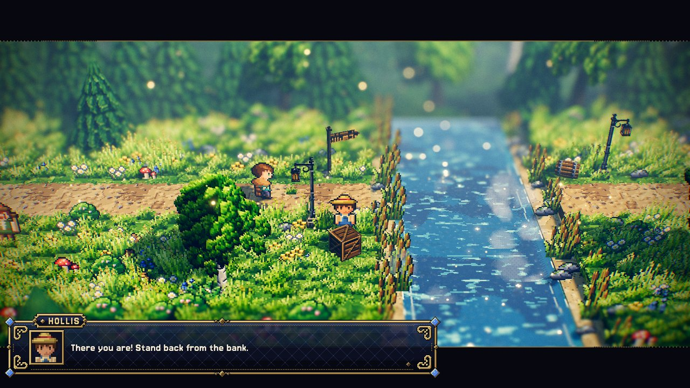
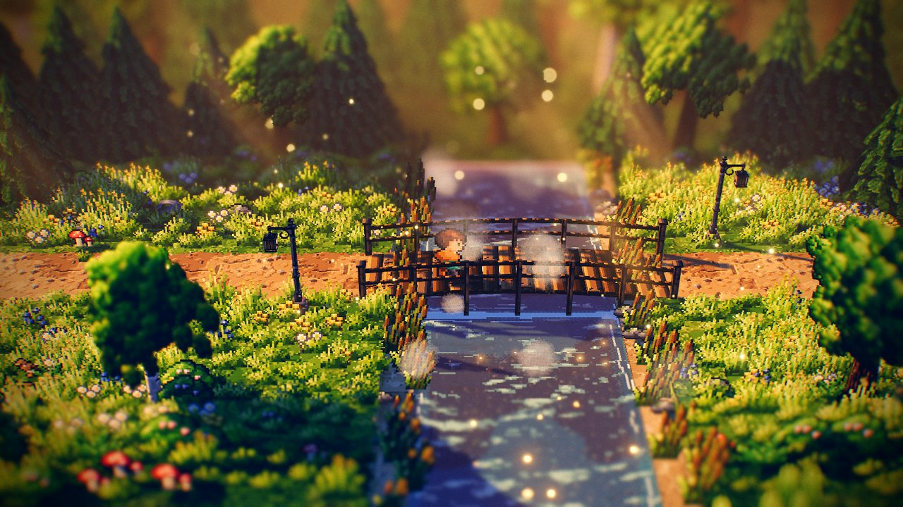
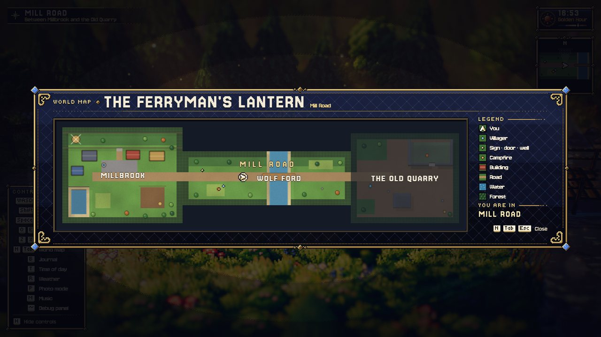
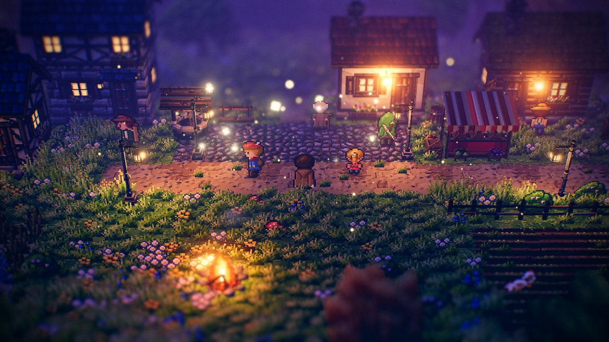
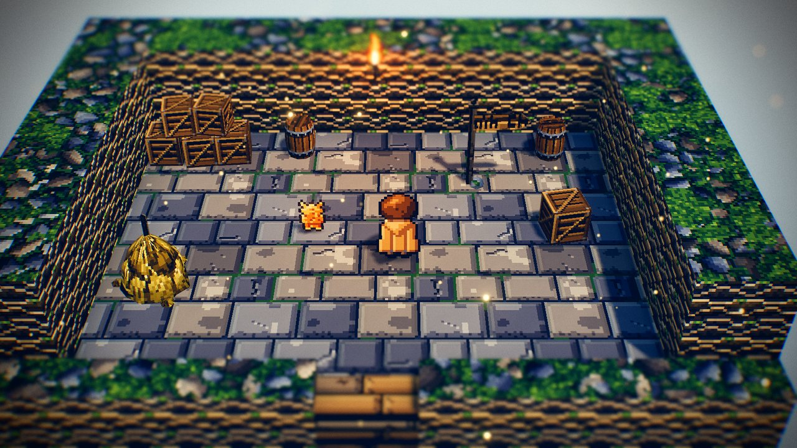

# The Ferryman's Lantern — a short tale of Millbrook

The design document of **The Ferryman's Lantern**, the demo campaign: four places joined into one
story — the mill village of Millbrook, the Mill Road down to the Wolf Ford, the Old Quarry beyond
it and the cellar under the mill — with a washed-out bridge, a locked door, a combat level and a
second chapter in which Millbrook celebrates at dusk. It exists to show every campaign and story
feature in a few minutes of play: seams, a Space exit with an entrance, a chapter variant, combat
between peaceful levels, saves and the campaign world map — and the story language
([STORY_SCRIPT.md](../../specs/STORY_SCRIPT.md)): talk scripts with branching choices, actors,
items, a quest with stages and a goal, every event trigger, a villager walking off-stage, a bridge
built live in a cutscene, a cleared-group event, a chapter-two cutscene and an ending. It is
**generated** by a deterministic script that checks the whole campaign before it writes.

| | |
| --- | --- |
| **Audience** | Designers and AI agents building a campaign; anyone testing travel, saves or the story layer. |
| **Source of truth** | [`tools/make-ferrymans-lantern.mjs`](../../../tools/make-ferrymans-lantern.mjs) (the generator — edit this: the levels, `STORY_MAIN` and `STORY_TEXT`), [`public/campaigns/ferrymans-lantern/`](../../../public/campaigns/ferrymans-lantern/campaign.json) (its output — never hand-edit; the story in [`story/main.json`](../../../public/campaigns/ferrymans-lantern/story/main.json) and [`story/dialogue.story`](../../../public/campaigns/ferrymans-lantern/story/dialogue.story)) |
| **Related docs** | [Campaign format](../../specs/CAMPAIGN_FORMAT.md) · [Level design guide §17](../LEVEL_DESIGN_GUIDE.md#17-campaigns-several-levels-one-story) · [Object catalog: exit, entrance](../../specs/OBJECT_CATALOG.md#exit) · single levels: [Emberfall](../levels/emberfall.md), [Gildhaven](../levels/gildhaven.md) |

```bash
node tools/make-ferrymans-lantern.mjs              # regenerate (≈ 1 s); refuses to write if the campaign check fails
node tools/make-ferrymans-lantern.mjs --check      # write nothing; exit 1 unless all eight files match byte for byte
node tools/make-ferrymans-lantern.mjs --out=<dir>  # write the campaign elsewhere
npm run level:check -- --campaign=ferrymans-lantern
```

Play it: `game.html?campaign=ferrymans-lantern` (`&new=1` starts over, `&autostart=1` skips the
title, `&new=1&story=at-the-ford` or `&story=chapter-two` starts further on). Edit a level:
`editor.html?open=ferrymans-lantern/millbrook`. The scripted play-through:
`npm run check -- --page=game.html "--query=campaign=ferrymans-lantern&autostart=1&new=1" --wait=500 --fps=0 --script=sandbox/story.play.json --out=<name>`.



---

## The story

Ilse the ferryman rowed east to the Old Quarry three nights ago with the **ferry lantern** and has
not come back; without the lantern nobody crosses the Wolf Ford after dark.

1. **Millbrook.** Watchman Bran stops a traveller heading east before the elder has spoken to them
   (an `enter` event). **Elder Wren** asks you to find Ilse (a choice; the quest *The Missing
   Ferryman* starts). **Hollis** will mend the bridge, but the flood took his timber: three **oak
   planks** from the stack by the east road (a `use` event gives them; the journal's goal counts
   them). Given the planks, Hollis walks off down the east road in a short cutscene and is gone
   (`hollis-at-ford`). **Miller Odo** has a menu (a `loop`) and gives the **cellar key** once you
   ask about Ilse; the cellar door needs it (`requires: item:cellar-key`). Leaving the green, the
   elder calls after you (a `leave` event); at 18:30 the lamps are lit (a `time` event).
2. **Mill Road.** Hollis waits at the broken bridge (`when: hollis-at-ford and not lantern-found`).
   Walking up to the bank starts the **ford cutscene** (an `enter` event, letterboxed, skippable):
   the camera on Hollis, a fade, `set bridge-mended` — the bridge appears and the flood debris and
   the notice vanish **live** — the camera on the bridge, Hollis's song. Gwil the peddler cheers (a
   `change` event); a campaign event toasts "The way east lies open."
3. **The Old Quarry** (combat). Arriving: "Slime trails glisten…" (an `arrive` event). Clearing the
   slimes before the ledge makes **Ilse** call down (a `cleared` event: the camera finds her).
   She hands over the **ferry lantern** (`lantern-found`, quest stage *found*) — chapter two begins.
4. **The mill cellar.** The ferry chart is a `use` event (the **ferry chart** item).
5. **Chapter Two — Lanterns Home.** Millbrook at dusk: arriving plays the **welcome cutscene** (an
   `arrive` event): Ilse walks from the east road to the green, the elder and Pip greet her, the
   quest is done, and `home ilse` keeps her there on later visits. Asking Ilse to row you over the
   ford is the **ending**.



| Flag / item | Set by | Read by |
| --- | --- | --- |
| quest `find-ilse` | Wren (start, `asked`), Hollis (`planks`), the ford cutscene (`bridge`), Ilse (`found`), the welcome cutscene (`home`, done) | Wren's and Hollis's talk, the planks event, the journal |
| item `plank` ×3 | the stack by the east road (`ev_planks`) | Hollis (`item:plank >= 3`), the quest goal |
| `hollis-at-ford` | Hollis's talk (after the walk-off) | Millbrook's Hollis (`unless`), Mill Road's Hollis (`when`), the ford event (`if`) |
| `bridge-mended` | the ford cutscene | Mill Road: the bridge (`when`), the flood debris and the notice (`unless`); Gwil; the campaign event |
| item `cellar-key` | Odo's menu | the cellar door (`requires: item:cellar-key`) |
| `lantern-found` (+ item `ferry-lantern`) | Ilse | chapter two (`when`, swaps in `millbrook-dusk`); Bran (`unless`) |
| `warned` | Bran (his plain conversation's `flag`) | Bran's `enter` event (`if: not quest:find-ilse and not warned`) |

Actors (story/main.json `actors`): `wren`, `hollis`, `odo`, `ilse` — each placed in one or more
levels with `actor`, their talk in `story/dialogue.story`. Pip and Gwil have their own `talk`
scripts in the level files (`cycle` / `pick` lines).

## The levels

| Level | Size | `at` | What it shows |
| --- | --- | --- | --- |
| `millbrook` | 40 × 32 | [0, 0] | The start (09:30). The east road runs off the map into Mill Road across a seam; the Mill House's cellar door is a Space exit to `mill-cellar` (entrance `from-mill`), and its door step is the entrance `mill-door`. Houses stand north of the road only: a roof south of it would hide the road behind it from the north-looking camera. Events `ev_planks` (use), `ev_bran` (enter), `ev_farewell` (leave), `ev_lamps` (time); the marker `east-road`. |
| `mill-road` | 56 × 18 | [40, 8] | A road strip with the Wolf Ford across it: the bridge exists only with `bridge-mended` (built live in the ford cutscene `ev_ford`, enter); Hollis waiting at the bank; Gwil's `change` event. Seams to Millbrook (west) and the quarry (east). |
| `old-quarry` | 36 × 30 | [96, 2] | A combat level: two slime packs, a waystone, a chest (40 gold, a draught, Max HP +20), Ilse on a ledge one level up behind a rock face with a stair; `ev_quarry` (arrive), `ev_cleared` (cleared, group `slimes_floor`). Seam to Mill Road. |
| `mill-cellar` | 16 × 12 | — | An interior, a room (`interior: true`: no weather down here, Millbrook kept set aside while the player is in it and the cellar after they leave — the door is a light switch, [CAMPAIGN_FORMAT.md §6.3](../../specs/CAMPAIGN_FORMAT.md#rooms-the-levels-set-aside)): no forest border or outer scenery, no minimap, its own hour (`clock: false`, 11:00 — the campaign clock pauses down here), a dark `backdrop` instead of the sky, a closer camera, a lantern and a torch, the cat and the ferry chart (`ev_chart`, use); a Space exit "Climb up" back to `mill-door`. |
| `millbrook-dusk` | 40 × 32 | (as `millbrook`) | Chapter two's Millbrook: its own hour (19:24, `clock: false`), four lanterns over the green, a stall, a campfire, the bard; the same terrain, exits and entrances; Ilse on the east road, the marker `green-centre`, the welcome cutscene `ev_welcome` (arrive). |



**Seams.** Millbrook's road (rows 15–17) leaves the map at x 40; Mill Road starts at plane x 40,
z 8, so the same plane rows are its rows 7–9; the quarry starts at plane x 96, z 2 (rows 13–15).
On both sides of each seam the road is dirt path at height level 2 and the border forest is open
only there; an exit covers the last 1.5 tiles of the road on each side (no entrance: arrivals
cross the seam). `level:check --campaign` reports 3 matching edge tiles per seam.







## How it was made

The generator builds each level with the `LevelFormat` helpers (`createEmptyLevel`, `setTile`,
`setHeightLevel`, `addObject`) like the sample hamlet, gives every object line the canonical key
order (`canonicalObject`), writes `campaign.json` with `serializeCampaign`, and runs
`checkCampaign` (every level's `checkLevel`, the links, the seams, the flags) before writing. The
first draft failed that check with three errors and sixteen warnings — a stair that climbed two
levels at once (the ledge was unreachable and Ilse with it), a cottage south of the road whose
roof hid 14 % of the path tiles, the well's roof over the lane, trees in front of doors and talk
spots, props overlapping — all fixed by moving things; it now reports 0 errors and 0 warnings.

## Measurements

On the reference desktop GPU (harness, 1600 × 900), every travel from the fade-out to the fade-in: the cellar
0.5 s, the quarry 0.9–1.1 s, Mill Road 1.3–1.4 s (the fades take 0.35 s of it; then 0.5 s of fade
in). Programs: Millbrook 50 at load; after each arrival the count stays put through play and
through the story's changes (Mill Road 58 → 58 with the bridge built live, the cellar 40 → 40, the
quarry 63 → 63 through the combat showcase, Millbrook at dusk 60 → 60). 12 point lights throughout
(the fixed pool). The story play-through reports 0 script errors.

## How to modify it safely

- Change the generator, run it, then `--check`. The other generators are unaffected.
- Keep the seams: the road rows and heights on both sides of a shared edge, and the `at` values in
  `campaignRaw`.
- A new flag must be set somewhere (`level:check --campaign` warns about a flag that is only read).
- Story text: edit `STORY_MAIN` (items, quests, actors, events, start presets) and `STORY_TEXT` (the
  scripts of `dialogue.story`) in the generator; the generator parses every script and refuses to
  write on an error.
- Run `sandbox/story.play.json` after a story change (it asserts nothing by itself: read its `info`
  lines — quests, items, flags, `errors: 0`).
- A variant (`millbrook-dusk`) must keep the entrances exits name (`mill-door`): the check fails
  otherwise.

## Known limits

- The road's arrival point on Mill Road lies among the border trees at the map edge; the player
  walks out of them into view.
- A defeated pack stays defeated when the player comes back, until a rest at the Quarry Gate
  waystone brings it back (then the `cleared` event, being `once`, does not run again).
- Hollis's walk-off ends at the map edge where he vanishes (the next level shows him at the ford);
  he does not follow the player (a companion who does is a party member — `party join`,
  [PARTY.md](../../specs/PARTY.md) —, which this campaign does not use).
