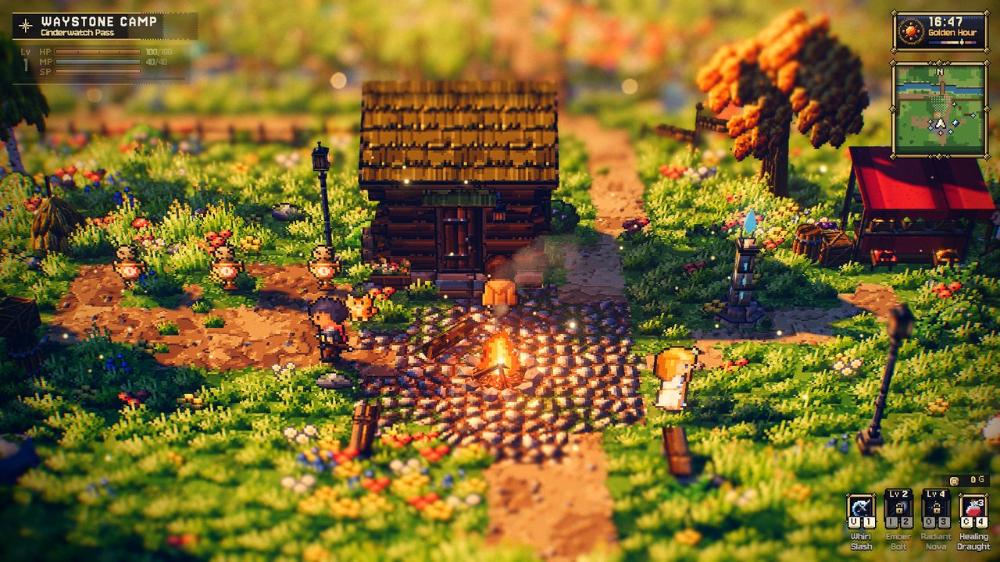
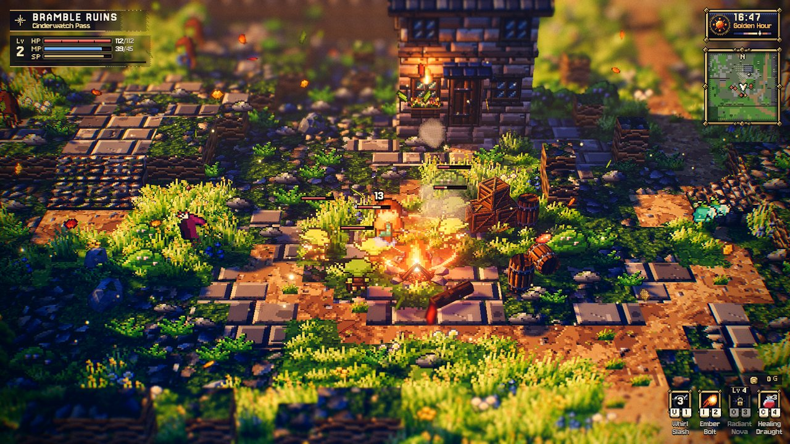
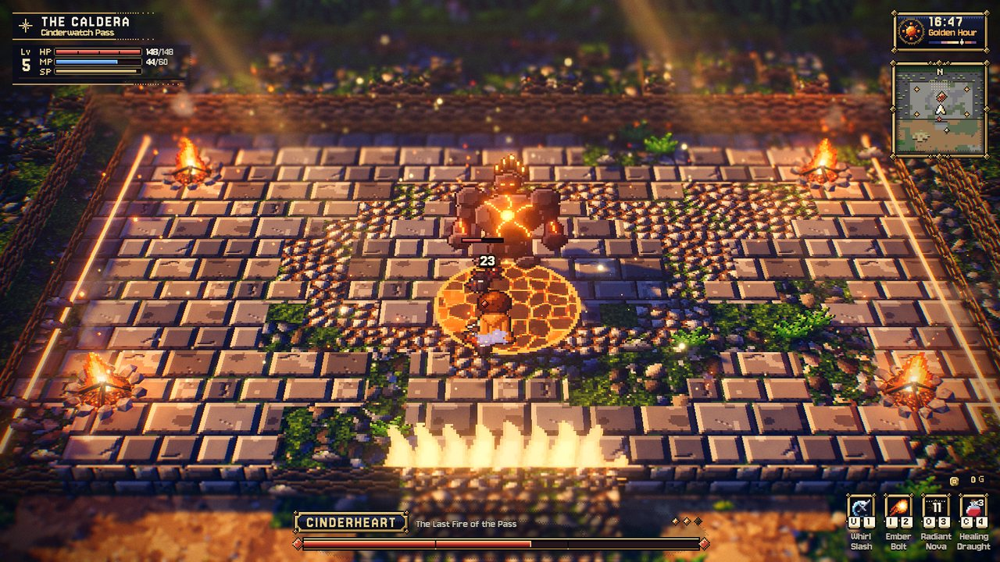
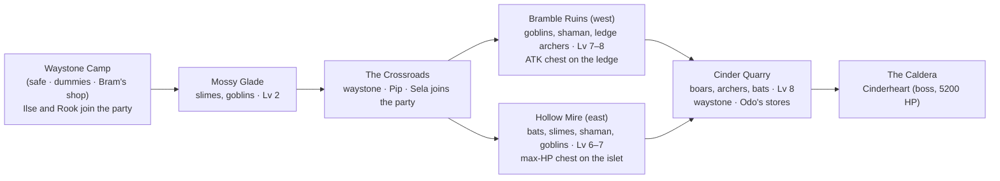
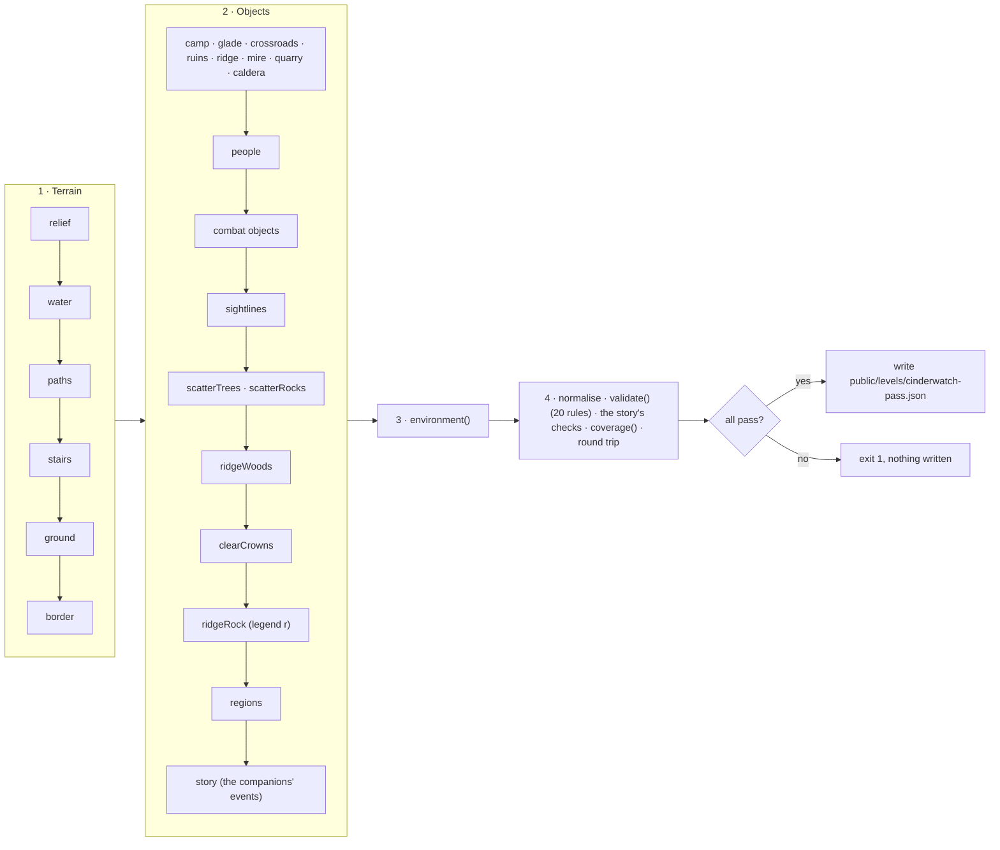

# Cinderwatch Pass — Where the Old Fires Wake

The design document of **Cinderwatch Pass**, the combat demo level: a 96 × 120 mountain pass climbed
from a safe camp at the south edge, through a meadow, over one of two branches (the Bramble Ruins or
the Hollow Mire) and across a quarry, to Cinderheart's caldera. It is the only shipped level with
enemies, so it is the only one that turns the ARPG combat of
[COMBAT.md](../../contracts/COMBAT.md) on (automatically: it has `enemy` objects and no
`environment.combat` key). Like Starfall Vale it is **generated** by a deterministic,
self-validating script; this page documents what the script builds and how to change it. It
also has a small **story**: three villagers join the player's party when asked — Sister Ilse (a
mystic, the party's healer) and Rook (a ranger) at the Waystone Camp, Sela (a warden) at the
Crossroads Waystone ([below](#the-companions-and-the-story);
[PARTY.md §9](../../specs/PARTY.md#9-the-demo-the-companions-of-cinderwatch-pass)) — and since
2026-10-11 its enemies are **balanced for that party of four**: the player and three companions
([Party balance](../../specs/PARTY.md#9-the-demo-the-companions-of-cinderwatch-pass)).
Nothing scales with the party's size; alone the pass is hard by design
([Balance](#balance-for-a-party-of-four)).

| | |
| --- | --- |
| **Audience** | Designers and AI agents extending or testing the combat level; anyone writing a level generator with enemies. |
| **Source of truth** | [`tools/make-cinderwatch-pass.mjs`](../../../tools/make-cinderwatch-pass.mjs) (the generator — edit this) and its helpers [`tools/lib/levelgen.mjs`](../../../tools/lib/levelgen.mjs); [`public/levels/cinderwatch-pass.json`](../../../public/levels/cinderwatch-pass.json) (its output — never hand-edit). The binding design is [COMBAT.md §15](../../contracts/COMBAT.md#15-demo-level-cinderwatch-pass). |
| **Related docs** | [COMBAT.md](../../contracts/COMBAT.md) (the combat contract: enemies, boss, waystones, chests) · [Level design guide](../LEVEL_DESIGN_GUIDE.md) · [Object catalog](../../specs/OBJECT_CATALOG.md) (`enemy`, `chest`, `waystone`) · other levels: [Starfall Vale](starfall-vale.md), [Emberfall](emberfall.md), [Brightwater Crossing](brightwater-crossing.md), [Willowmere](sample-hamlet.md) |

```bash
node tools/make-cinderwatch-pass.mjs              # regenerate (≈ 2 s); refuses to write if a check fails
node tools/make-cinderwatch-pass.mjs --check      # write nothing; exit 1 unless the file matches byte for byte
node tools/make-cinderwatch-pass.mjs --out=<file> # write elsewhere (e.g. a scratch copy)
node tools/make-cinderwatch-pass.mjs --ascii      # also print the tile map
node tools/make-cinderwatch-pass.mjs --quiet      # no report (errors still go to stderr)
node tools/make-cinderwatch-pass.mjs --force      # write a failing level for inspection (exit code stays 1)
```

Play it: `game.html?level=cinderwatch-pass` (`&autostart=1` skips the title). Edit (view) it:
`editor.html?open=cinderwatch-pass`. Tour it: `sandbox/cinderwatch.tour.json` (below). The
player's guide to it — controls, the HUD, a light-spoiler walk up the pass and the bestiary — is
[PLAYING_THE_GAME.md §15](../../user/PLAYING_THE_GAME.md#15-combat-cinderwatch-pass).

| Waystone Camp (start) | Bramble Ruins (a fight) | The Caldera (Cinderheart, phase 3) |
| --- | --- | --- |
|  |  |  |

*Captured with the harness at 1280 × 720 (2026-09-28, retaken after the known-issues pass: the
moved lodge and campfire, the magma crust); the fight and boss frames were set up with the combat
test hooks in god mode and stepped to a frame with a telegraph on screen. They predate the party
of four (2026-10-11): Rook is not yet at the camp, and the foes are the solo table's.*

---

## Concept

*The Cinderwatch kept the old fires of the pass asleep for a hundred years. This spring the watch
fire went out, and the pass woke up: slimes in the glade, goblins squatting in the ruined keep,
bats over the mire — and something big breathing in the caldera.*

The traveller starts at golden hour (16:48; **the clock is stopped**, `environment.clock: false`, so
a twenty-minute run never turns into night — T still cycles the hour) in the Waystone Camp, where
Captain Maren's drillmaster script teaches the controls on three straw dummies, and where Sister
Ilse, the keeper of the waystones, and Rook, the watch's scout, offer to come along; Sela waits at
the Crossroads Waystone and makes the party four. The pass is climbed south → north, up the screen,
so the camera always looks ahead:



The glade is fought by three (the player, Ilse and Rook), everything after the crossroads by four.
Both branches end on the quarry lip: the Ruins are the harder one (Lv 7–8, 395 XP) and give the
attack upgrade and the ridge pocket's gold and draught, the Mire the gentler (Lv 6–7, 321 XP) and
the max-HP upgrade; the quarry chest's max-MP upgrade is on either way. The player reaches
Cinderheart at level 6 either way ([Pacing and rewards](#pacing-and-rewards)).

| Fact | Value |
| --- | --- |
| Name / slug | `Cinderwatch Pass` (frozen: it seeds the terrain noise) / `cinderwatch-pass` |
| Size | 96 × 120 tiles; the big-level build path (> 64) |
| Objects | 283: 95 rocks, 57 trees, 24 enemy groups (58 enemies: 55 foes incl. the boss, and 3 dummies), 14 particle areas, 11 fences, 10 barrels, 9 regions, 7 campfires, 7 crate stacks, 7 villagers, 6 chests, 5 bridges, 4 benches, 4 signposts, 4 story events, 3 lampposts, 3 critter groups, 3 waystones, 2 houses, 2 crates, a haystack, a market stall, a flower box, a wall torch, a waterfall, a `light` |
| Tiles | 6865 walkable, 382 water; height levels 0–12 |
| Custom legend chars | `e` — the glade brook, flowing east (`flow: [0.45, 0]`); `q` — dressed stone (the quarry's cut faces and stacked blocks: `stone_tiles` top, `stone_wall` sides, blocked); `r` — crag (Cinder Ridge's 324 rock tiles: `moss_stone` top, the on-demand `crag` rock-face texture on the sides, blocked; set by `ridgeRock()` after all scattering, so the seeded scatter is unchanged) |
| Water | `waterLevel` 0.4, `flow [0, 0.45]`, `reflect 0.12`, `neutral 0.45`, `glint 0.6` |
| Spawn | (48.5, 113.5) facing up — the camp's south road |
| Light descriptors | exactly 12 (static: one permanent point light each, not pooled) |
| Interactables | 2 doors, 4 signposts, 6 chests, 3 waystones; 7 villagers — four with 11 pages (two of them run the combat shop) and three companions with a talk script (Sister Ilse, Rook, Sela; their plain pages stay as the fallback) |
| Story | the companions' three talk scripts and four background `enter` events (`levelHasStory`: the story runtime, the journal key B) — [below](#the-companions-and-the-story) |
| Balance | for a party of four — the player, Ilse and Rook from the camp, Sela from the crossroads (MAX_PARTY 3: they fill it); 55 foes, Lv 2–8, and Cinderheart with 5200 HP; nothing scales with the party's size ([Party balance](../../specs/PARTY.md#9-the-demo-the-companions-of-cinderwatch-pass)) |

---

## Layout

| Zone | Rect (x; z) | Ground level | What is there |
| --- | --- | --- | --- |
| Waystone Camp | 30–66; 99–117 | 2 | the lodge (46.5, 104.75; 4 × 3, no chimney), the cobbled campfire square (`campfire_camp` at (47.5, 110)), the sparring yard with 3 dummies, Bram's stall (58.5, 104.5), `waystone_camp`, Sister Ilse by the square (50.5, 111.5) and Rook south of the sparring yard (40.5, 112.5), a palisade along z 98.5 with the gate at x 45–52 (fences down both flanks), the secret chest behind crates in the north-east corner, hens and a cat |
| Mossy Glade | 7–89; 80–98 | 2 (3 below the crossroads) | meadow, flower beds away from the slime homes, the east-flowing brook — about two tiles wide, meandering ±1.5 u across the map (`BROOK`), straight on rows 93–94 only under its two bridges (x 28.5 and 48.5) — with sandy, reedy banks and stones at the bends, the west chest under a lone oak, petals, god rays |
| The heath and the fen | 15–37 and 59–92; 72–81 | 3 / 1–2 | wooded margins either side of the crossroads (the heath is part of the Ruins region, the fen of the Mire) |
| The Crossroads | 37–59; 72–81 | 3 | the stone-flagged junction round `waystone_crossroads`, the three-board signpost, `lamppost_crossroads`, Pip |
| Bramble Ruins | 3–41; 44–71 | 4; the archer ledge 6 (x 3–23, z 45–57) | the broken south wall with its gate (goblins), the goblins' camp and fire (`campfire_ruins`), the court and the shaman, the ledge stair (x 16–18, rising north), the Old Keep (a two-storey stone house at (30.5, 53), 5 × 3.5, `torch_keep` on its south wall), broken wall stubs, the **north rampart** (row z 44, x 3–31, blocked, level 8–9: 1–1.5 u above the ledge, 1.5–2 u above the lip — the ledge archers and the quarry's west pack cannot see each other, rule 19), the east lane to the quarry lip (the Ruins open onto the lip east of the rampart) |
| Cinder Ridge | 42–53; 44–71 | blocked rock 4–11 (legend `r`: crag sides) | a craggy spine of broken rock faces (the `crag` texture: upright rock pieces split by dark fissures, no strata): a crest of broken rock clumps (level 9–11) with pines and boulders, and flanks that drop in a few tall cliffs rather than a stair — a one-to-two-tile shelf at level 6 above the Ruins (4), a two-tile shelf at level 4 above the Mire road (2), a level-7 shelf toward the lip and a level-5 one behind the crossroads; the shelf edges wander ±1.5 tiles along the flank (`ridgeLevel`); low at its north end, with no pines there (the lip and the Quarry Waystone stay in view behind it); the ridge pocket (x 40–43, z 57–62, level 6) reached by a stair from the Ruins holds `chest_ridge` |
| Hollow Mire | 54–92; 44–71 | 2 (the ridge-foot road) / 1 | the still pond by the road, the great pond round the islet, three flat boardwalks (the islet is reached only by one), sand banks with reeds, the quarry spring's waterfall `fall_mire` into its plunge pool, the marsh light (`light_mire`: a teal will-o'-wisp hovering 2.4 u over a mossy standing stone by the great pond — a steady teal core of two `fireflies` at 2.2 u and six motes rising from 1.3 u, `#8af2ff` → `#3cc6ea`, no blinking, shown day and night), mist and fireflies, the Mire → quarry stair at x 56–58, z 44–46 (level 2 → 5, rising north, at the foot of the ridge's east flank) |
| Cinder Quarry | 3–92; 26–43 | the lip 5 (z 37–43) / the upper terrace 6 (z 26–36) | dirt, moss and sand floors, ragged cut-stone pads, two stepped **cut faces** of dressed stone at the terrace's back wall (x 4–21 and 74–91, benches 1–4 levels high, `QUARRY_FACES`), stacked dressed blocks on the lip and the terrace (charge-stun targets like the rock pillars), a gravel **spoil heap** one level up between the goblins' yard and the arena road, Odo's camp (`campfire_quarry`, `waystone_quarry`), the goblins' salvage pile, a stone-cutters' yard, the railing above the Mire, the arena road; no scatter on the strip under the caldera's south cliff; the woods behind it stand two levels higher |
| The Caldera | 30–66; 4–25 | the arena 8 (tiles x 36–60, z 8–22) | stone flags and a ring of cobbles, the four brazier campfires, a blocked level-9 ledge on the east and west sides and the level-11 rim (N / E / W); the stair from the terrace to the gate (x 46–51, z 23–24, level 6 → 8); embers, the braziers' own smoke, god rays |
| Border | the rest | — | forest (`T`) three tiles deep round the map (four in the north); the woods beside the caldera sit below the rim so their trees stay under the arena's view rays |

### Encounters (explicit ids, COMBAT.md §15.3)

Counts and levels are balanced for a party of four (2026-10-11,
[Party balance](../../specs/PARTY.md#9-the-demo-the-companions-of-cinderwatch-pass); the
solo table they replace is in [Balance](#balance-for-a-party-of-four)); ids, kinds, positions and
radii are unchanged.

| Where | Groups (kind × count, level) |
| --- | --- |
| Camp | `dummies` (dummy × 3) |
| Glade | `glade_slimes_w` (slime × 4, 2), `glade_slimes_n` (slime × 5, 2; at (38.5, 88.5)), `glade_slimes_e` (slime × 4, 2), `glade_goblins` (goblin × 3, 2) |
| Ruins | `ruins_gate_goblins` (goblin × 3, 7), `ruins_slimes` (slime × 2, 7), `ruins_court` (goblin × 3, 8), `ruins_shaman` (shaman × 1, 8), `ruins_archers_w` (archer × 2, 7, ledge), `ruins_archers_n` (archer × 2, 8, ledge; at (19.5, 49.5)) |
| Mire | `mire_bats_s` (bat × 3, 6), `mire_slimes` (slime × 3, 6), `mire_bats_islet` (bat × 3, 7), `mire_bats_n` (bat × 3, 7), `mire_shaman` (shaman × 1, 7), `mire_goblins` (goblin × 2, 7, at the stair foot) |
| Quarry | `quarry_boar_w`, `quarry_boar_e` (boar × 1, 8), `quarry_boar_elite` (boar, 8, elite "Old Ironhide"; at (56.5, 32.5), radius 1, `spotOffsets [[0, 0]]`), `quarry_goblins` (goblin × 3, 8), `quarry_archers` (archer × 2, 8), `quarry_bats` (bat × 2, 8) |
| Caldera | `cinderheart` (golem, 6 — display only: the boss does not scale; 5200 HP, `ENEMY_DEFS.golem`) with `arena { minX: -12, maxX: 12, minZ: -6.5, maxZ: 8.5 }` and `gate [-2.5, 8.5, 2.5, 8.5]` (the arena x 36.5–60.5, z 8–23; the gate x 46–51 at z 23) |

Two groups carry an `area` (relative scatter rect) that keeps their start spots off a bank edge:
`glade_slimes_w` (not on the brook's bank) and `mire_slimes` (not on the still pond's bank or the
west boardwalk). Every group's start spots come out the same whether the game tests plain tiles or
full standability (rule 4 below), so they do not depend on how strict the combat system's test is.

### Waystones, chests, people

| Kind | Objects |
| --- | --- |
| Waystones | `waystone_camp` (53.5, 107.5) "Camp Waystone" · `waystone_crossroads` (48.5, 77.5) "Crossroads Waystone" · `waystone_quarry` (48.5, 42.5) "Quarry Waystone" |
| Chests | `chest_camp_secret` (63.5, 101.5) gold 40 · `chest_glade` (15.5, 86.5) gold 20 + 1 draught · `chest_ruins_ledge` (10.5, 50.5) attack · `chest_ridge` (42.5, 60.5) gold 30 + 1 draught · `chest_mire_islet` (78.5, 60.5) max HP · `chest_quarry` (84.5, 30.5) gold 30 + 1 draught + max MP |
| Villagers | Captain Maren (swordsman, `script: 'drillmaster'`, 2 fallback pages) · Bram (merchant, `script: 'shopkeeper'`, `action: 'shop'`, `item: 'Healing Draught'`, 2 pages — the second: "Whetstones, ironbark tonic, a warding charm or two — the watch pays me in stories, so the rest of you pay in gold."; posted beside his stall, not behind it — KNOWN_ISSUES PROP-13) · **Sister Ilse** by the campfire square (cleric, `post`; a talk script with her 3 pages on the waystones and an offer: she joins as the party's mystic, its healer — [below](#the-companions-and-the-story)) · **Rook** south of the sparring yard (hunter look with `spec`, `post`, a talk script; he joins as a ranger) · Pip at the crossroads (hunter, 3 pages naming what each branch offers) · **Sela** at the Crossroads Waystone (guard look with `spec`, a talk script; she joins as a warden) · Odo on the quarry lip (guard, `script: 'shopkeeper'`, `action: 'shop'`, `item: 'Healing Draught'`, 4 pages: bait the charge into a brazier, roll *through* the rings toward him, step out of the magma, and "The watch keeps its last stores up here — draughts, whetstones, tonic. …"; after the first visit his menu's *Tell me again* replays the hints) |

On a peaceful level (or with `environment.combat: false`) chests and waystones are only examined
("The chest is locked tight." / "An old waystone hums quietly."); on Cinderwatch the combat system
turns them into *Open* and *Rest* (COMBAT.md §6.12). The two shopkeepers sell the Healing Draught
(25 gold) and three one-time wares — Whetstone ATK +2 (120), Ironbark Tonic max HP +15 (90),
Warding Charm DEF +3 (150) — through a menu (the gold sink of COMBAT-12, COMBAT.md §6.12).

### The companions and the story

| Sela's offer at the Crossroads Waystone | Sela fighting in the glade |
| --- | --- |
|  |  |

*Captured 2026-10-08, before Ilse and Rook joined the cast.*

Three villagers join the player's party when asked; the party holds three (`MAX_PARTY`), so
together they fill it, and the level's enemies are balanced for the four of them
([Balance](#balance-for-a-party-of-four)). Each is a `post` villager with a `talk` script of the
same shape (the full texts: [PARTY.md §9](../../specs/PARTY.md#9-the-demo-the-companions-of-cinderwatch-pass))
and keeps its plain `dialogue` pages as the fallback:

| Companion | Post | Look | *Walk with me* runs | As a member |
| --- | --- | --- | --- | --- |
| **Sister Ilse** (`ilse`), *Keeper of the Waystones* | the Waystone Camp (50.5, 111.5), by the campfire square, facing down; a `post` villager since 2026-10-11 (she wandered before), wander 1.0 and speed 0.7 kept (her keep-clear disc, so the scatter, unchanged) | the `cleric` preset — her staff makes her a mystic; name plate `#a7c7e7` | `party join ilse as mystic support` — the party's healer | *How shall I serve?* |
| **Rook** (`rook`), *Scout of the Cinderwatch* | the Waystone Camp (40.5, 112.5): south of the sparring yard with the dummies, west of the campfire square, facing right; wander 0.3, speed 0.8 | the `hunter` preset with `spec` (`ROOK_LOOK`: dark skin, short black hair, brown eyes, an ember-red hood `#8f3b28` with a gold feather tuft, a leather tunic `#6b4a32` over `#3a3640` with a red accent and a cream shirt, Sela's short charcoal cape `#2f2a30` lined `#7a2a20`, quiver, bracers, black boots, a brown belt) — his bow makes him a ranger; name plate `#a58ad8` | `party join rook as ranger balanced` | *What's the plan?* |
| **Sela** (`sela`), *Warden of the Cinderwatch* | the Crossroads Waystone (50.8, 78.1): east of the stone, between it and the bench, Pip at her back; facing the glade road; wander 0.3, speed 0.8 | the `guard` preset with `spec` (bare-headed, a silver ponytail, an ember-red tabard over mail, a short charcoal cape) — her spear makes her a warden; name plate `#e8873a` | `party join sela as warden balanced` | *How do you want this spear?* |

The first talk says who the companion is and ends with the offer (*Walk with me* / *Not yet*):
Ilse's three pages on the waystones and *The pass has grown too loud for one blade. Let me walk
with you, and I will mend what it breaks.*; Rook's three pages (*Rook, scout of the Cinderwatch.
The captain has me minding the camp while the whole pass goes mad.* …); Sela's — the watch keeps
the stone, the pass has been waking since the old fire went out. A later talk is one line before
the offer (Ilse: *Back from the road?* …; Rook: *Still here. Still shooting straw.*; Sela: *Back
again.* …). With three members already (`if party >= 3`) each says so in a line and makes no offer
(Ilse: *Three already walk at your back…*). Sela's join line follows who came first: `if party = 1`
*Then it's the two of us…*, else *Then the watch marches with you…* (Ilse and Rook usually joined
at the camp). As a member each asks its question: *Tactics…* (`party menu <id>`, the tactics
panel), *Part ways* (asked again; `party leave <id>` and `home <id>` — the companion keeps watch
where it left the party), *Lead on*.

Four **background events** (`on: enter`, `once`, `background: true`: the player walks on) are the
story speaking for the companions and setting their combat rules:

| Event | Rect (x; z) | `if` | What happens |
| --- | --- | --- | --- |
| `ev_rook_ruins` | 4–41; 44–71.5 — the Bramble Ruins inside their outer wall (the road from the crossroads comes in at x 34) | `party:rook` | `emote rook !`, a bark (*Archers on the walls. The ones with bows are mine.*), `party rule rook hunter` (*Hunt Casters*) |
| `ev_sela_lip` | 3–93; 37–44 — the quarry lip, where the Ruins east lane and the Mire stair come up | `party:sela` | `emote sela !`, a bark (*Boars on the lip — they charge in straight lines. I'll stay at your shoulder.*), `party rule sela guardian` (*Guard Me*) |
| `ev_ilse_caldera` | 45.5–51.5; 23.2–27 — the caldera stair below the gate | `party:ilse` | a bark (*Cinderheart… Stay within my reach, and I will keep you whole.*) |
| `ev_sela_caldera` | the same stair | `party:sela and not party:ilse` | a bark (*That's Cinderheart up there. You break the rock — I'll keep you standing.*), `party rule sela support` (*Support*) — only when Ilse is not there to heal |

A rule change shows the party's toast (*Rook: Hunt Casters*, *Sela: Guard Me*, *Sela: Support*).
Without its companion (or, for `ev_sela_caldera`, with Ilse) an event does not run and stays
unspent. The player can change a rule back any time (G). On this level a member fights by its rule
(party combat, PARTY.md §5) and never starts a fight itself; a downed companion gets up after the
fight.

**Placement.** Sela stands 2.4 u from the waystone's rest spot (talk radius 1.6: resting never
talks to her) and 12.8 u from the nearest pack's home (`glade_goblins`; rule 5 wants ≥ 12); Ilse
and Rook are at the camp, 25.1 and 23.1 u from the nearest (`glade_slimes_n`). Neither addition
moved anything of the scatter — Sela (2026-10-08): her keep-clear disc and sightline fall inside
the crossroads' own; Rook, Ilse's post and the two new events (2026-10-11): no tree, rock or other
object changed but the villagers, the events, the enemy groups and the banners. The story makes
Cinderwatch a level with a story (`levelHasStory`): the story runtime, the journal key B and its
legend line; still 63 programs. The fingerprint at the spawn gained Sela's sprite (166 draw calls,
2026-10-08), then Rook and the glade's extra foes in view (175, 2026-10-11). Sela stood off the
fixed-step bot's way, so its digest did not change on 2026-10-08; since 2026-10-11 the bot
recruits all three ([below](#combat-scripts-on-this-level)).

### Lights (exactly 12)

`campfire_camp`, `lamppost_camp_w`, `lamppost_camp_e`, `lamppost_crossroads`, `campfire_ruins`,
`torch_keep`, `light_mire` (the marsh light: teal `#4fc4dc`, intensity 4.5, range 9, 2.4 u up, burns by day too), `campfire_quarry` and the four braziers
`brazier_nw` / `ne` / `sw` / `se`. No house has `light: true` and nothing else emits a point light:
with 12 descriptors every light is permanent (no pooling), and the caldera keeps all four brazier
lights during the boss fight. The waystone crystals glow through bloom only (no light descriptors).

### Regions (smallest first; first match wins)

`region_caldera` "The Caldera" (no banner) · `region_camp` "Waystone Camp" (*Straw dummies and a warm
fire · Safe*) · `region_crossroads` · `region_ridge` "Cinder Ridge" · `region_glade` "Mossy Glade"
(*Slimes and goblins · Lv 2*) · `region_ruins` "Bramble Ruins" (*Goblins, archers and a shaman ·
Lv 7–8*) · `region_mire` "Hollow Mire" (*Bats, slimes and a shaman · Lv 6–7*) · `region_quarry`
"Cinder Quarry" (*Ironhide boars and archers · Lv 8*) · `region_pass` "Cinderwatch Pass" (the whole
map). A banner's *Lv a–b* is the level range of the packs at home in its zone — rule 16 checks it,
so the banners cannot drift from the encounter table (the four were re-translated in ja / zh with
the 2026-10-11 table).

### Environment

`timeOfDay 16.8`, `clock: false`, weather clear, forest border, outer scenery, god rays, dust, music;
`camera { distance: 28, pitch: 34 }`; `highGround { minY: 3.4, pitch: 38 }` (the arena and the
ledges); the title card, with the title camera drifting over the Hollow Mire — the falls from the
quarry lip, the ponds, boardwalks and reeds (`titleCamera { x: 78, z: 52, y: 1, driftX: 4, driftZ: 2,
distance: 34 }`); `fogScale 0.7`;
`scenery.southGap 8`; `forest.areas` (pines north of z 44, broadleaf woods south of it); god-ray
areas over the glade and the caldera; flower areas over the camp and the glade's slime-free parts,
shrub areas over the ruins and the mire's edges. There is **no `combat` key**: combat turns on
because the level has `enemy` objects.

---

## Pacing and rewards

The numbers behind "the player meets Cinderheart at level 6 either way" (COMBAT.md §15.3; XP per
enemy from `ENEMY_DEFS`, scaled by the group's level — +25 % a level, §7.2; a companion's kill
gives the player its XP too, the boss's bat adds give none):

| Stretch | Enemies | XP | Player level after it | Rewards on the way |
| --- | --- | --- | --- | --- |
| Camp | 3 dummies (no XP); Ilse and Rook join | 0 | 1 | the drill's 2 draughts; the hidden camp chest (40 gold) |
| Mossy Glade | 13 slimes, 3 goblins (Lv 2) | 149 (its west half, `glade_slimes_n` and `glade_slimes_w`: 72) | 3; 2 after the west half alone (Ember Bolt at 2) | the glade chest (20 gold, a draught) |
| One branch — Ruins **or** Mire (Sela joins at the crossroads before it) | Ruins 13 foes (Lv 7–8), Mire 15 (Lv 6–7) | Ruins 395, Mire 321 | 4 (Radiant Nova) | Ruins: ATK +3 on the ledge, the ridge pocket's 30 gold and a draught · Mire: max HP +20 on the islet |
| Cinder Quarry | 3 boars (one elite), 3 goblins, 2 archers, 2 bats (Lv 8) | 581 | 6 | the quarry chest (30 gold, a draught, max MP +10) |
| The Caldera | Cinderheart (5200 HP, ATK 22, phases at 70 % / 35 %) and up to 6 bat adds | 400 | 6 (7 after the whole glade and the Ruins) | its core (max HP +20), 150 gold, the results card |

A level costs `xpToNext` (`rules.js`): Lv 2 at 30 XP in all, 3 at 121, 4 at 295, 5 at 571, 6 at
965, 7 at 1492. The play-through bot's Ruins route (the glade's west half, the Ruins, the quarry)
is Lv 2 after the glade, Lv 4 after the Ruins and Lv 6 after the quarry (1048 XP), meets
Cinderheart at Lv 6 and ends at Lv 6 with 483 XP into it; the Mire route with the glade's west
half reaches Lv 6 at the quarry's end by 9 XP (974). The whole glade and both branches give 865 XP
before the quarry (Lv 5) and 1446 before the boss — still Lv 6, 46 short of Lv 7. Until
2026-10-11 the stretches gave 84 / 189 / 370 XP and the player met Cinderheart at Lv 5 (832 XP with
both branches, still Lv 5).

The boss fight's length has a floor: a greedy scripted player (alone, Lv 5, god mode, always
attacking — the fixture's `tests.greedy`) needs 96.6 s on Cinderwatch (phases 29.5 / 33.3 / 33.8 s;
the contract asks ≥ 30 s and ≥ 7 s for phase 3), 83.5 s (24.8 / 30.1 / 28.6 s) with every chest and
shop ware; at 1800 HP it was 39.9 s (12.5 / 13.35 / 14.0 s) and 34.7 s (phase 3 11.4 s).

### Balance for a party of four

Since 2026-10-11 ([Party balance](../../specs/PARTY.md#9-the-demo-the-companions-of-cinderwatch-pass))
the level's own data is balanced for the player with three companions — Ilse and Rook from the
camp, Sela from the crossroads — and single play is deliberately hard. It is a static rebalance:
nothing in the code scales with the party's size. `ENEMY_DEFS` (but Cinderheart's HP), `scaledDef`
(HP +20 %, ATK +12 %, XP +25 % a level), the attack-token budgets (melee 3 / ranged 2) and the
companions' own numbers are unchanged; the Ferryman's Lantern's old quarry (a campaign level with
two slimes) is unaffected.

**The baseline** — the solo enemy table (*Before* below) with the full party, the bot's human
model: the Ruins 59.6 s / 0.27 of max HP (the companions made 11 of the 12 kills), the Mire 52.3 s /
0.20, no damage taken in the quarry on either route, Cinderheart in 42–45 s — about half the solo
targets of COMBAT-12; and the companions killed Old Ironhide before the bot's planned fall.

**The change** (count · level, before → after; ids, kinds, positions and radii unchanged):

| Zone | Before (solo, 2026-09-28) | After (a party of four) |
| --- | --- | --- |
| Mossy Glade | slimes 3 / 4 / 3, goblins 2 · Lv 1 | slimes 4 / 5 / 4, goblins 3 · Lv 2 |
| Bramble Ruins | gate goblins 3 · Lv 2, slimes 2 · 2, court goblins 2 · 3, shaman · 3, archers 2 · 2 (west) and 2 · 3 (north) | gate goblins 3 · Lv 7, slimes 2 · 7, court goblins **3** · 8, shaman · 8, archers 2 · 7 (west) and 2 · 8 (north) |
| Hollow Mire | the south bats and the slimes Lv 2; the islet and north bats, the shaman and the goblins Lv 3 | Lv 6 and Lv 7; counts unchanged |
| Cinder Quarry | every pack Lv 4 (Old Ironhide too) | every pack Lv 8 |
| Cinderheart | Lv 6 (display only), 1800 HP | Lv 6, **5200 HP** (`ENEMY_DEFS.golem.hp`: this is the golem's only level) |

The foes went from 50 to 55 (the boss included). More would break rule 15 (≤ 30 start spots within
28 u: the peak is now exactly 30, at (56, 70)), so the Ruins, the Mire and the quarry got levels
instead, and the Ruins court a third goblin; the Ruins stay the harder branch (Lv 7–8), the Mire
the gentler (Lv 6–7). The glade is fought by three — Sela joins only at the crossroads.

**Measured** with the fixed-step bot beside the party it recruits by talking
(`sandbox/combat_play.js`; its seeded human model at ≈ 30 % damage uptime; three runs: seed 1 on the
Ruins route, seed 2 on the Ruins route, seed 1 on the Mire route; damage in shares of max HP):

| Stretch | Time | Damage taken | Design intent |
| --- | --- | --- | --- |
| Mossy Glade | 28–35 s | 0–0.06 | teaches; fought by three |
| Bramble Ruins | 65 s and 99 s | 0.46 and 0.32 | the harder branch: ATK and more gold |
| Hollow Mire | 61 s | 0.18 | the gentler branch: max HP |
| Cinder Quarry | 77–98 s | 0.19–0.32 | the last step up |
| Cinderheart | 87 s (1 draught), 95 s, and 153 s (5 draughts; all three companions down in phase 3, won) | companions down 0–3 a run in the boss fight, none elsewhere | a long fight for four |

The player's own kills are 46–51 % (18–20 of 39–41), the companions' the rest. The shipped scripts:
`combat.play.json` (the expert; `combat.play.fast.json` gives the same run) 365.400 s (21 924
frames), Lv 6 with 483 XP into it, 39 kills (the companions 9), one death (the planned fall), 5
chests, 133 pickups, Cinderheart down in 57.917 s (phases 16.083 / 22.000 / 19.833 s), digest
`cf165213` (was `1d81f069` solo); `combat.play.human.json` 477.1 s, Lv 6, 39 kills, Cinderheart in
85.1 s with no companion down, digest `8c4ef71b` (was `920a4269`).

**Alone** (`start({ party: false })`, a report only, not a shipped script): the human model on the
Ruins route needs 4 draughts in the Ruins (219 s, 3.0 × max HP of damage) and 5 for Cinderheart
(164.5 s, 2.82) — it wins, barely; the expert falls once to Cinderheart (in phase 2) before winning
(153.8 s), after 2 draughts in the Ruins (1.89). Solo is hard by design.

### Solo balance (2026-09-28, history)

The level's first balance, for a player alone with the solo table (tuned 2026-09-28, KNOWN_ISSUES
COMBAT-12; measured with the fixed-step play-through bot in its expert and seeded human settings,
boss-only probes and the greedy runs; the bat has 24 HP / ATK 8 and Cinderheart ATK 22 since):

| Stretch | Time | Damage taken (shares of max HP) | Design intent |
| --- | --- | --- | --- |
| Mossy Glade | — | 0 (expert, both routes); 0.08 (human, full route) | teaches |
| Bramble Ruins | 94–110 s | 0.24–0.74 | the harder branch: ATK and more gold |
| Hollow Mire | 50–70 s | 0–0.29 | the gentler branch: max HP (still gentler than the Ruins — open) |
| Cinder Quarry | 74–181 s | 0.14–0.96 (the hardest normal zone in 6 of 8 runs) | the last step up |
| Cinderheart | human model at 30–35 % uptime 83–114 s (mean 95.5 s; target 90–120 s); expert 45–87 s, no fall in 8 runs | the human model falls in 7 of 18 probes, mostly late in phase 3 with the draughts gone (0.72 falls per run, was 1.28) | a real fight, deaths possible but not the norm — a human play-test is still open |

Gold now has somewhere to go: a thorough player reaches the quarry lip with 262–351 gold, buys two
wares at Odo's and the third (plus draughts) after the quarry chest; gold left at the end is
158–286 (454–634 with nothing to buy before). The final expert run: 304.35 s, Lv 6, 36 kills, one
planned fall, all three wares bought, Cinderheart down in 44.5 s (digest `54c13fa2`); the human
model: 390.7 s, the boss won first try in 75.0 s with 2 draughts — after the goblin back-hop
fix (KNOWN_ISSUES COMBAT-24, 2026-10-01; the expert run is unchanged) 378.5 s, the boss first try
in 63.5 s with one draught (digest `d99e2c65`). Since the stall and crate-stack colliders were
fitted to what is drawn (KNOWN_ISSUES PROP-14, 2026-10-07: the camp's stall has a box for its side
crates) both runs take another route out of the camp and part from there: the expert run 361.7 s,
Cinderheart in 44.4 s (digest `1d81f069`); the human model 390.2 s, Cinderheart in 98.5 s
(`920a4269`). Sela and the level's story (2026-10-08) changed neither: she stood off the bot's
way, and the bot reads a villager's visits from the story on a level with one (the game counts
them there; `sandbox/combat_play.js` `_visits`). The party of four (2026-10-11) replaced these
numbers ([above](#balance-for-a-party-of-four)).

---

## How it was made

The generator runs these passes in order, all seeded (`RNG`, `fbm2`, `hash2`, `hashString` — never
`Math.random`, never a date):



- **Helpers.** [`tools/lib/levelgen.mjs`](../../../tools/lib/levelgen.mjs) holds copies of Starfall's
  helpers, parametrised by a grid object (`createGrid`: the terrain stamps; `createPlacer`: `add`,
  the approximate colliders — with `chest` circle r 0.45 and `waystone` circle r 0.5 —, keep-clear
  zones and the small builders; `createWalkModel`: the quarter-unit walk BFS and the route
  Dijkstra, with an optional forbidden area; `createOcclusion`: the crown / roof / terrain / forest
  view-ray model at any camera yaw and pitch; `scatterTrees` / `scatterRocks`;
  `normalizedChanges`, `canonicalObject`). Starfall's generator is not refactored onto it.
- **Terrain.** The map starts as forest; every zone is carved out of it. The ridge is blocked
  rock: each flank is a band or two (`ridgeLevel`: the Ruins side 6, the Mire side 4, the lip end
  7, the crossroads end 5) whose inner edge wanders with the noise, then the crest's clumps of
  9–11 — a few tall cliffs instead of one level per tile, which read as stacked planks. Rules 14
  and 19 re-prove the fights at its foot. The caldera's east and west rims rise through a blocked
  level-9 ledge before the level-11 rim, and the woods beside the caldera stand at level 7, below
  the arena's view rays.
- **Scatter.** Trees and rocks follow per-zone rules (`TREE_RULES`, `ROCK_RULES`) and avoid every
  enemy home (radius + 1.2), the boars' four 9.5 u axis lanes and the terrace strip under the
  caldera's south cliff. `ridgeWoods()` then puts pines on the crest (none north of z 51) and up to
  30 boulders on the shelves and among the crest's blocks. `clearCrowns()` finally drops scattered
  trees whose crowns hide a villager, door, sign or campfire (yaw 0) or a chest or waystone (any of
  yaw −60 / 0 / +60; a crest pine hid the ridge pocket's chest at +60), hide more than half of a
  walker on the two roads along the ridge (`RIDGE_ROADS`) at yaw ±60, cover any arena point
  (> 25 % at yaw −60 / 0 / +60) or cover more than 10 % of an enemy home's views (rule 14 allows
  15 %). A tree-only avoid (`treeAvoid`) keeps trees out of the keep's back yard (from the
  rampart to the keep, keep.x ± 5.1), so moving the keep did not reshuffle the scatter. Last,
  `ridgeRock()` turns the ridge's 324 blocked rock tiles into the crag char `r`.
- **Moves from the design** (printed by every run): the four braziers moved 1 u toward the arena
  centre (z 9.5 → 10.5, 21.5 → 20.5) so they stand ≥ 2 u inside the arena edges (rule 9); the
  waterfall stands at (79.5, 44), the tile edge between the spring pool and the plunge pool, not at
  (79.5, 44.5) (rule 13); `glade_slimes_n` sits at (38.5, 88.5), not (40.5, 87.5), and
  `quarry_boar_elite` at (56.5, 32.5) with radius 1 and one spot at home, not (55.5, 32.5) with
  radius 1.5 — a player resting at the Crossroads / Quarry Waystone is out of their sight (rule 5);
  `ruins_archers_n` sits at (19.5, 49.5), not (19.5, 47.5) (rule 14: the north rampart hides the
  lip side of its home disc; then rule 20: a fight with `quarry_boar_w` drifting under the rampart
  came within 3 u of a roaming archer); `light_mire` moved 0.8 u onto its standing stone; the lodge
  stands at (46.5, 104.75), 4 × 3 without a chimney (with `lamppost_camp_w`, its flowers and the
  camp cat 2 u south and 0.5 u west), the campfire at (47.5, 110) to keep the square open, and the
  keep at (30.5, 53), 3.5 u deep, with `torch_keep` (29, 54.87) (rule 13: no walker behind a roof
  above the knee on a path tile — both hid path tiles before, KNOWN_ISSUES COMBAT-13).

### `validate()` — COMBAT.md §15.5

| # | Rule | Current result |
| --- | --- | --- |
| 1 | `normalizeLevel` zero warnings, `validateLevel` no errors, `normalizedChanges` empty, byte-stable round trip (also through `parseLevel`) | ✓ |
| 2 | walk BFS from the spawn: no unreachable walkable pocket of 1 u² or more (16 quarter-unit nodes) | 94342 of 94345 nodes reachable |
| 3 | routes ≤ 1.5 × straight + 3 | spawn → crossroads 35.2 u; crossroads → quarry via the Ruins (Mire forbidden) 47.4 u, via the Mire (Ruins forbidden) 47.0 u, both for 35.0 straight (limit 55.5); quarry → arena centre 29.0 u |
| 4 | every ground start spot standable and reachable; flier spots over ground or water within 8 u of reachable ground; the spots identical under a plain tile test and the standable test | ✓ |
| 5 | non-dummy homes ≥ 20 u from the spawn, ≥ 12 u from every waystone and villager; a player **resting at a waystone** (reachable ground within 2.5 u of it) wakes no pack: no member at its start spot or roaming its home radius round it is within 3 u, or within its aggro range with line of sight (the projectile model), at a height difference < 1.5 | ✓ |
| 6 | ground home discs (radius + 2) ≥ 70 % walkable | ✓ (lowest 73 %: `glade_slimes_n`, beside the brook's bend) |
| 7 | boars: ≥ 2 of 8 directions with 8 u of straight, same-level ground (move radius 0.45) | boar_w E W · boar_e E W · elite E W N |
| 8 | archers: LOS by the projectile height model (ground + 0.9 to ground + 0.9, blocked where the terrain is above the path − 0.1 or inside a collider) to reachable ground 5–9 u away in ≥ 3 of 8 directions; ledge archers see the floor below | ruins_archers_w 8, ruins_archers_n 6 (both incl. the floor below), quarry_archers 7 |
| 9 | the arena: one level, ≥ 95 % walkable, sealed but for the gate, no other group inside, the boss home inside, every inset point ≤ 25 % covered at yaw −60 / 0 / +60, braziers ≥ 2 u inside | worst cover 0 % over 966 views |
| 10 | chests: the spot 0.8 u in front standable and reachable; chest and waystone footprints flat and dry | ✓ |
| 11 | ≥ 3 waystones, reachable; `waystone_camp` ≤ 10 u from the spawn | 7.8 u |
| 12 | light descriptors (the editor's `countLights` rule) ≤ 12 | 12 |
| 13 | Starfall's prop rules: props on flat dry ground, no overlaps, doors clear, paths unblocked, stairs directions, waterfall drop, bridges bank to bank and walkable end to end, no villager / door / sign / campfire / chest / waystone behind a roof, no crown hiding half a sight target; **no walker behind a roof above the knee on a path tile** (an error since 2026-09-28: the knee, 0.25 u, at six points per tile — the centre, the south edge, near both sides — against a roof model with the slab, the ridge cap, eaves and barge boards and a chimney box at every spot the house RNG can put it), and no wall or cliff hiding a walker to the waist at a path tile's centre (where one hides only the legs is listed) | ✓ (0 of 658 path tiles; legs behind a wall on 10 tiles of the lip road's row z 41, the rampart's merlons — KNOWN_ISSUES COMBAT-22) |
| 14 | every non-dummy home disc (radius + 3, 1 u grid) at yaw −60 / 0 / +60: ≤ 15 % of the views > 25 % covered by crowns, roofs, terrain or forest | worst 11.6 % (`quarry_boar_w`, the north rampart south of its disc) |
| 15 | ≤ 30 hostile start spots within 28 u of any point | 30, at (56, 70) by the crossroads — exactly the limit since the party-of-four table (28 before): more foes there fail it |
| 16 | the 9 regions, in order, with the 5 banners; each has reachable ground; each banner's *Lv a–b* is the level range of the packs at home in its zone (the first region holding a home, as in the game; since 2026-10-11) | ✓ (Lv 2 · 7–8 · 6–7 · 8) |
| 17 | every non-boss home disc (radius + 2) ≥ 6 u from the arena; flier clamp rects (home ± (radius + 8)) outside it | ✓ (`quarry_boar_elite` 6.5) |
| 18 | no flower area over a slime home (radius + 1) | ✓ (and no flower tiles either) |
| 19 | **zone separation** (added by the review fix pass): for two hostile groups whose homes lie in different regions, a player fighting one (reachable ground within 1.5 u of its start spots, 3 u for fliers) wakes no member of the other (its spots and 8 points at 0.7 × its radius round them) by the rule-5 sight test | ✓ (32 near pairs; it caught `ruins_archers_n` ↔ `quarry_boar_w`, 4 u apart across the ledge's edge, before the north rampart) |
| 20 | **chase and group-wake margins** (2026-09-28): (a) no roaming member of a pack of another region within 6 u in line of sight of a roaming member (the group wake's radius); (b) the rule-19 fight ring plus a *walked* 3 u drift (about one roll; `walkBall()` in `levelgen.mjs` stops at walls and cliffs) stays out of another region pack's sight aggro. Conflicts too big to fix with a ≤ 3 u move would go into `RULE20_ACCEPTED` (printed as warnings; a stale entry fails) — it is empty | ✓ (97 cross-region pairs; it caught `quarry_boar_w`'s fight under the rampart against `ruins_archers_n`, fixed by moving the archers 1 u south) |

Rule 9's boundary test counts an outside neighbour that is not walkable (the blocked level-9 ledge)
as sealed, like a two-level drop: with the ledge walkable the player could step onto it. The view
rays of rules 9 and 14 use the pitch the game uses there (`highGround`: 38° above y 3.4, else 34°)
and model the forest border's trees (`scatterForestTop`: none in the southmost three rows or the
third column from the east / west edge).

### `coverage()` — COMBAT.md §15.6

Every `OBJECT_TYPES` type with `combat: true` (`enemy`, `chest`, `waystone`), every `ENEMY_KINDS`
kind, exactly one golem with `arena` and `gate`, an elite, every `CHEST_UPGRADES` value but `none`
plus a gold-only chest, ≥ 3 waystones, a `drillmaster` villager, a Healing Draught shop and a
`shopkeeper` villager at the camp and at the Quarry Waystone, the
particle presets mist, fireflies, embers, smoke, dust, leaves and petals, a waterfall, ≥ 3 bridges,
the environment keys of §15.1 with `clock === false` and no `combat` key — and, for the party demo
(2026-10-08), a villager whose talk script holds `party join` and `party menu` (now `ilse`, `sela`,
`rook`) and a background event that sets a member's rule with `party rule` (now `ev_sela_lip`,
`ev_sela_caldera`, `ev_rook_ruins`); since 2026-10-11, for the full party of four the enemies are
balanced for, a villager who joins as each class — `party join … as warden` (`sela`),
`as ranger` (`rook`), `as mystic` (`ilse`): three rows more. Before them the generator runs the
story's checks (`StoryChecks.storyIssues`, what `npm run level:check` prints as `story:` lines) and
refuses to write on an error.

**Coupling rule:** a new `OBJECT_TYPES` type with `combat: true`, a new `ENEMY_KINDS` value or a
new `CHEST_UPGRADES` value makes this generator fail its `coverage()` (and write nothing) until it
is placed here; every other new type must still be placed in Starfall Vale.

---

## The tour

[`sandbox/cinderwatch.tour.json`](../../../sandbox/cinderwatch.tour.json) is the level's visual
check:

```bash
npm run check -- --page=game.html --query="level=cinderwatch-pass&autostart=1" --out=cw_tour --wait=3000 --fps=0 --script=sandbox/cinderwatch.tour.json
```

It locks the resolution governor, freezes the clock at 16.8 h, enters photo mode and visits every
zone at yaw 0 and ±60° at zoom 42, measuring `state().drawCalls` with the combat sprites hidden
(throws — page error, exit 1 — above 200) and again with them shown; it shoots the Ruins' east edge
and the arena's edges at yaw ±60, a boar lane across the z 37 step and a ledge archer's lane down
into the court (`GroundMarkers`, draped), an attuned and an unattuned waystone by day, and the camp,
the Ruins and the arena at 21.5 h. Its last eval prints the draw calls of every view.

Measured (2026-09-28, 1600 × 900, reference desktop GPU, after the review fix pass): baseline 106–188 calls
with the enemies hidden (the glade at yaw −60 is the busiest), 114–238 with the enemy sprites
shown; 63 programs after load and after a full fight; load ≈ 4.2 s
(`__luminati.loadMs`). After the known-issues pass (the crag ridge, the marsh wisps, the moved lodge
and keep): at most 188 calls with the enemies hidden; the §16 fingerprint at the spawn ≈ 164 calls,
≈ 611 890 triangles, 12 lights for 12 descriptors (not pooled), `batching` true, 277 objects; with
Sela (2026-10-08) 166 calls, 611 884 triangles, 63 programs, 280 objects, the story on; with Ilse's
post, Rook and the party-of-four table (2026-10-11) 175 calls (Rook and the glade's extra foes in
view), 611 932 triangles, 12 lights, 63 programs, 283 objects, 373 colliders, the story on — and
the tour passes unchanged. The tour also shoots the brook walk and the lip road at yaw 0 (the
player in front of the eaves), the marsh light by day and at night, and the ridge from the
south-east and south-west (yaw ±60).

---

### Combat scripts on this level

The generator proves the layout; these scripts prove the fights (details in
[TESTING_AND_VERIFICATION.md §8.2](../../development/TESTING_AND_VERIFICATION.md#82-scripted-suites)):

```bash
npm run check -- --page=game.html --query="level=cinderwatch-pass&autostart=1" --out=cw_fight --wait=5000 --fps=0 --script=sandbox/combat.fight.cw.json      # stepped combo goldens, ledge shots, level-up
npm run check -- --page=game.html --query="level=cinderwatch-pass&autostart=1" --out=cw_boss --wait=5000 --fps=0 --script=sandbox/combat.boss.cw.json        # intro, phases, brazier stun, rings, greedy run
npm run check -- --page=game.html --query="level=cinderwatch-pass&autostart=1" --out=cw_prog --wait=5000 --fps=0 --script=sandbox/combat.programs.json      # 63 programs at load and after a full tour
npm run check -- --page=game.html --query="level=cinderwatch-pass&autostart=1" --out=cw_perf --wait=5000 --fps=0 --script=sandbox/combat.perf.json          # draw calls and GPU time per zone, woken enemies
npm run check -- --page=sandbox/index.html --query= --out=cw_play --wait=0 --fps=0 --script=sandbox/combat.play.json                                        # the fixed-step bot plays the whole level with its party (deterministic)
npm run check -- --page=sandbox/index.html --query= --out=cw_human --wait=0 --fps=0 --script=sandbox/combat.play.human.json                                 # the same with the seeded human model
```

Final verification (2026-09-28): combo goldens 21 · 13 · 23 = 57; greedy boss run 39.083 s; 63
programs at load and after the tour, no frame over 45 ms; worst 230 draw calls with every enemy of
a zone woken; the bot's run: drill, 5 chests, a rest, the Ruins, the quarry, a planned death and
respawn at the Quarry Waystone, Cinderheart in 64.3 s, results card `5:54 · 36 foes · 1 fall ·
3 perfect dodges · Lv 6`. After the known-issues pass (same day): greedy 39.883 s (the bat adds
have 43 HP), the equipped greedy run 34.733 s; worst 229–231 draw calls; the fixed-step bot:
drill, 5 chests, a rest, the Ruins, the quarry and Odo's three wares, the planned death, Cinderheart
in 44.48 s, 304.35 s in all (digest `54c13fa2`, identical over repeated runs and the fast variant;
`1d81f069`, 361.7 s, since the PROP-14 colliders of 2026-10-07 — still so with Sela, 2026-10-08).

With the party of four (2026-10-11): the bot recruits the party as a player would — a `join` task
talks to the villager (every page, the offer's *Walk with me*) and fails unless it is a member
then: Rook and Ilse at the camp after the drill reward, Sela at the Crossroads Waystone after the
rest (start option `party`, default true; `false` plays alone). For the planned fall beside Old
Ironhide the members hold back (`__game.party.rule(id, 'passive')`, the test hook — a player would
pick *Hold Back*) and get their rules back at the respawn; with no Old Ironhide left (a fight woke
and killed him first, as the expert alone does) the fall and its respawn check are skipped, a note,
not a failure. `verify()` wants the party of three at the end; `summary().line` adds
`| party 3 kills <n> downs <n>`, `report()` a `party` record and per zone `allyKills` / `allyDowns`.
In fixed step a chunk loaded mid-run — the party's, at the first join — is waited for between two
frames (`chunkLoads`), so `combat.play.json` and `.fast` give one digest again. Digests: the
expert `cf165213` (365.400 s, Cinderheart in 57.917 s), the human model `8c4ef71b` (477.1 s,
Cinderheart in 85.1 s) — [Balance](#balance-for-a-party-of-four). The greedy runs (`combat.boss.json`,
`combat.boss.cw.json`) now step ≈ 5 900 frames in one evaluate: run them alone (under a loaded GPU
the harness's 180 s protocol timeout can cut them off). `combat.perf.json`: worst 240 draw calls
(≤ 300), combat tick p95 0.4 ms, 63 programs; `combat.programs.json` 63 = 63.

The companions themselves: [`sandbox/party.cinderwatch.json`](../../../sandbox/party.cinderwatch.json)
(helpers `party_cinderwatch.js`; real input throughout) — Sela's talk, the join, the tactics panel,
her two events, *Part ways*, fights in the glade and the quarry (s01–s14, the fights with the
companions in god mode, `allyGod(true)`); then (s15–s27) Ilse and Rook — first talk, *Not yet*, the
join, the member's talk, *Tactics…*, *Part ways* twice —, the full party (Sela's *the watch marches*
line, a three-member walk and rest), the panel's Q / E through three members, a fourth join refused
and the full-party answers, `ev_rook_ruins` (bark, *Hunt Casters*, toast), and on the caldera stair
`ev_ilse_caldera` running while `ev_sela_caldera` does not. Shots 01–17, English only.

```bash
npm run check -- --page=game.html --query="level=cinderwatch-pass&autostart=1" --out=cw_party --wait=3000 --fps=0 --width=1280 --height=720 --script=sandbox/party.cinderwatch.json
```

## How to modify it safely

1. **Edit the generator, not the JSON.** Then run `node tools/make-cinderwatch-pass.mjs` and read
   the ✗ lines if it refuses; `--check` tells whether the committed file is current.
2. **Ids, kinds, counts and levels of the combat objects are the contract** (COMBAT.md §15.3):
   the combat scripts and tests address them by id. A position may move by ≤ 3 u only when a rule
   requires it — and the move is printed (add it to `MOVES`). Counts and levels are also the
   balance: change them only as a balance change (item 7), as the party-of-four balance change did.
3. **The scatter shifts.** A new tree, rock or `nextSeed()` placement reshuffles the scatter after
   it; the validator re-proves every rule, but look at the level again (the tour).
4. **Keep 12 lights.** Any extra lamppost, torch, campfire, `light` or `light: true` house fails
   rule 12; there is no pooling on this level.
5. **Keep enemy homes readable:** no tall trees south of a fight (the scatter already avoids the
   homes; `clearCrowns()` trims the rest), no flower areas over slimes; a taller ridge band next
   to a road shows up in rules 14 and 19 — read the tour's yaw ±60 shots of the Ruins' east edge
   and the Mire road.
6. **Re-run the tour** and the regression checks of TASK_PLAYBOOKS §16; the shipped peaceful
   levels must stay byte-identical.
7. **Balance is for the party of four.** After changing a count, a level or Cinderheart's HP
   (`ENEMY_DEFS.golem.hp`), re-run the play-through bot with its party (its default:
   `combat.play.json` / `.fast` and `combat.play.human.json`; for a wider sample the human model
   with another seed and on the Mire route, as measured), compare `report()`'s `zones` and `party`
   with [Balance](#balance-for-a-party-of-four) and re-record the digests; run it alone too
   (`start({ party: false })`): solo should stay hard but winnable. Run `combat.boss.json` /
   `combat.boss.cw.json` alone for the greedy floor and `party.combat.json` for the companions.
   Do not scale anything with the party's size in the code. Rule 15 caps the foes — 30
   start spots within 28 u at the crossroads already — so raise levels rather than counts. A
   banner's *Lv a–b* must follow the table: rule 16 fails until it says the levels of its zone's
   packs (an edited banner keeps its text key and shows English until its ja / zh units are
   re-translated — `npm run i18n:check`).
8. **The companions fill the party.** `MAX_PARTY` is 3 and Ilse, Rook and Sela are three: a join
   to a full party is refused, so a fourth joinable villager could join only after one of them
   parted ways. `coverage()` wants a villager who joins as each class.

## Known limits

- Rule 4 makes the start spots independent of the game's walkability test, but the enemy AI's
  actual behaviour (leashes, charges, arrows) is checked by the combat scripts
  (`combat.fight.cw.json`, `combat.boss.cw.json`) and the play-through bot (`combat.play.json`),
  not by the generator.
- No path tile is behind a roof any more (rule 13, since the lodge and the keep moved). On 10
  tiles of the lip road's row z 41 the ruins rampart's taller merlons (level 9) hide a walker's legs
  — below the knee at the tile centre, up to the waist at its south edge — so the x-ray silhouette
  shows there (KNOWN_ISSUES COMBAT-22; terrain, kept for the ruins' crenellated look; flattening the
  rampart is one line, see there).
- Nothing scales the enemies down for a smaller party: alone, the human model needs 4
  draughts in the Ruins and 5 for Cinderheart and wins barely. With one or two companions the
  pass has not been measured.
- `quarry_boar_elite`'s home disc is 6.5 u from the arena (rule 17's minimum is 6): moving it
  north or growing its radius much fails the rule, and moving it toward the Quarry Waystone fails
  rule 5.
- Rules 5, 19 and 20 are the layout's side of pack separation; since 2026-09-28 the game enforces
  the rest with **zones** (the first `region` containing a group's centre, grown to hold its home
  disc): the group wake stays inside a zone, a player outside the zone + 3 u is not seen, and the
  leash breaks when an enemy leaves that margin or 1 s after the player did. So region order is part
  of the combat design here: a group centred only in `region_pass` would have no zone limits. Flee
  probes from the Ruins to the quarry lip: two zones engaged for 121 / 115 frames (198 / 691 without
  the zone rules); the three waystones stay calm. Within the 3 u margin a fleeing player can still
  have two packs on them for a moment; the quarry terrace's goblins, bats and west boar are one
  zone and wake together by design.
