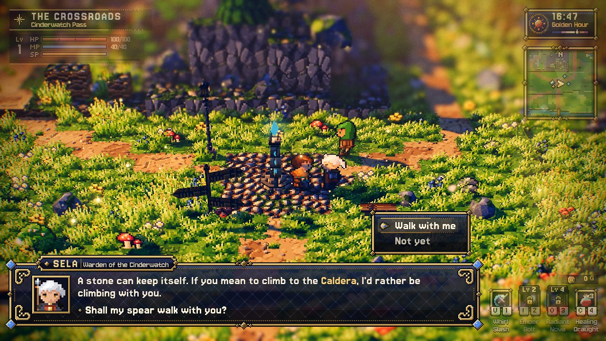
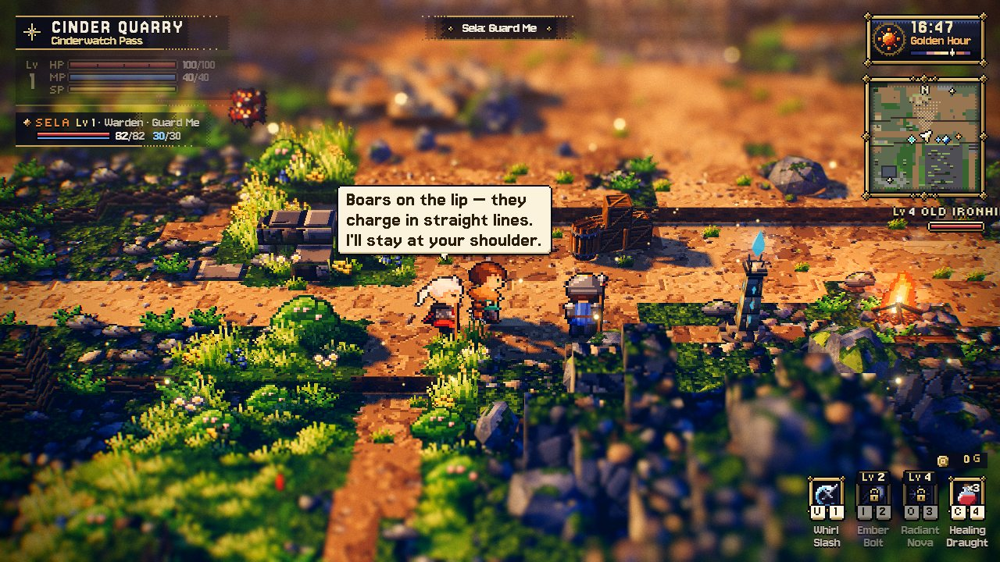
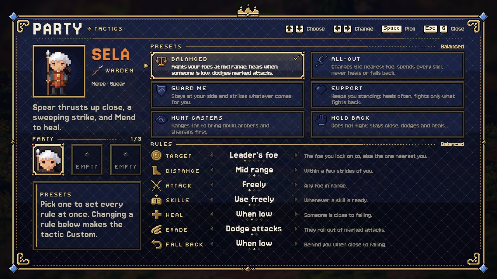
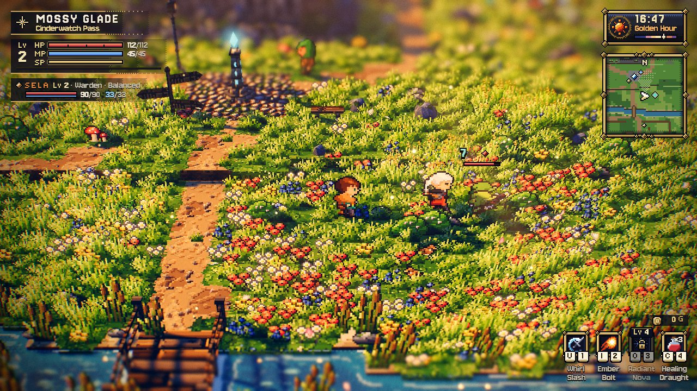

# The party

> **Status.** **Binding contract** for the party system: villagers who join the player, follow
> them, and fight beside them by a combat rule the player and the story set. Like the other
> contracts it may only be changed additively ([contracts/README.md](../contracts/README.md));
> document any necessary deviation alongside the code change and update §11 with its reason.
>
> **Relation to the other contracts.** [COMBAT.md](../contracts/COMBAT.md) (the combat rules, the
> enemies' `CombatContext`), [STORY_SCRIPT.md](STORY_SCRIPT.md) (the script language),
> [CAMPAIGN_FORMAT.md](CAMPAIGN_FORMAT.md) (travel, rooms, saves) and
> [AUTOMATION_API.md](AUTOMATION_API.md) stay binding; this document adds to them.

## Contents

1. [Summary and decisions](#1-summary-and-decisions)
2. [Records and saves](#2-records-and-saves)
3. [Rules, presets, classes](#3-rules-presets-classes)
4. [The party in the game (party core)](#4-the-party-in-the-game-party-core)
5. [Companions in combat (party combat)](#5-companions-in-combat-party-combat)
6. [The party UI](#6-the-party-ui)
7. [The story's party commands](#7-the-storys-party-commands)
8. [Test hooks and state](#8-test-hooks-and-state)
9. [The demo: the companions of Cinderwatch Pass](#9-the-demo-the-companions-of-cinderwatch-pass)
10. [Must not change, packages, verification](#10-must-not-change-packages-verification)
11. [Deviations](#11-deviations)

---

## 1. Summary and decisions

A villager can **join the player's party** (at most `MAX_PARTY` = 3 members). Out of a fight a
member **follows the player's footsteps** — it walks the path the player walked, a step or two
behind, at the player's pace (the follow of classic console RPGs such as Earthbound). In a fight on a combat
level it **leaves the trail and fights on its own**, by its **combat rule**: which foe to go for,
how far from the player it ranges, when it attacks, uses skills, heals, dodges and falls back. The
rule is one of six **presets** or a custom mix; the **player** changes it in the tactics panel (G,
or by talking to the member) and the **story** changes it with `party rule` / `party set`. Foes
fight back: an enemy can turn on a companion that hits it.

| # | Decision | Chosen | Rejected (why) |
| --- | --- | --- | --- |
| P1 | Who joins | The story decides: `party join <who>` in a script (a talk script's choice, an event). Test hooks join any villager. | An NPC `action: 'join'` (a new NPC action is a catalog change: Starfall's `coverage()` would have to place a joining villager). |
| P2 | The member as an actor | A `PartyMember` of its own (sprite, follow, combat), made per level by the party; the level's `Npc` with that id is **hidden** while it is in the party (on every level and in every chapter variant). | Driving the level's `Npc` (it exists only on its own level: a campaign's travel would lose the member). |
| P3 | Lifetime | The **party** belongs to the game's persistent half (`game.party`, made on demand), the **records** to the story's state (saved with a campaign), the **actors** to the level (made at `attachLevel`, released at `detachLevel`). | Members kept as level objects (a room set aside would keep a stale member). |
| P4 | Follow | The player's **trail** (positions sampled as they walk), each member at its own distance along it; catch-up and a snap behind the player when it falls far behind (§4.2). No collider: a member never blocks the player or a villager. | Steering toward a point behind the player (cuts corners into walls and water, bunches up). |
| P5 | Combat targeting by enemies | Per enemy: core sets `ctx.player` to the view of the enemy's **target** (the player's view, or a companion's) before that enemy's update — the brains are unchanged. With no companion every enemy reads the player's view exactly as before. | Brains made multi-target (every `ai/*.js` rewritten; the boss framing). |
| P6 | Rules as names | The vocabulary (fields, values, presets, classes) is import-free data in `src/engine/level/PartyRules.js` (the story's checks read it in Node); what the names mean in numbers is the game's (`src/game/party/rules.js`). | Numbers in scripts (`party set sela leash 6.5`: unreadable, untestable). |
| P7 | Levels nobody joins on | Nothing changes: no party chunk, CSS, binding, DOM node, program or per-frame work until the first join (`game.party === null`). | — |
| P8 | Programs | A member's sprite uses the player's material kind of the level (lit; `combatFx` on combat levels); its effects reuse the combat's FX batch, markers and bursts. No new program, no light. | A member material of its own (a program compiled mid-game at the first join). |

---

## 2. Records and saves

*(Implementation: party core; the story system implements `StoryState`'s side.)*

A member is remembered as a `PartyRecord` (`src/game/party/types.d.ts`): `id` (the villager's
id, the key everywhere), `name`, `actor` (its story actor or ''), `preset` / `spec` / `color` (its
look and name-plate colour, from its level object), `cls` (a class, §3), `rule` (its combat rule,
§3) and `level` (the base level id it joined in, '' on a single level).

- `StoryState.party: PartyRecord[]` holds them (join order). The Party writes them after every
  change (`state.setParty(records)`); `toJSON` / `fromJSON` save and read them (untrusted: a record
  whose `id` is no story name, an unknown class or preset, a bad rule field is repaired or dropped;
  at most `MAX_PARTY`). A campaign's save therefore holds the party; a single level's story lives
  for the session (STORY_SCRIPT.md §9.3) and so does its party.
- Runs are atomic (STORY_SCRIPT.md §9.3): a save during a run writes the party as it was when the
  run began, like every other value.
- **Continue / a new journey**: `Game.syncParty()` makes the party when the state holds members and
  brings the actors in line with the records (`Party.syncFromState`). Init calls it after
  `campaign.onStart()`; the story calls it whenever its state is replaced (a new journey, a loaded
  save); the title's *New journey* calls it once more after `campaign.newGame()`. It is idempotent
  and safe at any time: a party made before the level is built attaches its members when the level
  is (`attachLevel`), one made while a level is played attaches them at once.
- `syncFromState` reads the records as untrusted (`sanitizeRecords`, exported by `Party.js`): an id
  that is no story name (`isStoryName`) or a second record of an id is dropped, at most `MAX_PARTY`
  are kept; a bad actor becomes none, a bad preset `villager`, a bad colour the default, a bad class
  the one its weapon makes, a bad rule field the default preset's (`normalizeRule`). Members the
  records no longer hold go (their villagers here come back, at home); new ones arrive behind the
  player; no member is ever made twice (by id). Records that needed repair are written back
  (`state.setParty`), so the next save holds only checked ones. (A save is checked by the story's
  `StoryState.fromJSON` first, §7.6; this is the party's own guard.)
- Records are written (`state.setParty`) after every join, leave and rule change; `level` is the
  campaign's base level id at the join (`campaign.levelId`, '' on a single level).
- Without a story (a test hook's join on a level without one) the party keeps its records itself.

---

## 3. Rules, presets, classes

*(Implementation: shared rules; the combat values are in
`src/game/party/rules.js`.)*

The vocabulary is [`src/engine/level/PartyRules.js`](../../src/engine/level/PartyRules.js):

| Field | Values | Meaning (numbers: `src/game/party/rules.js`) |
| --- | --- | --- |
| `target` | `leader` · `nearest` · `weakest` · `strongest` · `ranged` | the player's lock-on target, else the foe nearest the player · nearest the member · lowest HP fraction · boss, elites, then highest max HP · archers and shamans first, then nearest |
| `distance` | `close` · `mid` · `far` | how far from the player it ranges in a fight (`DISTANCE[v].leash`: 4 / 8 / 13 u — it does not chase past it) and a ranged member's distance to its target (`standoff`) |
| `attack` | `free` · `assist` · `never` | any foe in range · only foes that fight the player or the party (aggroed on one of them, hit by the player in the last 4 s, or the player's lock-on) · no attacks |
| `skills` | `free` · `save` · `never` | combat skills whenever ready · only with mana to spare for a heal (MP after the skill ≥ the heal's cost) · basic attacks only. Heals are not skills: `heal` alone decides them |
| `heal` | `never` · `low` · `half` · `often` | heal the player or a member whose HP fraction is below `HEAL_AT[v]` (0 / 0.3 / 0.5 / 0.75), the lowest first |
| `evade` | `on` · `off` | roll out of an enemy ground marker (a telegraphed attack) it stands in |
| `retreat` | `never` · `low` · `half` | below `RETREAT_AT[v]` of its own HP (0 / 0.25 / 0.5) it falls back behind the player and only heals and evades |

**Presets** (`PARTY_PRESETS`, the panel's order): `balanced` *Balanced* (the default),
`aggressive` *All-Out*, `guardian` *Guard Me*, `support` *Support*, `hunter` *Hunt Casters*,
`passive` *Hold Back* — each a full rule. A rule that matches no preset field for field is
*Custom* (`presetOf`, `ruleLabel`).

**Classes** (`PARTY_CLASSES`): `warden` (spear, melee), `ranger` (bow, ranged), `mystic` (staff,
caster). A villager joins as the class the story names (`party join sela as warden`), else by the
weapon it carries (`classForWeapon`: bow → ranger, staff → mystic, else warden). On a combat level
its sheet is the combat sheet with the class weapon (`memberSpec`); elsewhere its own look.

`normalizeRule(rule, base)` makes any input a full valid rule (unknown keys dropped, bad values from
`base`); every writer of a rule goes through it.

---

## 4. The party in the game (party core)

*(Implementation: party core — `src/game/party/Party.js`, `PartyMember.js`, `src/game/Game.js`,
`src/game/Npc.js`, `src/game/types.d.ts`.)*

### 4.1 Lifecycle

- `Game.ensureParty()` → the party (once: the party chunk and its UI chunk, `ui.usePartyUI`, the
  G binding). `game.party` is null until then.
- `Party.join(who, { cls, preset, rule })`: a villager of the level being played (id, actor or
  name; or the `Npc`) becomes a member — refused (null) when the party is full, it is a member
  already, or it is not here. Its `Npc` is hidden (`setPresent(false)`); the member appears where
  the villager stood and walks to the player. On a combat level `combat.addAlly(member)`.
- `Party.leave(who)`: the member goes; its villager appears where the member stood (on its own
  level: there as the story has it; on another level it is back at home on its own level).
- `Party.setRule(who, presetOrRule, { source, quiet })` / `setField(who, field, value)`: through
  `normalizeRule`; `source: 'story'` shows a toast `<name>: <rule label>` unless `quiet`. Events
  `join`, `leave`, `rule` on `party.events`.
- `attachLevel()` at the end of `Game._buildLevel` (a built, prepared or kept level alike): the
  members' actors arrive behind the player (§4.2 placement), are registered like the level's actors
  (scene, sprite manager, warm fill `SPRITE_FILL`, the contact-shadow batch on batched / combat
  levels with `makeShadowOnly`), become allies of the level's combat, and hide their villagers.
  `detachLevel()` in `Game._detachLevel` releases the actors (their records stay). A level set
  aside (rooms) keeps no member.
- Hidden villagers: `Party.holds(objOrNpc)` (by id or actor) — every place that shows villagers
  asks it (the story's presence, §7.4; `attachLevel`; `refreshActors` and the maps).

**As built.** `join` refuses a villager the story has away (`npc.present` false) and any join during
a travel (`Party.canTake(npc)`: there, not held, a place free, no travel); the member's sprite starts
at the villager's spot, facing its way, and walks (or, farther than CATCH_UP from its trail point,
runs) to the player; the villager's speech bubble is cleared; the party's walk grid is built ahead
in idle time from the first join on (`_prepareNav`). The first member of a party starts the trail
at the player (`_seedTrail`). **A refused join makes no party**: the join hook (and the story's
`party join` may) asks `Game.canJoin(who)` first — the villager by id, actor or name
(`Game.findVillager`, names and ids coerced to text: level data is untrusted), there as the story
stands, not held, no travel; when a party exists also not a member and a place free — and only
then `ensureParty()`. `leave` on the member's own level (its record's `level`, or a single level)
puts the villager where the member stood, facing the player, shown as the story has it
(`story.present` is asked after the record is gone), and **makes that spot its home**
(`npc.setHome`; with a story also the story's memory of the level, as the script command `home`
writes it — `state.levelMemory(story.levelId).homes[id]`, read back when the level is attached, saved
with a campaign): a `post` / `wander` villager left away from home stays there instead of walking
straight back home through the player. Elsewhere the member goes with a puff of dust (the
`footstep` burst) and the villager is back at its home — at once when it stands on this level, else
when its level (set aside meanwhile) is attached again (`_applyVillagers`: a villager the party hid
and holds no more is put home and shown). The
party remembers the villagers it hid (`_hid`, a WeakSet) and, on the level played, re-hides one that
something shows again (`_hidHere`, checked every frame). A member's speech bubble goes with its
sprite (`PartyMember.detach`: `ui.emotes.clear(sprite, true)`). What `attach` registers it keeps in
`member._reg` (the warm-fill entry, the blob batch that adopted it, the sprite manager) and `detach`
releases exactly those, so a level that failed to build or is set aside keeps nothing of a member.
The sheet's texture is uploaded at `attach` (`renderer.initTexture`): a member arriving with a level
is drawn behind the fader. Programs: a join on Emberfall leaves `renderer.info.programs` at 57, on
Cinderwatch Pass at 63 (`party.follow.json`, `party.follow.combat.json`). Joins, leaves and syncs
call `Game.refreshActors` (map dots, chicken threats) and `Game.refreshPartyLegend`, and refresh an
open tactics panel (`openMenu` again; closed when nobody is left).

### 4.2 The follow

- **Trail.** The party records the player's ground positions as they move (a point every
  ~0.12 u; with the player's height and whether they ran) in a ring buffer long enough for the
  last member. Member *k* (0-based) stands at arc length `spacing · (k + 1)` behind the player along
  it (`spacing` ≈ 1.1 u). It walks there at the speed it needs (at most the player's run × 1.3),
  animates walk / run by that speed, faces where it moves; when the player stops it stops on its
  point, and after a moment turns to face the way the player faces. It never stands on the
  player: the trail point is where the player *was*.
- **Catch-up.** A member more than ~4 u from its trail point (after a fight, a story walk, a talk)
  runs to it — straight while the way is clear, else along the level's walk grid (`combat/Nav.js`;
  the combat's when there is one) — and takes the trail again when close.
- **Snap.** Farther than ~20 u, or stuck 2 s, it is put behind the player (a standable spot near
  the trail, preferably off-screen) with a small dust burst.
- **Teleports** (`Game.teleport`, `talkTo`, a respawn, a travel's arrival, `party.onTeleport`):
  the trail starts again at the player; members are placed behind the player on standable spots
  (fanned out, facing the player's way).
- No collider. Ground height as a villager (damped). A member does not follow while the map, the
  journal or the tactics panel is open (play pauses), nor while a story directs it.
- On big levels a member is never throttled (it is always near the player).

**As built** (`Party.js`: `Trail`, `Party.update` / `_follow`; `PartyMember.js`: `stepToward`,
`stand`, `_gait`). A party, not a train: each member reacts a beat after the one before it, eases
in and out, keeps a spacing of its own, steps aside where it would hide the player and makes way
when the player walks into it. The numbers are constants at the top of `Party.js`:

| Constant | Value | Use |
| --- | --- | --- |
| `SPACING` | 1.1 u | member k's arc length behind the player: `SPACING · (k + 1)` (plus its jitter, sway, reaction and hang) |
| `SAMPLE` / `TRAIL_CAP` | 0.12 u / 400 points | the trail (≈ 48 u; `x, y, z, run` per point, a ring buffer, nothing allocated per frame) |
| `MAX_SPEED` | 5.6 × 1.3 u/s | the player's run × 1.3 |
| `TAU` / `MIN_PACE` | 0.16 s / 1.2 u/s | follow pace `min(MAX_SPEED, pace + gap / TAU)` (feed-forward: the pace of the trail point it follows); a member finishing its approach walks at least `MIN_PACE` |
| `REACT` | 0.06 s | member k follows the trail point of `REACT · (k + 1)` s ago: it sets off and stops a beat after the one before it (`_lagged`: a 48-frame history of the player's way, pace and whether it walked) |
| `ACCEL` / `BRAKE` / `SLOW` / `STOP_PACE` | 16 u/s² / 22 u/s² / 60 u/s² / 0.6 u/s | it speeds up over ≈ 0.2 s; it brakes into a goal that stands along `√(2 · BRAKE · gap)` (from a walk in ≈ 0.15 s — so it trails its goal by that braking distance, ≈ 0.23 u at a walk, ≈ 0.7 u at a run); it slows down at most `SLOW` otherwise (a goal that comes toward it: a few frames, never one); the last centimetres at least `STOP_PACE` |
| `STAND_AFTER` | 0.1 s | the player stands once it made no step this long (a frame held up by a wall or a turn is no stop) |
| `JITTER` / `SWAY` / `SWAY_LEN` | ± 0.08 u / ± 0.1 u / 6.5 u | spacing: each member's own offset and a slow sway along the way, phase and offset seeded by its id (`hashString`: no randomness) |
| `LATERAL` / `SHARE_ON` … `SHARE_FULL` / `DEPTH_ON` … `DEPTH_OFF` | 0.8 u / 0.35 … 0.75 / 2.6 … 3.6 u | the trail runs toward the camera: the member walks `LATERAL` to the side (below) |
| `LATERAL_TAU` / `LATERAL_BACK` / `SIDE_SWITCH` | 0.12 s / 0.2 s / 0.3 u | the side offset eased out / back; a side kept until the trail point lies this far on the other side of the player's column |
| `HANG` / `HANG_TAU` | 1.6 u / 0.25 s | walled in where it would step aside: it hangs back (below) |
| `CLEAR_SIDE` / `CLEAR_FAR` / `CLEAR_BEHIND` | 1.05 u / 2.8 u / 0.1 u | screen-clear rest spots and placements (below) |
| `REST_YAW` / `YAW_SETTLE` | 0.15 rad / 0.25 s | the camera turned this far while the player stands and is still again: the rest spots are worked out again |
| `REST_PACE` / `REST_RUN` | 3.4 u/s / 3 u | to a rest spot (or out of the way) it walks; it runs only from farther |
| `WAY_AHEAD` / `WAY_SIDE` / `WAY_CLEAR` | 2.2 u / 0.75 u / 1.05 u | make way (below) |
| `COVER` | 0.03 | the silhouette fade: a member nearer the camera covers this share of the player's body on screen |
| `ARRIVE` | 0.05 u | standing on its spot |
| `CATCH_UP` / `REJOIN` | 4 u / 0.9 u | catch-up from / back to the trail |
| `SNAP_DIST` / `STUCK` | 20 u / 2 s | the snap |
| `GAP` / `APART` | 0.8 u / 0.6 u | the player stands: no member rests nearer the player / another member |
| `JUMP` | 2.5 u | the player moved farther in one frame: handled as a teleport (a script's `teleport`, an arrival not through `Game.teleport`) |
| `TURN_AFTER` | 0.6 s | standing this long, a member faces the player's way (re-applied every frame: a camera turn keeps it); it shows the player's own sprite direction (a diagonal facing picks one by the sprite's hysteresis) |
| `PLACE_MOVE` | 0.3 u | members put behind the player wait there until the trail grew this much |

- **Gait**: walk / run / idle by the speed it really made (smoothed; run above 4.4 u/s, back to the
  walk below 3.8; idle after 0.08 s still), the animation speed by its pace; on a run's contact
  frames a small `footstep` burst as the player's.
- **Following**: while the member "sees" the player walk (a beat late: `REACT · (k + 1)` s) it
  steers to the trail point at its spacing plus the player's way since then (and the hang of the
  members before it and its own); while it does not (the player stands, or set off a moment ago) to
  its rest spot. Its pace is eased (`follow.v`): `ACCEL` up, the braking curve down.
- **The side** (`_lateral`, `follow.lat`): where the way from the player to the member's trail point
  runs down the screen (its screen-down share between `SHARE_ON` and `SHARE_FULL`, faded out again
  between `DEPTH_ON` and `DEPTH_OFF` u down the screen, where it hides nothing) the member would
  stand in front of the player: it walks up to `LATERAL` u to the side, out of the player's column
  on screen — the side its trail point is on, else the side it stands on, else by its place (0
  right, 1 left, 2 right; kept with a `SIDE_SWITCH` hysteresis). Only where it can stand and walk to
  from its trail point (else half, else none), and never into a corner: a goal it cannot walk to
  straight, or a member held up by a wall (stuck 0.2 s), goes back onto the player's way at once.
  Setting off from a rest spot it starts from the side it stands on (no cut across behind the
  player). **Hang back** (`follow.hang`): for the share of the offset it could not take (a passage,
  a bridge, stairs) it falls back up to `HANG` u more trail, it and the members after it — far
  enough down the screen not to hide the player.
- **Resting**: when the player stops the rest spots are worked out once (`_computeRest`), again
  after a camera turn of `REST_YAW` once the camera is still: a member that was not following the
  trail (it stood, or stepped out of the way) keeps its spot when that is a good one near the
  player; else its natural spot — its trail point, to the side it walked on —, unless that lies
  within `GAP` of the player (a trail that folds back on itself), within `APART` of an earlier
  member, or **in front of the player on the screen** (`_screenClear`: below the player, within
  `CLEAR_SIDE` of its column and `CLEAR_FAR` down the screen; up the screen is always clear); then
  the spot around the player (rings of 1.1 – 2.8 u, 24 ways) nearest to the natural one — beside or
  behind the player — that keeps all three, standable and reachable in a straight line from its
  trail point or where it stands; without one, the nearest that keeps the first two; else where it
  stands. It walks there (`REST_PACE`). While the player stands, a member whose straight way would
  pass within 0.6 u of them goes round them (a waypoint 0.85 u beside the player on its side:
  `_roundPlayer`) — a villager who joined in front of the player walks round them to its place.
- **Make way** (`_makeWay`, `follow.way`): a member (not in catch-up) ahead of the walking player's
  step, nearer than `WAY_AHEAD` u and within `WAY_SIDE` u of its line, steps aside to `WAY_CLEAR`
  u from that line — up the screen when that step runs up / down it, else the side it stands on
  (else the other; standable and reachable) — and waits until the player has passed it (it rests
  there when the player stops meanwhile: `wayHold`). With no room to step aside the player walks
  through it (no collider).
- **The silhouette fade**: every frame of the follow the party works out whether a member nearer
  the camera covers more than `COVER` of the player's body on screen (`coversPlayer`: the sprites'
  quads projected, their bodies — the middle 44 % of the width, the lower 80 % of the height); the
  game fades the player's x-ray silhouette out meanwhile (`Player.fadeSilhouette`: opacity over
  0.15 s, no colour or depth write when faded out; a material value, no program) — its 1.3 u pull
  is about one member's spacing along the view ray: it painted a pale ghost of the player over a
  member in front of it. Never called on a game without a party.
- **Catch-up** runs straight while `Nav.lineClear` (or, without a grid yet, a sampled standable
  line) says the way is clear, else along a path on the walk grid — `combat.nav` on a combat level,
  else the party's own `Nav`, built ahead in idle slices from the first join and when a level is
  attached with members (as the story's) and dropped when live story objects change the level
  (`Game.repaintLevelMap`). A path is asked again every 0.5 s at most. With **no path on the grid**
  (closed where the player squeezed through — Emberfall's lamppost beside the brick house — or the
  ends in parts it does not join) it runs back **along the trail** (`_trailStart` / `_trailWay`,
  `follow.crumb`): from the nearest trail point it can walk to straight, on toward the player — to
  the farthest point a few metres ahead it can walk to, else the next one. With no way at all (none
  on the grid, no trail point within reach) it is put behind the player at once (the snap) rather
  than running into a wall for `STUCK` s. It rejoins the trail within `REJOIN`.
- **Snap**: the first standable trail point behind its own (up to 30 u of trail, within 16 u of the
  player) that the camera does not see — it runs in from there (catch-up) —, else the first
  standable one, else a spot around the player; a `footstep` burst where it lands. A member stuck
  `STUCK` s (wanting to move, making < 25 % of it) snaps too.
- **Placement** (`placeBehind`, teleports, `attachLevel`, a sync's new members): the trail is seeded
  with a straight line of standable points behind the player (the way they face; else the most open
  of a fan of ways ±30° … 180°, as long as the ground allows up to the last member's place). Member
  0's first choice is on it at `SPACING`, members 1 and 2 fanned out (1.6 u back, 0.85 u to either
  side), then the trail at their own distance, then the spots around the player (1.1 – 2.8 u, from
  behind round to the front) — **screen-clear ones first** (facing up the screen, "behind" is in
  front of the player on the screen: they stand beside it), then any; then a wider and finer search
  (0.8 – 4 u, 16 ways) — always standable, reachable in a straight line from the player and apart
  from each other; they face the player's way and wait (`follow.mode` 'placed') until the player
  walks on. The wide search also takes a spot round one corner (reachable straight from a
  standable spot the player reaches straight). With no such spot anywhere (a pocket too small for
  three) the member is put on the player's own spot, in catch-up (`stats.unplaced`). A teleport moves every member but one a script
  directs or one talking.
- **Held** (`follow.held`: 'combat' while `member.combat.active`, 'script' while directed, 'talk'):
  the follow only keeps it on the ground; a member put behind the player that is held follows the
  trail from then on ('placed' → 'trail': its rest spot was where it stood); let go, it takes the
  trail again (catch-up when far) and the rest spots are worked out again. A member a finished
  story run left directed is released after 0.5 s without a run, walk or background run holding it
  (`_scriptDone`; StoryRunner releases members itself at a run's end).
- **Pause**: `Game.update` runs `party.update` only while playing with no map, journal or tactics
  panel open.

Measured (Emberfall, real key presses, the review's scripts; before → after): the player's body
covered by the members in front of it walking north 56 % → 2.5 % on average (one member) and
65 % → 2.6 % (three; largest frame 3 %), at rest after it 56 % / 66 % → 0, after a camera turn at
rest 1 % → 0; running north 60 % → 5 % (largest frame 62 % → 8 %);
members set off 4 / 7 / 11 frames after the player and stand still 8 / 10 / 14 frames after it
(before: all three in the player's frame, from a walk).

### 4.3 Talk

A member offers **Talk** like a villager (`_findInteractable`; not while it fights or is down).
Talking runs, in this order: its talk script (the story's: the villager's `talk`, else its
actor's — `StoryRunner.talkFor(member)`, §7.5), else the **party conversation**: the member's
line and a choice — *Tactics…* (opens the panel on it), *Part ways* (asks again, then `leave`),
*Carry on*.

**As built.** `_findInteractable` also skips a member a script directs, one talking, and one on the
move (smoothed speed > 0.5 u/s: a party walking behind the player flashes no prompts). `_interact`
calls `Party.talk(member)`: `story.talkFor(member)` → `story.talk(member)` when it returns a script,
else the conversation (`Party._converse`): one of four lines (by the member's id and the
conversations so far this session), the three choices; *Part ways* asks *You want me to stay
behind?* (*No — stay with me* / *Yes, part ways*), says goodbye and leaves; *Tactics…* opens the
panel (`Game.togglePartyMenu(true, id, { force: true })`) once the window has closed.
`Game.talkTo(id)` falls back to the member with that id when the villager is hidden: the member
steps up to the player (`Party.standBeside`: 1.15 u in front, else beside, else behind, standable
and reachable) — the player is not moved. `talkTo` refuses (false) while the tactics panel is open:
the panel holds play and the story (StoryRunner waits while `partyMenuOpen`).

### 4.4 Input, HUD, maps

- **G** (`party` action; bound by `ensureParty`) opens / closes the tactics panel while playing
  (not in a dialog, the map, the journal, photo mode, a cutscene or while the combat locks the
  player). Open, it pauses play like the journal (combat inactive). Esc closes it. The controls
  legend gains *G — Party* (the combat legend too) once someone joined.
- The party HUD (`ui.party.frames.update(party.frames())`) every frame while playing; hidden in
  photo mode, cutscenes and on the title screen.
- Minimap and world map: one dot per member (`map.party`, live positions; drawn by the UI, §6.3).

**As built.** `Party.wireUI()` (called by `ensureParty` after `usePartyUI`, again by `openMenu`) sets
the panel's `onSound` (`menuOpen` / `menuClose` / `menuMove` / `menuSelect` → the SFX `open` /
`close` / `blip` / `confirm`, volume 0.5) and `onClose` (notes the frame it closed in); `openMenu`
sets `onRule` (`setRule(id, rule, { source: 'player' })`) and opens it with every member (focus:
`who`); `setRule` from the story or a test calls `panel.setRule` while it is open.
`Game.togglePartyMenu(open, who, { force })` is the one way in (G, *Tactics…*, the
test hook; the story's `party menu` may use it too): it refuses outside play, in a dialog, over the
map or the journal, in photo mode, a cutscene (`ui.cutscene`), while the combat locks the player and
in the engine frame the panel last closed in (`party.closedFrame`, set by `closeMenu` and the
panel's `onClose`) — `force` skips all but the mode; with nobody in the party it toasts *No one
travels with you.* Opening hides the prompt and calls `combat.onMapOpen()`. `Game.update` folds
`partyMenuOpen` into its `mapOpen` gate (player frozen, combat inactive, no follow); G or Esc close
it there (the `party` press is consumed). The map, the journal and photo mode do not open over it.
The legend line comes from `Game._controls()` / `_legendExtra()` while `party.count > 0`; a change
re-sets the peaceful legend, or on a combat level `combat.legendExtra` and `combat.refreshLegend()`.
The binding is G only (`Game._bindParty`): **no pad button** — every one is taken on a combat level
(A talk, B dodge, X attack, Y draught, LB / RB the camera, LT the skills, RT run, Back the map,
Start help, LS photo, RS lock-on, the d-pad moves; LT and LS are free only on peaceful levels, and a
button that does one thing on one level and another on the next is worse than none); a pad player
opens the panel through a member's talk (A, *Tactics…*). The line is marked `pad: false`
(`PARTY_CONTROL`): the combat legend's pad variant should leave it out (§11 C14). `_bindParty` runs
again in every `_buildLevel` while a party exists: a combat level's CombatSystem puts back, when
it goes, the bindings it saved at its load — from before a party made on that level, which lost G
on the next level. The HUD frames are fed every frame while
playing and shown only then (`_updatePartyHud`: hidden in photo mode, a cutscene, on the title and
with nobody in the party; `update([])` when hidden). `refreshActors` keeps held villagers off the
maps and the chickens' threats, and sets `map.party` (and adds the members to the chickens'
threats) only once a party exists.

### 4.5 The story's staging

A member has the members `StoryRunner` uses on an `Npc` (`id`, `name`, `position`, `sprite`,
`present`, `talking`, `directed`, `storyObj`, `storyTalk`, `def`, `interactPoint`, `talkRadius`,
`beginTalk`, `endTalk`, `direct`, `release`, `walkStep`, `stopWalk`, `placeAt`, `setHome` (no-op),
`teleportHome` (behind the player)). A script's `<who>` that names a member finds the member
(§7.4). A directed member neither follows nor fights; `release` (the run's end) gives it back to
the follow (catch-up).

**As built.** `walkStep(dt, x, z, running)` walks it at 2.6 u/s (running 5.2) through the terrain
and colliders (`moveBy`, radius 0.3), facing and animating as it goes; `stopWalk` stands it idle;
`placeAt` puts it on the ground at once; `teleportHome` puts it behind the player
(`placeBehind([member])`); `storyObj` is the villager's level object while the member is on that
villager's level, else `{ id, actor }`; `talkRadius` 1.6. The follow keeps a directed member on the
ground (`followGround`).

**Its text.** A member's texts are translated by the keys the data holds for them
([I18N.md §4.8](I18N.md#48-call-sites)). On its villager's level they are the villager's level
object's (`storyObj`: its title, its talk script's `#line:` tags, its dialogue pages); on any other
level the member talks with its story actor's talk script, whose lines carry their own tags. A
stand-in made from the record (`{ id, actor }`) holds no title and no pages. Its name is shown as a
term (`memberName` in Party.js: a villager named `Villager`
shows the UI string `game.default.villager`), in the frames, the tactics panel, the rule toasts and
the party's conversation.

---

## 5. Companions in combat (party combat)

*(Implementation: party combat — `src/game/party/MemberCombat.js`, `src/game/party/rules.js`,
`src/game/combat/CombatSystem.js`, `Enemy.js`, `Projectiles.js`, `Hitboxes.js`, `hooks.js`,
`src/game/combat/types.d.ts`, the COMBAT.md section it adds.)*

### 5.1 Allies

- `CombatSystem.addAlly(member)` → a `MemberCombat` (implements `AllyCombatView`), stored in
  `combat.allies` and as `member.combat`; `removeAlly(member)` drops it (its target, tokens, hit
  tags and markers released). Combat's `dispose` drops all.
- The member's stats: its class's `CLASS_STATS` at the **player's level** (the party levels with
  the player): HP, MP, ATK, DEF. Kills by a member give the player XP and loot as the player's
  kills do; the combat's kill count counts them.
- **When it fights** (`active`): while the combat is `engaged`, or a foe has it as its target, or
  it is down. Otherwise the follow drives it (§4.2; it catches up). A member that has been out of
  a fight for 2 s regains HP and MP quickly (≈ 10 % / s) and a downed member gets up with 30 %.
- **Frame order.** Each combat sub-step: the player's kit, then the allies (`MemberCombat.step`),
  then the enemies (with `ctx.player` per target, §5.3), projectiles, `_resolve`. `afterPlayer`
  separates allies too and writes their sprite speeds. Nothing advances while combat is inactive
  (dialog, map, tactics panel, photo).

### 5.2 The kit (per class; numbers in `rules.js`, tuned by the combat package)

| Class | Basic attack | Skill (`skills`) | Heal (`heal`) |
| --- | --- | --- | --- |
| warden | spear thrust combo (2 hits, sector ≈ 1.7 u) | *Sweep*: a spin around it (r ≈ 2.2 u), knockback | *Mend*: heals the lowest ally below the threshold |
| ranger | arrow (a player-side projectile, range ≈ 12 u) | *Volley*: three arrows fanned | *Mend* |
| mystic | ember bolt (the player's bolt projectile, smaller splash) | *Flare*: a delayed burst on its target's spot | *Mend* (stronger) |

Poses from the combat sheet (`sheet.poses`: `wind`, `slash`, `follow`, `thrust`, `spin`, `cast`,
`aim`, `hurt`, `tuck`, `roll`, `down`) with `sprite.setFrame`; locomotion with `play`. Effects
through the combat's `fx` / bursts / projectiles (already warmed). Allies' attacks show **no**
ground markers (only enemy attacks are telegraphed). Hit numbers in the ally colour.

### 5.3 Enemies against allies

- Each enemy has a **target**: the player (default) or an ally. Before an enemy's update core sets
  `ctx.player` to its target's view (a `PlayerView` per ally: position, radius 0.3, body
  [0, 1.8], facing, velocity, alive (not down), invulnerable, dodging, action, swing, sealed) and
  back to the player's after the loop. With no ally nothing changes (P5).
- Switching: an enemy hit by an ally switches to it when the ally is nearer to it than the player
  (and holds it ≥ 2.5 s); every 0.5 s an enemy whose target is an ally goes back to the player
  when the ally is down or gone, or the player is clearly nearer (< 0.6 × the distance). The boss
  and its adds always target the player (their area attacks still hit allies).
- Enemy hitboxes and projectiles resolve against allies too (after the player; one hit per tag per
  target), with the player's damage formula against the ally's DEF; hitstun / knockback / down.
  Allies have i-frames while rolling. No friendly fire.
- `engaged` stays the player's (an aggroed foe within 16 u of the player).
- Separation: allies are pushed by enemies (ally mass 3) and by each other; an ally never pushes
  the player (it yields entirely).
- Boss arena: when it closes, allies within 12 u are placed inside behind the player; while it is
  closed they are held inside like the player; outside ones wait at the gate (they follow again
  when it opens).
- The player's death: allies stop (invulnerable, idle); the respawn puts them behind the player
  (`game.teleport` → `party.onTeleport`) at full HP. A waystone's rest and the story's `heal`
  refill them.

### 5.4 The AI (per sub-step decision, re-planned ≈ every 0.25 s)

In order: down → nothing; retreat (`retreat`) → move behind the player away from foes; evade
(`evade: on`, standing in an enemy marker whose fill is ≥ 0.3 and < 1) → roll out; heal (§3) →
*Mend* when MP allows (cooldown); skill (`skills`) → when ready and a cluster / target suits it;
attack (`attack`, `target`) → pick the target (only foes within `leash` of the player plus reach;
not dummies; not the boss's arena from outside), approach (melee: to reach; ranged / caster: to
`standoff` with line of sight) along the walk grid when the straight way is blocked; else hold a
spot beside the player (≈ 1.8 u, the side away from the nearest foe). Seeded (no `Math.random`);
deterministic with `&fixedstep=1`.

### 5.5 As built (party combat)

The code: [`src/game/party/MemberCombat.js`](../../src/game/party/MemberCombat.js) (a member's
fight), [`src/game/party/rules.js`](../../src/game/party/rules.js) (`DISTANCE`, `HEAL_AT`,
`RETREAT_AT`, `CLASS_STATS`, `ALLY`, `KIT`), the combat side in
[`CombatSystem.js`](../../src/game/combat/CombatSystem.js); the combat contract's view of it is
[COMBAT.md §28](../contracts/COMBAT.md#28-party-allies). Deviations from §5.1–5.4: §11 rows PC1–PC26
(PC15–PC26: the fixes and the balance pass after the play-test review).

- **API.** `combat.addAlly(member)` → the `MemberCombat` (null before the combat's `load`; again
  for the same member: the one it has); `combat.removeAlly(member)`; `combat.allies`;
  **`combat.healAllies()`** → every companion full HP / MP and up again (the story's `heal` calls
  it, falling back to each `member.combat.refill()`; also the `healAllies` hook) — the count.
  `MemberCombat` implements `AllyCombatView` (`active`, `down`, `hp`, `hpMax`, `mp`, `mpMax`,
  `refill()`, `onTeleport()`) and adds `info()` (the state row of §8), `id`, `cls`, `kills`,
  `target`, `mode`, `action`, `counts`.
- **Stats** at the player's level `L`: `CLASS_STATS[cls]` + `perLevel × (L − 1)` (HP, MP rounded).
  At L 3: warden 98 HP / 36 MP / ATK 8.8 / DEF 4.9, ranger 75 / 36 / 10.4 / 3, mystic 70 / 72 /
  9.7 / 3 (the player: 124 HP, ATK 18, DEF 6). ATK × `ALLY.partyAtk` by the members in the fight:
  1 / 0.85 / 0.72 for one / two / three. A member that heals `often` (Support) waits twice as long
  after a basic attack and for its skill (`ALLY.healerPace` 2). The player's level-up fills the
  members up too; any change of the player's level keeps their HP / MP fractions (PC20). *(Before the balance pass,
  PC25: warden 115 / 36 / 15 / 7, ranger 91 / 36 / 13.4 / 4.4, mystic 84 / 72 / 12 / 4.4, no
  party factor.)*
- **Regeneration.** In a fight 0.8 MP / s; out of one (`engaged` off and no foe after it) for 2 s:
  10 % of max HP and MP per second, and a downed member gets up (24 f, pose `tuck`) with 30 %.
- **The kit** (`KIT`; frames at 60 Hz; each class also has the dodge `roll`: 20 f, i-frames f1–13,
  3 u, cooldown 1.1 s):

  | Class | Basic | Skill (MP, cooldown) | Mend (MP, cooldown, heal, range) |
  | --- | --- | --- | --- |
  | warden | thrust 20 f (sector r 1.7 / 35°, mv 1.0, kb 0.5) then at once while in reach a second 26 f (r 1.8, mv 1.3, kb 1.2); 0.75 s pause; starts within 1.35 u + the foe's radius | *Sweep* (10, 7 s): spin 32 f, circle r 2.2 at f10–13, mv 1.3, kb 2.2, super armour to f16; ≥ 2 foes within 2.5 u, or an elite / the boss in reach | 10, 6 s, 25 % + 6, 8 u |
  | ranger | arrow 26 f (release f14; 16 u/s, range 12, mv 1.0), 0.5 s | *Volley* (9, 7 s): three arrows ±12° (mv 0.9 each); ≥ 2 foes within 3 u of the target, or an elite / the boss | 10, 6 s, 25 % + 6, 8 u |
  | mystic | ember bolt 26 f (release f14; 12 u/s, range 11, mv 1.15, splash r 0.8 mv 0.45), 0.75 s | *Flare* (12, 8 s): cast 30 f, a burst on the target's spot 0.7 s later (circle r 1.9, mv 2.2, kb 1.5) — no marker; ≥ 2 foes within 2.3 u of the target, or an elite / the boss | 12, 4.5 s, 35 % + 10, 9 u |

  Poses: wind / thrust / follow (thrusts), spin, aim / follow (arrows), cast / follow (bolt,
  Flare, Mend), tuck / roll (roll), hurt, down / tuck (knockdown), down (down). Effects: `thrust`,
  `spin`, `impact`, bursts `healGlow`, `magicBurst`, `emberBurst`, `sparkle`, `hitSpark`,
  `footstep`; sounds `swing`, `swingHeavy`, `whirl`, `arrow`, `bolt`, `hexBurst`, `pickup`, `dodge`,
  `hurt`, `playerDown`. Mend heals the lowest HP fraction below the threshold among the player and
  the members up (itself included); a downed member is not raised by it.
- **Getting hit.** Hit stun 14 f (slide 10 f) then 0.5 s i-frames (blink); knockdown (`knockdown`
  or kb ≥ 2.5) 36 + 18 f then 0.6 s; a hit without knockback does not interrupt Mend or Flare;
  Sweep has super armour. Flat damage (magma) only takes HP. At 0 HP it is down: the foes after it
  turn to the player at once, it lies (pose `down`, invulnerable) until the fight is over.
- **Separation.** Only a member the combat drives (a follower has no collider, P4), up and not
  rolling: against ground enemies by inverse mass (3 against the enemy's; an armoured one plows
  through), against another member evenly, and it gives way to the player entirely.
- **Where it stands and how it aims** (the review fixes; rows PC15–PC24, PC26). A warden strikes from a
  spot round its foe that is not in front of the player on screen while another is free, and
  steps to one between thrusts; it gives up a foe it cannot reach in height after 1 s. A shooter
  shoots only from within its leash + 0.75 u of the player (and from on screen when a spot there
  sees its target) and leads a moving target. Mends are reserved (one healer per target and
  threshold) and checked again at the heal frame; a Support member keeps its hands free for them
  (PC25). A member holding beside the player sets off only
  beyond 1 u and faces one foe steadily. A member goes round the player in its way. The party level
  is kept through any change of the player's level (HP and MP fractions). A foe not yet in the fight
  is a target only within 6 u of the player, never an elite or the boss.

---

## 6. The party UI

*(Implementation: party UI — `src/engine/ui/PartyPanel.js`, `PartyFrames.js`, `party.css`,
`src/engine/ui/UI.js`, `Minimap.js`, `src/engine/ui/types.d.ts`, `src/game/party/partyUI.js`,
the ui module page.)*

### 6.1 The tactics panel (`PartyPanelLike`)

A modal parchment panel in the journal's style (`story.css` look; its own `party.css`): a tab per
member (name in its colour, class); the six presets as cards (label, help; the current one marked,
*Custom* when none); below, the seven fields as rows with ◀ value ▶ (label, the value's hint).
Input as the Journal's (it binds no key, UI-01): `update(dt, input)` — called by `UI.update`
while it is open — reads the game's actions with `input.consumeAction?.(name) ??
actionPressed(name)`: `up` / `down` (W S, ↑ ↓, d-pad) between rows, `left` / `right` change a value
or move between preset cards, `confirm` (Space / Enter / F, pad A) picks, `camLeft` / `camRight`
(Q / E, LB / RB) switch member, `cancel` (Esc, pad B) closes — `update` then returns true and
`onClose` runs. The game opens and closes it with its `party` action (G); while it is open the
game pauses play like the journal, so the consumed actions reach nothing else. Mouse: click
anything; a click outside closes (reported by the next `update`). Every change calls
`onRule(id, rule)` at once and shows the new rule; `setRule` updates what it shows. Sounds through
`onSound`. Opens and closes with the journal's motion.

**As built** ([`PartyPanel.js`](../../src/engine/ui/PartyPanel.js), `.lu-party`, a root child at
z 7 — the journal's and the world map's layer; the game never opens two of them):

- **Layout** (the pixel UI after mockup G since 2026-10-09; sizes in
  [PIXEL_UI.md §5](PIXEL_UI.md#5-component-recipes)). A centred L window, 608 × 328 art px (up to
  342 tall), on G's stepped veil; the HUD and the minimap hide under it. Header *PARTY ◆ TACTICS*
  with the member pips (Q / E) and the key hints (↑↓ Choose · ←→ Change · Space Pick · Esc /
  `closeKey` Close). The left column (140 art px): the member's 68-px portrait from its character
  sheet (`PartyPanelMember.portrait`), the name, the class icon (`clsId`), role · weapon, the
  class's help, PARTY n/3 with three 40-px slots, and the note box — the focused row's help, and a
  rule's hint whole where its row cuts it (on a narrow window every hint). The right column:
  *Presets* (its heading ends with the member's tactic now, *Custom* when the rule matches none)
  as a 2 × 3 grid of cards (icon, label, help; the member's preset gilt with a check mark), then
  *Rules*: seven 19-px rows `LABEL  ◀ value ▶  hint` with pips under the value. It reflows to the
  screen rather than being scaled (480 wide at 1024 × 768); the body scrolls only when the window
  is too short — then every focus move scrolls the focused card or row into view. Texts arrive
  translated (`party` strings, `partyUIClasses()` registers them).
- **Focus.** The rows are the grid's two rows, then the seven fields. `up` / `down` move between
  them (wrapping; on the grid the column is kept). On the grid `left` / `right` move between the
  six cards in reading order (wrapping) and `confirm` picks the focused card (its whole rule; the
  card flashes; picking the member's current preset again changes nothing). On a field row `left`
  / `right` change the value and `confirm` takes the next one (both wrap). The focus is the
  gilt selection band and the nudging gem cursor on a row, a gold ring and the cursor on a card.
  `open()` puts it on the member's current preset card (the first card when *Custom*); another
  member keeps the row.
- **Data.** Everything comes from `open(opts)`: names and texts set with `textContent` only,
  looked up by own keys (`"constructor"` is no value), a member without an id or a duplicate id
  dropped, its rule made full against `opts.fields` (a bad value: the first preset's), its colour
  parsed by a canvas into `#rrggbb` (anything else: the gold default; no `url()` or `;` reaches a
  style) and, for its name, mixed toward cream where it is too dark to read on the panel.
  `open()` while open shows the new data — the focus row kept, and the member shown kept when
  `opts.focus` names no member that is there (the first member if the one shown left; a focus that
  names one wins); with no member nothing opens.
- **Changes.** Every change calls `onRule(id, rule)` with a copy of the member's **full** rule (all
  seven fields; `normalizeRule(rule)` returns it unchanged). `setRule(id, rule)` (the story changed
  it) shows it without calling `onRule`; an unknown id is ignored.
- **Closing.** `close()` — by the panel itself (`cancel`, a click outside, reported by the next
  `update`, which returns true) or by the game — calls `onClose` once (`isOpen` is false by then).
- **Sounds** (`onSound(name)`, `PartySound` in `src/engine/ui/types.d.ts`): `menuOpen`,
  `menuClose`, `menuMove` (the focus moved: a row, a card), `menuSelect` (a change: a value, a
  preset picked, another member). Suggested SFX (AudioSystem): `open`, `close`, `blip`, `confirm`.
- **Extras for tests** (not on `PartyPanelLike`): `memberId`, `focus` (`'presets'` or a field's
  key), `focusedPreset`, `rule` (a copy of the shown member's).

### 6.2 The party frames (`PartyFramesLike`)

Under the player's vitals (combat) or the location plate (peaceful): one compact frame per
member — a colour chip, name, class · tactic; on combat levels thin HP and MP bars, *Down* when
down, a subtle pulse while fighting. `update(list)` diffs and touches the DOM only on change.

*(Pixel UI, 2026-10-09: each frame is G's `partyFrame` — a band with a hairline, the member-colour
gem, the NAME in small capitals (cut with an ellipsis when long), Lv and level, class · tactic; HP
48 × 4 over MP 48 × 3 art px, canvases repainted in place, the numbers beside them; 22 art px tall
(24 in CJK), 13 without bars, 16 compact; a `tl` group 4 art px under the vitals or the place
plate at their left edge, shrinking with the corner groups. Down shows DOWN in red, low HP blinks
the empty bar red, fighting blinks a bright gem, lost HP leaves a pale chip for 0.35 s — all
stepped. The placement and update rules below hold; the look is
[PIXEL_UI.md §5](PIXEL_UI.md#5-component-recipes)'s.)*

**As built** ([`PartyFrames.js`](../../src/engine/ui/PartyFrames.js), `.lu-pframes`): the
constructor takes the UI root and puts the frames into its HUD (`.lu-hud`; or the element itself
when it has no HUD), so they hide with it — the title, `setHudVisible(false)`, cutscenes, photo
mode — and dim to 0.55 during a dialog like the vitals. Placement: on a combat level (the root has
`lu-root--combat`) under the vitals' bottom edge, else where the vitals would be (the location
plate's two-line height: a name change never moves them); measured when the frames first show,
when the combat comes or goes, on a window resize and when the anchor's size changes (a
ResizeObserver). A frame: chip, name (in the member's colour), *class · tactic*; with `hp` and
`hpMax` in the entry, an HP bar (a pale lag fill like the vitals') and an MP bar; `down`: the
chip grey, the name dim, *DOWN* instead of the tactic, the bars faded; HP ≤ 25 % (not down): a
deep red pulses through the bar's empty track (1.1 s); `fighting` (not down): the chip's glow
pulses (1.4 s).
`update(list)` compares with what it shows: frames are made / removed / reordered only when the
ids change, texts only when they change, a bar's transform only when its value rounded to 1/1000
changes — calling it every frame with the same list writes nothing (a few µs). `[]` hides it;
`setVisible(false)` fades it out. On short or wide windows (`max-height: 680px` or an aspect ratio
of 2 : 1 and wider), where the controls legend (bottom-left, growing up) reaches them on a combat
level — 1280 × 600, 1024 × 600, 1366 × 640 —, the frames tighten and show the HP bar alone (no MP
bar): three members end above the legend there. Extras: `visible` (members shown and not
hidden), `element`, and the exports `safeColor(c)` / `readableColor(hex)` (the panel uses them too). On a combat level the
world labels keep out of the frames (`UI` adds them to `labels.setPanels`).

### 6.3 Maps

`Minimap` and the world map draw `map.party` (`{ x, z }[]`, live) as small teal dots with a light
rim, above villagers, below the player's arrow.

**As built:** a teal core `#3fcfae` in a light rim `#e6fff7` and the maps' dark outline, drawn after
the villagers and enemies and before the view wedge and the player's arrow (indexed loop, no
allocation). The world map's legend gains a *Companion* row (after *Villager*) while it draws a
party, and loses it again without one. Without `map.party`, or with an empty one, both maps draw
exactly what they drew before (checked by canvas hashes in `sandbox/party_ui.json`).

### 6.4 Loading

`UI.usePartyUI(classes)` (once) makes `ui.party = { panel, frames }`; `partyUIClasses()` (the
party chunk) imports the classes and `party.css`. A game nobody joins loads neither.

**As built:** `usePartyUI(null)` (or a class missing) makes nothing and returns null; a second call
returns the first `ui.party`. `vite.config.js` marks `PartyPanel.js` and `PartyFrames.js` side-effect
free (`PARTY_PURE`, like the story UI). Production build: the classes are in the `partyUI` chunk
(≈ 20 kB, 6.3 kB gzip) with `party.css` in its own stylesheet (≈ 16 kB, 3.8 kB gzip); the main
chunk holds only the dynamic import and `usePartyUI`. Emberfall: no party DOM, CSS rule, module
request, binding or `state().party`; 231 draw calls, 57 programs, the same fingerprint.

### 6.5 Wiring (what the party core does)

- After `ui.usePartyUI(…)` (in `ensureParty`): `panel.onSound = (n) => audio.playSfx(SFX[n], {
  volume: 0.5 })` with `SFX = { menuOpen: 'open', menuClose: 'close', menuMove: 'blip',
  menuSelect: 'confirm' }`, and `panel.onClose` (play resumes; a story's `party menu` waits for
  it). `Party.openMenu` sets `onRule` (`setRule(id, rule, { source: 'player' })`).
- While `panel.isOpen`: pause play as for the journal (player frozen, combat inactive —
  `combat.onMapOpen()` —, the prompt hidden, no talk); refuse to open it while the map, the
  journal, a dialog, photo mode, a cutscene or a combat lock is on. Close it on the `party` action
  (G) in `Game.update`; `cancel` (Esc) may be left to the panel (it consumes it in `UI.update`,
  which runs after `Game.update`) or handled like the journal's (`actionPressed('cancel')`, then
  `closeMenu()`). Either way `onClose` runs once.
- A rule changed by the story while the panel is open: `ui.party.panel.setRule(id, rule)`. A member
  joining or leaving while it is open: `openMenu()` again (the open panel shows the new data).
- Every frame while playing: `ui.party.frames.update(party.frames())` (it writes only on change);
  `[]` when the party is empty. The HUD's own rules hide the frames on the title, in cutscenes and
  with `setHudVisible(false)`; photo mode hides the whole overlay.
- Maps: `this._map.party = party.members.map((m) => m.position)` (live vectors, read on every
  draw) after `_setupMaps` and whenever the members change; the members' villagers leave
  `_map.npcs`.

### 6.6 Tests

[`sandbox/party_ui.html`](../../sandbox/party_ui.html) (`?combat=1`: the combat UI too) with
[`party_ui.json`](../../sandbox/party_ui.json): three fake members (warden / ranger / mystic, three
colours, one custom rule) driven by key presses and clicks — rows, values, wrapping (the focused
row scrolled into view where the body scrolls), members, presets, every `onRule` a full valid
rule (`normalizeRule` round trip), `setRule`, `open()` while open (the member and the row kept),
Esc / a click outside / the game closing it and `onClose`, the four sounds, hostile member data,
no member; frames in both variants (placement, clear of the controls legend — compact, without
MP bars, on short or wide windows —, the diff writing nothing, a member leaving, reordering, `[]`,
`setVisible`, `setHudVisible`, the dialog dim; low HP, down, fighting); the maps with no, an empty
and a party; `dispose`. Run at 1600 × 900, 1280 × 720, 1024 × 768 and 1920 × 1080, and the short
windows 1366 × 640, 1280 × 600 and 1024 × 600:
`npm run check -- --page=sandbox/party_ui.html --query= --out=party_ui --fps=0
--script=sandbox/party_ui.json` (and `--query=combat=1`).

---

## 7. The story's party commands

*(Implementation: story — `StoryScript.js`, `StoryCondition.js`, `StoryChecks.js`, `StoryStates.js`,
`StoryRunner.js`, `StoryState.js`, `tools/test-story*.mjs`, `tools/lib/campaigncheck.mjs`, the
editor's `src/editor/story.js`, STORY_SCRIPT.md.)*

### 7.1 Commands

One command, `party`, with five forms (`SCRIPT_COMMANDS.party`; the editor's command reference
lists it). `<who>` is a villager's id, story actor or name, in any case, quoted when it has spaces
(`party join "Sela of the Watch"`) — never `player` (a parse error: the player leads the party).

| Command | Does |
| --- | --- |
| `party join <who> [as <class>] [<preset>]` | a villager of this level joins (`Party.join(npc, { cls, preset })`) — as a class (§3: `warden`, `ranger`, `mystic`; else by its weapon) and with a preset rule (else `balanced`); `as <class>` and the preset in either order. Only this form makes the party (`Game.ensureParty`) — and only a join that happens: what refuses it is checked first, so a refused join makes none. Refused — a warning, the run goes on — when it is a member already (of the party, or of the story's records before the party is made), no villager here, not there as the story stands (`when` / `unless`), or the party is full (`MAX_PARTY`). A walk the villager was on ends where it stands, a bubble over it goes |
| `party leave <who>` | a member leaves (`Party.leave`); its walk ends where it stands, a bubble over it goes |
| `party rule <who> <preset>` | its rule becomes the preset's (`Party.setRule(id, preset, { source: 'story', quiet })` — the party toasts `<name>: <rule label>`) |
| `party set <who> <field> <value>` | one field of its rule (`Party.setField(id, field, value, { source: 'story', quiet })`): `party set sela heal often` |
| `party menu [<who>]` | the tactics panel (`Party.openMenu(id)`, on that member, else the first) — the run waits, polled every frame, until `party.menuOpen` is false; a held dialog window closes first |

- **Never a stop.** A `leave`, `rule`, `set` or `menu` with no party, or naming no member, is a
  warning (`[Luminati] story: <run>: line n: party <verb>: …` in the console) and the run goes on; none
  of them makes the party.
- **Parse errors** (the line is left out; *Check for problems* and `level:check` list them with
  the line): a missing or extra word (`party rule sela` → `party rule <who> <preset>: the preset is
  missing (balanced, aggressive, guardian, support, hunter, passive)`), an unknown verb, class,
  preset, field or value — each lists the names and offers the closest when it is near
  (`closestName`: one edit for a word of up to 4 letters, two for a longer one, two neighbours
  swapped count as one; `party set sela hael often` → `"hael" is not a field of the rule (target,
  distance, attack, skills, heal, evade, retreat) — did you mean "heal"?`), or the value a word
  means (`RULE_SYNONYMS`: `distance near` → `close`, `evade no` → `off`, `heal always` → `often`
  …) —, a name of the list in quotes (`as "warden"` → `"warden" is quoted — a class is written
  without quotes: warden`), a class without `as` (`"warden" is a class — write "as warden"`), a
  preset after `as` (`"balanced" is a preset, not a class … — a preset is written without "as"`), a
  class given to `rule` (`… a member's class is chosen when it joins: party join sela as warden`),
  a field given to `rule` or a preset to `set` (the fix is said).
- **Background runs** (STORY_SCRIPT.md §6): `party` is in `BACKGROUND_OPS`; `backgroundIssue`
  refuses `party menu` ("the tactics panel needs the player").
- **Skipping.** In a skipped cutscene the changes still happen, quietly (`quiet: true`: no toast);
  `party menu` opens nothing then, nor while tests answer for the player (`__game.story.auto`).
- **Checks** (`StoryChecks.storyIssues`, `level:check`, `--campaign`): `party join` of no villager
  of the level the script runs in — a warning (an actor of the story files when the script travels:
  none); a member (`party leave / rule / set / menu <who>`, `party:<who>`) that is no villager of
  this level, no actor of the story files and — in a campaign — no villager of any of its levels
  (`StoryContext.villagers`): a warning (`memberProblem`; a campaign level whose other levels are
  not known — the editor before it read them — is not doubted); `party:player`: a warning. A
  villager of another level of the campaign that a script stages (`walk`, `bark`, `face`, `camera`
  …) or names as a speaker is no warning when the script tests `party:<it>` — in its lines, its
  event's `if` or the object's `when` (`partyTests`; on a campaign level whose other levels are not
  known: not doubted) —: the member came along and the runtime finds it first (§7.4). The campaign
  check does the same for the story files' scripts. References: `ScriptRefs.joins` (`party join`)
  and `ScriptRefs.members`.
- **The panel holds the story.** While the tactics panel is open (`game.partyMenuOpen`) no queued
  run starts and background runs wait, their walks and waits standing still (`StoryRunner._idle`,
  `_bgPaused`) — as for the journal; they go on once it closed.

### 7.2 Conditions

`party` is a game value — how many members (`party >= 2`, `${party}`; 0 to `MAX_PARTY`) — and
`party:<who>` a reference kind — 1 while that villager is a member (by id, actor or name, in any
case), else 0 (`if party:sela`, `when: party:sela` on any object). `GAME_REFS` and `REF_KINDS`
hold them; `party` stays a reserved word (it is a game value: `set party` is an error; alone in a
`when` / `unless` — the flag rule — it is a flag that can never be set: an error with the hint
`party > 0` / `party:<who>`). The reader (`StoryState.storyReader`, also the boot-time
`basicReader`) reads `StoryState.party` (`partyHas`); the story-state checks (`StoryStates`) give
`party:` 0 / 1 and `party` 0 to `MAX_PARTY`, read together: no more `party:<who>` hold than `party`
counts (never more than `MAX_PARTY`), a name in any case is one test (`party:Sela` is
`party:sela`), two names are two members (`partyPatterns`; past 24 names each is free of the
count). The editor's story preview takes `party = 2` and
`party:sela` as values.

### 7.3 `heal`

The story's `heal` also refills the members: `combat.healAllies()` when the combat has it, else
`member.combat.refill()` for each member.

### 7.4 Presence and `<who>`

- `StoryRunner.present(obj)` is false for an `npc` object the party holds (`partyHolds`:
  `game.party.holds(obj)`, else — no party made yet — the state's records by id or actor): its `Npc`
  stays hidden (`applyPresence` never shows a held villager, whatever its `when` / `unless`), the
  maps skip it; it comes back when it leaves (`Party.leave` asks `present`).
- `_npc(s)` / `_actor(s)` find a party member first (`game.party.find(s)`, one with a sprite in this
  level), else the level's villager (`_villager`): `bark`, `emote`, `face`, `walk`, `teleport`,
  `camera`, `wait` and a speaker's name plate direct and name the member; the run's end releases
  the members it directed (`release` → the follow). `home <member>` is a warning and changes
  nothing.

### 7.5 Talk

`StoryRunner.talkFor(member)` → the parsed talk script (`ScriptNode[]`) of the member's villager —
its `Npc`'s talk script when the villager's object is on this level (by id: its own `talk`, else its
actor's), else the talk script of its story actor (`record.actor`) — or null (the party's own
conversation then, §4.3). `story.talk(member)` runs it like a villager's (`talkFor` first, then
`member.storyTalk`); visits count under the actor, else `<record.level>/<id>` in a campaign (the id
on a single level). `StoryRunner.setState` (a new journey) calls `Game.syncParty()`; Continue is
`Game.init`'s (§2).

### 7.6 Saves

`StoryState.toJSON` writes `party` only while it holds members (a save of a game nobody joined is
byte for byte as before); `fromJSON` reads it untrusted (`readPartyRecords`): a record whose `id` is
no story name, or a second one with the same id or actor, is dropped; `name` loses control
characters and is cut at 60 (else the id); `actor` and `level` are story names or ''; `preset` a
story name (else `villager`); `color` `#rgb…` (else the default); `spec` a plain object of plain
values (text ≤ 80, finite numbers, booleans, null) with one level of plain objects, ≤ 32 keys a
level and 4 KB of JSON (else null); `cls` a class (else `classForWeapon(spec.weapon)`); `rule`
through `normalizeRule`; at most `MAX_PARTY`. Runs are atomic: a save taken during a run holds the
party as it was when the run began.

---

## 8. Test hooks and state

- `window.__game.party` (every level, `PartyHooks` in `src/game/party/types.d.ts`): `join(who,
  { cls, preset })` → Promise of `info()` or null, `leave(who)`, `rule(who, presetOrRule)`,
  `set(who, field, value)`, `menu(open, who)`, `info()`. The party core may add members (documented
  in AUTOMATION_API.md).
- `state().party` once a party exists: `PartyInfo` (members with position, mode, distance to the
  player, rule, preset; HP on combat levels; `menuOpen`).
- `__game.combat` (combat package): `allies()` (each ally's state: hp, mp, action, target, down,
  kills), `allyHurt(id, n)`, `allyTarget(enemyUid)` … and `state().combat.allies`.

Harness scripts (one per package, named in its brief): `sandbox/party.follow.json`,
`sandbox/party.combat.json`, `sandbox/party.story.json` (or Node tests), `sandbox/party_ui.json`,
`sandbox/party.cinderwatch.json`.

---

## 9. The demo: the companions of Cinderwatch Pass

*(Implementation: demo — `tools/make-cinderwatch-pass.mjs`, `public/levels/cinderwatch-pass.json`,
`docs/design/levels/cinderwatch-pass.md`, the harness script.)*

Three villagers of Cinderwatch Pass join the party when asked, and together they fill it
(`MAX_PARTY` = 3): **Sister Ilse**, the keeper of the waystones (a mystic, her staff; the party's
healer), and **Rook**, a scout of the watch (a ranger, his bow), at the Waystone Camp; **Sela**, a
warden of the Cinderwatch (her spear), by the Crossroads Waystone — the level's second. Talking to one: who they are and why they wait; a choice to take them along (`party join
<id> as <class> <preset>`) or not yet. As a member, talking to one offers *Tactics…* (`party menu
<id>`), *Part ways* and *Lead on*. A full party hears a line instead of the offer. Background
events as the player climbs with them: on the quarry lip Sela barks a line and switches to *Guard
Me* (`party rule sela guardian`) — the story changing a rule; the player can change it back —; in
the Bramble Ruins Rook switches to *Hunt Casters*; on the caldera stair Ilse speaks, and Sela
switches to *Support* there only when Ilse is not in the party to heal. Cinderwatch thereby has a
story (`levelHasStory`): the journal key B appears. `validate()` keeps every rule (the talk spots
reachable, seen past the roofs); the combat bot recruits all three, and its digest is recorded
with them (§10, must-not-change 2).

**Balanced for the party of four**
([Party balance](PARTY.md#9-the-demo-the-companions-of-cinderwatch-pass)).
The enemies are set for the player with all three companions: the Mossy Glade for three (Ilse and
Rook join at the camp), the rest of the pass for four (Sela joins at the crossroads). The balance
is in the level's own data — the enemy table's counts and levels (55 hostile foes, was 50; the
glade Lv 2, the Bramble Ruins Lv 7–8, the Hollow Mire Lv 6–7, the quarry Lv 8) and the region
banners that name them ([cinderwatch-pass.md](../design/levels/cinderwatch-pass.md)) — and in
Cinderheart's HP (`ENEMY_DEFS.golem.hp` 1800 → 5200; this level is the golem's only one). Nothing
scales with the party: `ENEMY_DEFS`, `scaledDef`, the token budgets and the companions' numbers
(`ALLY.partyAtk` …, §5.5) are unchanged, so a player alone meets the same foes, and the pass is
hard alone by design. Measured with the fixed-step play-through bot
([`sandbox/combat_play.js`](../../sandbox/combat_play.js), its human model at ≈ 30 % damage uptime
beside the party it recruits): the Ruins 65–99 s, the Mire 61 s, the quarry 77–98 s, Cinderheart
85–153 s, the player's own kills 46–51 %; alone the human model needs 4 draughts in the Ruins and 5
for Cinderheart and wins barely, and the expert alone falls once to Cinderheart before it wins.

| The offer at the Crossroads Waystone | The story sets her rule on the quarry lip |
| --- | --- |
|  |  |
| **The tactics panel over Cinderwatch (*Tactics…*)** | **Sela fighting in the Mossy Glade** |
|  |  |

*Captured with `sandbox/party.cinderwatch.json` at 1280 × 720 (2026-10-08: Sela alone, before
Ilse and Rook joined the demo and the enemies were balanced for four).*

**As built** (generator: `people()`, `story()` and the constants `SELA`, `SELA_LOOK`, `SELA_TALK`,
`ILSE_TALK`, `ROOK`, `ROOK_LOOK`, `ROOK_TALK`, `SELA_LIP`, `SELA_CALDERA`, `ROOK_RUINS` in
[`tools/make-cinderwatch-pass.mjs`](../../tools/make-cinderwatch-pass.mjs); level design:
[cinderwatch-pass.md](../design/levels/cinderwatch-pass.md#the-companions-and-the-story)):

- **Who and where.** Three `post` villagers, each with a `title` and a talk script (`talk`); their
  plain `dialogue` pages stay as the catalog's fallback.

  | Villager | Post | Joins as | Look | Name plate |
  | --- | --- | --- | --- | --- |
  | `ilse` Sister Ilse, *Keeper of the Waystones* | (50.5, 111.5), by the campfire square of the Waystone Camp; `facing: 'down'`, wander 1.0, speed 0.7 | mystic, *Support* (`party join ilse as mystic support`) | the `cleric` preset as it is: long blonde hair, a white robe with blue accents and a gold sash, a circlet, the staff with its blue gem (her class weapon) | `#a7c7e7` |
  | `rook` Rook, *Scout of the Cinderwatch* | (40.5, 112.5), south of the sparring yard (the dummies), west of the campfire square; `facing: 'right'`, wander 0.3, speed 0.8 | ranger, *Balanced* (`party join rook as ranger balanced`) | the `hunter` preset (its bow — his class weapon — and quiver) with `spec` overrides in the watch's colours: `skinDark`, short black hair, brown eyes, an ember-red hood (`#8f3b28`) with a gold feather tuft, a leather tunic (`#6b4a32`) over `#3a3640`, a red accent, a cream shirt, Sela's short charcoal cape (`#2f2a30`, lining `#7a2a20`), bracers, black boots, a brown belt | `#a58ad8` |
  | `sela` Sela, *Warden of the Cinderwatch* | (50.8, 78.1), east of the Crossroads Waystone (48.5, 77.5), between it and the bench, Pip at her back (51.5, 75.5); `facing: 'down'`, wander 0.3, speed 0.8 | warden, *Balanced* (`party join sela as warden balanced`) | the `guard` preset with `spec` overrides: `hat: 'none'`, `female`, a silver ponytail (`hairWhite`), gold eyes, an ember-red tabard (`#a8452c`) over mail, a short charcoal cape (`#2f2a30`, lining `#7a2a20`), pauldrons, black boots, brown gloves — and the guard's spear, her class weapon | `#e8873a` |

  The `spec` overrides have no inspector field; the game and the editor preview draw them. Ilse
  was a wandering villager with three pages; she keeps her wander (1.0) and speed (0.7) as a
  `post` villager — her keep-clear disc, and so the scatter, is as it was — and her pages, now
  the fallback, lost their translation units (a talk script hides the pages from the extractor).
  Rook is new (two fallback pages). Sela stands 2.4 u from the waystone's rest spot (talk radius
  1.6: a player resting at the stone never talks to her by mistake) and 12.8 u from the nearest
  pack's home (`glade_goblins`, rule 5 ≥ 12). No tree, rock or other object moved for them: Sela
  and her two events made the level 280 objects (2026-10-08; off the bot's way then, its digest
  stayed `1d81f069`), Rook and two more events 283 (7 villagers, 4 events).
- **Talk.** Sela's (her offer and her join line read the party, below):

  ```
  if party:sela
    cycle sela-orders
      * Sela: Still on your feet? Good.
      * Sela: Every step up, the pass gets louder.
      * Sela: Your lead, traveller.
    choice How do you want this spear?
      > Tactics…
        party menu sela
      > Part ways
        Sela: Here? You're sure?
        choice
          > No — stay with me
            Sela: Good. I'd have followed you anyway.
          > Yes, part ways
            party leave sela
            home sela
            Sela: Then this is where I keep watch. Come back for me if the pass gets too loud.
      > Lead on
        Sela: Lead on, then.
    stop
  if visits = 0
    Sela: Easy, traveller. Sela, of the Cinderwatch — the watch keeps this stone, and today the watch is me.
    - Since the old fire went out, the pass has been waking one hollow at a time. Slimes in the glade, goblins in the keep, and something up in the {Caldera} that breathes like a forge.
    - A stone can keep itself. If you mean to climb to the {Caldera}, I'd rather be climbing with you.
  else
    Sela: Back again. The {Caldera} hasn't come any closer.
  if party >= 3
    Sela: Your company's full, traveller. If one of them heads home, the stone and I will still be here.
    stop
  choice Shall my spear walk with you?
    > Walk with me
      party join sela as warden balanced
      sfx chime
      if party = 1
        Sela: Then it's the two of us. I'll keep to your heels — tell me how you want me fighting, and that's how I'll fight.
      else
        Sela: Then the watch marches with you. I'll keep to your heels — tell me how you want me fighting, and that's how I'll fight.
      toast Sela joined your party · G: Tactics
    > Not yet
      Sela: Then I'll keep the stone warm. You know where to find me.
  ```

  The first talk tells who she is (four pages with the question), every later one is two
  (`visits`). `home sela` after `party leave` makes the spot she left from her post (D2). Ilse's
  and Rook's have the same shape:

  ```
  if party:ilse
    cycle ilse-orders
      * Ilse: The stones are listening. Walk on.
      * Ilse: Bruised? Stay where my light can reach you.
      * Ilse: I am with you, traveller.
    choice How shall I serve?
      > Tactics…
        party menu ilse
      > Part ways
        Ilse: Here? Are you certain?
        choice
          > No — stay with me
            Ilse: Then I stay.
          > Yes, part ways
            party leave ilse
            home ilse
            Ilse: The nearest stone will know where I am. Go gently.
      > Lead on
        Ilse: Lead on.
    stop
  if visits = 0
    Ilse: The waystones remember the last traveller who came near. Walk close, and the crystal will know you.
    - Should you fall, the stone you last woke calls you back to it — lighter in the purse, but whole.
    - Rest at a stone and your wounds close. The creatures of the pass return to their haunts as well, mind. Nothing is free up here — not even sleep.
    - The pass has grown too loud for one blade. Let me walk with you, and I will mend what it breaks.
  else
    Ilse: Back from the road? The pass will not wait for you to heal — but I can heal you as you go.
  if party >= 3
    Ilse: Three already walk at your back. Go with the stones' blessing, and come for me if one of them turns home.
    stop
  choice Shall I walk with you?
    > Walk with me
      party join ilse as mystic support
      sfx chime
      Ilse: Then I come. Keep close, and I will keep you whole.
      toast Sister Ilse joined your party · G: Tactics
    > Not yet
      Ilse: The stones will keep me. Come back when you need mending.
  ```

  ```
  if party:rook
    cycle rook-orders
      * Rook: Quiver's full. Point me at something.
      * Rook: Anything with a bow is mine. Anything bigger is yours.
      * Rook: Your call, traveller.
    choice What's the plan?
      > Tactics…
        party menu rook
      > Part ways
        Rook: Here? You sure?
        choice
          > No — stay with me
            Rook: Good. I was just getting my eye in.
          > Yes, part ways
            party leave rook
            home rook
            Rook: Fair enough. I'll watch the road from here.
      > Lead on
        Rook: Lead on.
    stop
  if visits = 0
    Rook: Rook, scout of the Cinderwatch. The captain has me minding the camp while the whole pass goes mad.
    - Goblins on the ruin walls, bats over the mire, archers on every ledge — and me down here, shooting straw.
    - Take me up the pass and I'll pick off whatever's shooting at you. Keep the big ones busy; I'll do the rest.
  else
    Rook: Still here. Still shooting straw.
  if party >= 3
    Rook: Your company's full. Come back for me if one of them heads home.
    stop
  choice Want a bow at your back?
    > Walk with me
      party join rook as ranger balanced
      sfx chime
      Rook: About time! Keep them off me and I'll keep them off you.
      toast Rook joined your party · G: Tactics
    > Not yet
      Rook: Suit yourself. I'll be here, shooting straw.
  ```

  Ilse's first talk is her three pages on the waystones and her reason to come along (four pages),
  Rook's three; a later talk is one line before the offer. Ilse joins as the party's healer
  (*Support*), Rook and Sela on *Balanced*.
- **The full party.** Ilse, Rook and Sela fill the party exactly. Each talk script asks `if party
  >= 3` after its greeting and before its offer: a full party hears a line and no offer, and the
  talk stops — instead of an offer whose `party join` would be refused (a warning, §7.1). With the
  three in the party none of them makes an offer, so the line is heard only when another villager
  holds a place (the harness's Pip, joined by the hook). Sela's join line reads the party:
  `if party = 1` (she is the first) "Then it's the two of us. …", else "Then the watch marches
  with you. …" — Ilse and Rook usually joined at the camp first.
- **Events** (`event`, `on: enter`, `once`, `background: true` — the player walks on while they
  play):

  | id | Rect (x; z) | `if` | Script |
  | --- | --- | --- | --- |
  | `ev_sela_lip` | 3–93; 37–44 (the quarry lip, where the Ruins east lane and the Mire stair come up) | `party:sela` | `emote sela !` · `bark sela Boars on the lip — they charge in straight lines. I'll stay at your shoulder.` · `party rule sela guardian` |
  | `ev_sela_caldera` | 45.5–51.5; 23.2–27 (the caldera stair and its pad below the gate) | `party:sela and not party:ilse` | `bark sela That's Cinderheart up there. You break the rock — I'll keep you standing.` · `party rule sela support` |
  | `ev_rook_ruins` | 4–41; 44–71.5 (the Bramble Ruins inside their outer wall; the road from the crossroads comes in at x 34) | `party:rook` | `emote rook !` · `bark rook Archers on the walls. The ones with bows are mine.` · `party rule rook hunter` |
  | `ev_ilse_caldera` | 45.5–51.5; 23.2–27 (the rect of `ev_sela_caldera`) | `party:ilse` | `bark ilse Cinderheart… Stay within my reach, and I will keep you whole.` |

  The rule changes show the party's toast (`Sela: Guard Me`, `Sela: Support`, `Rook: Hunt
  Casters`). An event whose guard does not hold does not run and stays unspent (it runs the first
  time the player enters its rect with the guard holding): without its companion in the party,
  and Sela's caldera event while Ilse is in it — Ilse heals already, so Sela stays on her rule and
  Ilse speaks instead. The player can change a rule back at once (G, or *Tactics…*: no toast for
  the player's own change).
- **Checks.** The generator runs the story's checks (`StoryChecks.storyIssues`, the `story:` lines
  of `level:check`) and refuses to write on an error. `coverage()` asks for a villager whose talk
  script holds `party join` and `party menu` (`ilse sela rook`), for a background event with
  `party rule` (`ev_sela_lip ev_sela_caldera ev_rook_ruins`; COMBAT.md §15.6) and — the full party
  the enemies are balanced for — for a villager who joins as each class: a warden (`sela`), a
  ranger (`rook`), a mystic (`ilse`) (`party join … as <class>`). `validate()` rule 16 also checks
  each region banner's "Lv a–b" against the levels of the packs at home in its zone (the first
  region holding a home, as in the game): the banners ("Slimes and goblins · Lv 2", "Goblins,
  archers and a shaman · Lv 7–8", "Bats, slimes and a shaman · Lv 6–7", "Ironhide boars and
  archers · Lv 8") can no longer drift from the enemy table. `npm run level:check --
  cinderwatch-pass`: 283 objects, 0 errors, no story line (the one warning — a cliff by the lip
  road — is the level's old one).
- **Numbers.** The fingerprint at the spawn (`sandbox/fingerprint.json`): 175 draw calls (166 with
  Sela alone, 165 before her; now Rook and the glade's extra foes are in view), 611 932 triangles,
  12 lights, 63 programs, 283 objects, 373 colliders; `story` and the journal binding on. No
  program is compiled by the joins, the panel, the four events or the fights (63 throughout
  `party.cinderwatch.json`); `combat.perf.json`: worst 240 draw calls (≤ 300), 63 programs;
  `combat.programs.json` 63 = 63.
- **Text.** Every line, title and bark carries its key (`#line:` tags, `textKeys`) and is
  translated in `public/i18n/{ja,zh}/levels/cinderwatch-pass.json` (Rook is a term: ルーク / 鲁克;
  the titles 道標石の守り手 / 路标石守护者 and シンダーウォッチの斥候 / 烬望斥候 —
  [I18N_GLOSSARY.md](I18N_GLOSSARY.md)). `sandbox/i18n.campaign.json` reads Ilse's and Rook's
  offers, *Not yet*, joins, member options and *Part ways*, the full-party lines, both new barks
  and Sela's "watch marches" line in ja and zh (0 misses).
- **Test.** [`sandbox/party.cinderwatch.json`](../../sandbox/party.cinderwatch.json) (helpers
  [`party_cinderwatch.js`](../../sandbox/party_cinderwatch.js), `window.PC`): real input throughout,
  the party hooks only where a player could not (a fourth join, Pip as a member). s01–s14, Sela:
  the offer and *Not yet* (no party made), the short second talk and the join (her villager hidden,
  the toast, *G — Party* in the legend), a walk up the glade road (on her trail point, no snap),
  *Tactics…* (the panel on her; Esc; the talk ends), both of her events (bark, toast, rule, nobody
  held, `done:`), the player picking Balanced back with G ← ← ← Space Esc, *Part ways* twice (stay;
  leave: her villager where the member stood, keeping that post), the join again, a fight with the
  glade goblins (Balanced: her own kills and hits; the player in god mode never attacks) and with
  the terrace goblins after `party rule sela guardian` (never past the Guard Me leash + reach of the
  player). The fights run with `allyGod(true)` (timeouts 30 / 120 s): alone against a pack balanced
  for four a companion can go down, and a downed Sela left the god-mode player, who never attacks,
  in a fight that never ended — they check her fighting, not her survival. s15–s18 Ilse and s19–s22
  Rook, each with Sela in the party: the first talk at the post (preset, name plate and title, the
  pages, the question), *Not yet* (no join, one visit), the short second talk and the join (class
  and preset, the toast, an ally of the combat, the villager hidden), *Tactics…* (the panel on the
  member, the run waiting; Esc), *Part ways* twice (stay; leave — the villager where the member
  stood, keeping that post; the others stay). s23 the full party: Sela leaves (the hook), then Ilse,
  Rook and Sela join by their talks — Sela as the third with "Then the watch marches with you." —,
  `party = 3`, mystic *Support* / ranger *Balanced* / warden *Balanced*, all three allies, a walk
  across the camp on their trail points and the rest after it. s24 the panel's Q / E through the
  three members (wrapping, each shown with its preset marked). s25 a fourth join refused
  (`__game.party.join('pip')` → null); with Pip in Ilse's place (the hook) Ilse's full-party line
  and no offer; Pip leaves. s26 `ev_rook_ruins` (emote, bark, *Hunt Casters* and its toast, nobody
  held; it had not run in s01 / s08 without him). s27 Ilse joins again; at the caldera stair her
  bark (`ev_ilse_caldera`) while `ev_sela_caldera` — un-spent for the check — does not run with her
  there (no bark, no *Support*). No story error, no program compiled. `press()` holds a key two
  drawn frames; `PC.settle(ms)` waits on the game clock. Shots `01`–`17`; English only (it compares
  the English lines, KNOWN_ISSUES I18N-10).

---

## 10. Must not change, packages, verification

**Must not change**

1. Levels nobody joins on behave byte for byte as before: no party chunk / CSS / binding / DOM /
   program / per-frame work (`game.party === null`); Emberfall 57 programs, every fingerprint;
   `state()` has no `party` key.
2. Combat with no ally: every enemy update reads the player's view as before; the bot's digest
   (`combat.play.fast.json`) is unchanged by the code (a level change may change it: documented).
   With [Party balance](PARTY.md#9-the-demo-the-companions-of-cinderwatch-pass)
   the bot plays Cinderwatch Pass with the party: it recruits Rook and Ilse at the camp and Sela at
   the crossroads by their talks (§9, §11 D6), and its digest is `cf165213` (`combat.play.json` =
   `combat.play.fast.json`; was `1d81f069` alone; the human model's `combat.play.human.json`
   `8c4ef71b`). `start({ party: false })` plays alone, with no ally.
3. ≤ 12 point lights fixed after the first frame; no program compiled after warm-up by a join, a
   fight with allies, a member's skill or heal (`combat.programs.json` stays equal).
4. Determinism: no `Math.random()`; the follow and the AI are seeded / deterministic.
5. Contracts additive: no export, hook, event or state key renamed.

**Implementation map**

| Area | Files |
| --- | --- |
| party core | `src/game/party/Party.js`, `PartyMember.js`, `src/game/Game.js`, `src/game/Npc.js`, `src/game/types.d.ts`, `sandbox/party.follow.json` (+ helpers `sandbox/party_follow.js`), PARTY.md §2 / §4, AUTOMATION_API.md (`__game.party`) |
| party combat | `src/game/party/MemberCombat.js`, `src/game/party/rules.js`, `src/game/combat/*` (`CombatSystem`, `Enemy`, `Projectiles`, `Hitboxes`, `hooks`, `types.d.ts`), `sandbox/party.combat.json` (+ `sandbox/party_combat.js`), PARTY.md §5, COMBAT.md (a new section) |
| story | `src/engine/level/StoryScript.js`, `StoryCondition.js`, `StoryChecks.js`, `src/game/story/*`, `tools/test-story.mjs`, `tools/test-story-runtime.mjs`, the editor's story reference if it needs a change, PARTY.md §7, STORY_SCRIPT.md |
| party UI | `src/engine/ui/PartyPanel.js`, `PartyFrames.js`, `party.css`, `UI.js`, `Minimap.js`, `src/engine/ui/types.d.ts`, `src/game/party/partyUI.js`, `sandbox/party_ui.{html,js,json}`, PARTY.md §6, the ui module page |
| demo content | §9's files |

**Verification** (before submitting a change): `npm run typecheck` (0 / 0), its own harness
script(s) and Node tests, the shipped levels' fingerprints unchanged (TASK_PLAYBOOKS §16) where its
files can touch rendering, `npm run build`, `npm run docs:check`.

---

## 11. Deviations

These notes document implementation choices and their reasons. Keep them consistent with the
current API sections above.

| # | Package | Text | Code | Why |
| --- | --- | --- | --- | --- |
| S1 | story | §7.1 `<who>`: id, actor or name | `player` is a parse error in every form (`party join player` …) | the player leads the party: a line that can never work is caught by the checks |
| S2 | story | §7.1 the checks report a `<who>` that is no villager of the level / actor of the story files | `party join`: so (this level; an actor when the script travels); `party leave / rule / set / menu <who>` and `party:<who>`: no villager of **the campaign's levels** (new `StoryContext.villagers`) and no actor; a campaign level whose other levels are not known (the editor before it read them) is not doubted | a member joined in one level follows the player to the others |
| S3 | story | §7.1 "a villager not here: a warning" | also a villager the story has away (`when` / `unless`) is refused; a member already is found first (by id, actor or name) | an absent villager would join out of nowhere |
| S4 | story | §7.1 `party menu` waits until the panel closes | in a skipped cutscene and while `__game.story.auto` answers it opens nothing | skip means skip; tests answer for the player |
| S5 | story | §7.3 `member.combat.refill()` | `combat.healAllies()` when the combat has it (the combat package adds it), else each member's `combat.refill()` | the lead's brief; both refill |
| S6 | story | §4.5 a member's `setHome` is a no-op | `home <member>` is a warning; no home is saved under the member's id | a home kept for its id would move the villager when it leaves |
| S7 | story | — | additive: `ScriptRefs.joins` / `members`, `StoryContext.villagers`, `LocalStory.villagers`, `OwnStory.villagers`, `memberProblem` (StoryChecks); `PARTY_VERBS`, `closestName` (StoryScript); `readPartyRecords`, `partyHas` (StoryState); `StoryRunner.partyHolds`, `talkFor`; `story.party` absent from a save without members | — |
| S8 | story | §7.1 join / leave | the story's `party join` / `leave` end the actor's walk and clear its bubble (`emotes.clear(sprite, true)`); the party's other paths (*Part ways*, `__game.party.leave`) do not — for party core: `PartyMember.detach` (and `join` for the villager) could clear it | a bark bubble stayed on the departed member's disposed sprite |
| S9 | story | §7.1 `party join` "only this form makes the party" | A refused join makes none: the villager, its presence, the story's records (no party yet) and a full party are checked before `Game.ensureParty`; the party just made is asked again (a member of its records, full) | §10 must-not-change #1: `party join nobody` made the party, its chunk, CSS, G binding and `state().party` |
| S10 | story | §7.1 the checks | Additive: `partyTests(o, nodes)` (StoryChecks): a campaign villager staged or speaking in a script that tests `party:<it>` (lines, event `if`, object `when`) is no warning | A level of the campaign staging a member that joined elsewhere warned "no villager / names no object / speaker is no villager" though the game finds the member |
| S11 | story | STORY_SCRIPT.md §4 "a `choice` after lines shows its options on the last line" (answers D1) | Across a block too: a `choice` with no question and no lines of its own while the window holds a line (`if` / `else`, `cycle` … ended with one) shows its options on that line — its speaker and text, shown whole (`dialog.skip()`), not typed again. Additive: `DialogBox.heldLine` (a copy of the held line as shown, else null). The player still dismisses the line once before the options come (as before, when they came on an empty page) | The runner cannot see past the block it is in |
| S12 | story | §7.1 parse errors "offers the closest" | `closestName` is stricter (one edit for a word of up to 4 letters; two neighbours swapped count as one); `RULE_SYNONYMS` (StoryScript, not exported) maps words to a field's values for the hint only; a quoted name of the list, a preset after `as` and a class given to `rule` have messages of their own | `distance near` suggested `far`, `as "warden"` suggested `warden` back |
| S13 | story | §7.2 the story-state checks | `party` and `party:<who>` are one reference group (`partyPatterns`): names in lower case, no more members than the count, at most `MAX_PARTY` (StoryStates keeps a local 3, checked equal by `story:test`); two names of one member (`party:sela`, `party:sela-actor`) count as two | `level:check` printed a false overlap for `when: party:sela` beside `unless: party > 0` |
| S14 | story | §6.5 / §7.1 `party menu` | `StoryRunner._idle` / `_bgPaused` read `game.partyMenuOpen`: no queued run starts and background runs wait while the panel is open (G or a member's *Tactics…*, not only the story's `party menu`) | A queued event ran under the panel (its window behind it, Space taken by the panel); background barks, walks and joins went on |
| UI-1 | party UI | §6.1 "`confirm` … picks" | On a preset card `confirm` picks it; on a field row it takes the next value (wrapping), like `right`. | A field row has nothing to pick; a pad player can change a value with A alone. |
| UI-2 | party UI | §6.1 "`up` / `down` … between rows" | The 3 × 2 preset grid counts as two rows (the column is kept); `left` / `right` there move through all six cards in order. Values and cards wrap at both ends. | A grid that `up` / `down` skipped half of read as broken; wrapping answers every press. |
| UI-3 | party UI | §6.1 "*Custom* when none" | *Custom* is a label (the Presets heading's end, the tab's *class · tactic*), not a card: no card is marked then. | A Custom card could not be picked to any effect. |
| UI-4 | party UI | `PartyPanelLike.onClose` "(any way)" vs the Journal | `close()` called by the game runs `onClose` too (the Journal's runs it only when it closes itself). | The contract's words; the story's `party menu` can wait for one callback whoever closes it. |
| UI-5 | party UI | `PartyUIClasses.PartyFrames: new (root)` | Given the UI root, the frames go into its `.lu-hud` child (else into the element itself). | They must hide with the HUD (title, cutscene, `setHudVisible`) like the vitals. |
| UI-6 | party UI | — (additive) | `PartyPanel` getters `memberId`, `focus`, `focusedPreset`, `rule`; `PartyFrames` `visible`, `element`; exports `safeColor` / `readableColor` (PartyFrames.js); `PartySound` / `MapPartyDots` (src/engine/ui/types.d.ts); the world map's *Companion* legend row; the frames among the world labels' keep-out panels (`UI._setLabelPanels`); `PARTY_PURE` in vite.config.js; `partyUIClasses()` returns the classes (never null). | Tests, safety and the bundle split; nothing renamed. |
| UI-7 | party UI | §6.1 / §6.2 | The panel scrolls the focused card or row into view (`_scrollToFocus`; `.lu-party__body` is `position: relative`, the cards' and rows' offset parent); `open()` while open keeps the member shown when `opts.focus` names none that is there; the frames' compact rule on short or wide windows (`max-height: 680px`, `min-aspect-ratio: 2/1`: no MP bar) | The focused *Fall back* row stayed hidden at 1366 × 640; a member joining or leaving while the panel was open showed the first member; the frames overlapped the controls legend at 1280 × 600 on combat levels |
| C1 | party core *(in part superseded by C11: a member makes way)* | §4.2 "It never stands on the player: the trail point is where the player *was*" | The trail point alone cannot promise it (a trail folds back on itself when the player turns round); the rest spots do (`GAP` 0.8 u from the player, `APART` 0.6 u between members, worked out once per stop), and a member rounds the standing player. While the player walks back through the party a member may pass through them. | No collider (P4); a member pushed off its trail point while walking would lose the trail. |
| C2 | party core | §4.2 the follow's numbers | The constants of `Party.js` (§4.2 *As built*): `TAU` 0.16 s feed-forward follow, `REJOIN` 0.9 u, `JUMP` 2.5 u (a jump of the player is a teleport), `PLACE_MOVE` 0.3 u (members placed behind the player wait until it walks on), the snap's search (trail points within 16 u, the first off-screen one: it runs in). | Measured on Emberfall: members within 0.003 u of their trail points on a bridge, stairs and a running reversal. |
| C3 | party core | §4.3 "Talk like a villager (not while it fights or is down)" | Also not while a script directs it, while talking, or on the move (smoothed speed > 0.5 u/s). | A party walking behind the player flashed *Talk* prompts. |
| C4 | party core | §4.1 `leave` "on another level it is back at home on its own level" | The member goes with a puff of dust; its villager on this level (the same id or actor) is shown at its home; on its own level set aside, when that level is attached again (`_applyVillagers`). | The text is silent on what the player sees. |
| C5 | party core | §4.4 the legend line | Shown while `party.count > 0` (not merely once a party was made); on a combat level by `combat.legendExtra` and `combat._device = null` (a private member: the combat legend is set again on its next frame). | For the combat package: a public `refreshLegend()` would be cleaner. |
| C6 | party core | §8 hooks, `state().party` | Additive: `__game.party.trail(who, max)` and `sync()`; `state().party.members[]` gain `follow` ('placed' / 'trail' / 'catchup') and `attached`. `Party`: `trail` (`Trail`), `attached`, `stats`, `closedFrame`, `placeBehind`, `standBeside`, `talk`, `wireUI`, `mapPositions`, `trailInfo`, `dropNav`, event `sync`; exports `Trail`, `SPACING`, `sanitizeRecords`. `PartyMember`: `follow`, `followMode`, `stepToward`, `stand`, `followGround`. `Game`: `togglePartyMenu`, `partyMenuOpen`, `refreshPartyLegend`. Types: `PartyHooks.trail` / `sync` and `Window.PF` by augmentation in `src/game/types.d.ts`. | Tests and the other packages' wiring; nothing renamed. |
| C7 | party core | §4.1 a member's speech bubble | `PartyMember.detach` clears it (`ui.emotes.clear(sprite, true)`: *Part ways*, `leave`, the level going), `join` the villager's (answers S8). | — |
| C8 | party core | §2 a new journey | The title's *New journey* also calls `syncParty()` after `campaign.newGame()` (the story's `setState` does too; idempotent). | It ran before the story package's `setState` hook existed. |
| C9 | party core (review) | §4.2 member k "stands at arc length `spacing · (k + 1)` … walks there at the speed it needs … when the player stops it stops on its point" | A beat late (`REACT · (k + 1)` s: it follows the trail point of then, with the player's pace of then as its feed-forward), eased (`ACCEL` up, the braking curve `√(2 · BRAKE · gap)` down: it trails its point by that braking distance, ≈ 0.23 u at a walk, ≈ 0.7 u at a run), its own spacing (seeded jitter and a sway along the way); where the trail runs toward the camera `LATERAL` u to the side (§4.2 *The side*), where that is walled up to `HANG` u further back; the player stands only after `STAND_AFTER` s without a step | The review: walking north the first member covered 53 – 58 % of the player's sprite (100 % at rest, three members left only the head), and the follow moved like a train (every member starting and stopping in the player's frame, fixed 1.10 / 2.20 / 3.30 u) |
| C10 | party core (review) | §4.2 resting on the trail point | Rest spots are screen-clear (`_screenClear`: never in front of the player on the screen within `CLEAR_SIDE` of its column and `CLEAR_FAR` down it), worked out again after a camera turn once the camera is still; a member that was not following (it stood, or made way) keeps a good spot near the player; to its spot it walks (`REST_PACE`), running only from farther than `REST_RUN` | As C9; a member walking 2 – 3 u back to a trail point at a run looked frantic |
| C11 | party core (review) | §4.2 "No collider"; C1 "a member may pass through the player" | A member ahead of the walking player's step makes way (`_makeWay`: a step aside to `WAY_CLEAR` u from the player's line — up the screen when that step runs up / down it — until the player passed; resting there if the player stops); with no room the player still walks through it (no collider) | The reaction delay and the easing kept members standing in the player's way for longer; walking into the party covered the player (C1 stays for a member with no room) |
| C12 | party core (review) | §4.2 teleports: "members are placed behind the player on standable spots" | Screen-clear spots first (facing up the screen "behind" is in front of the player on the screen: they stand beside it), then any; then a wider, finer search (0.8 – 4 u, 16 ways); no spot anywhere (a pocket too small for three): the member on the player's own spot, in catch-up (`stats.unplaced`); the wide search also takes a spot round one corner (straight from a standable spot the player reaches straight) — never the old unchecked fallback (`P − facing · SPACING`: 114 / 12 132 placements off the map or inside walls on Emberfall, 33 inside the inn's counter) | The review's sweep (three members, every standable spot, four facings: Emberfall ≈ 4 000 placements, its five rooms ≈ 5 500): none on a spot a member cannot stand on or reach (before: 114 on Emberfall, 33 in the inn, 28 in the barn); 20 round a corner (the wide search, C12); 72 on the player's own spot, all in the 1-tile pockets at Emberfall's north edge (no reachable room for three) |
| C13 | party core (review) | §4.2 catch-up "else along the level's walk grid" | With no path on the grid (closed where the player squeezed through — the lamppost beside Emberfall's brick house — or apart parts) back along the trail (`_trailStart` / `_trailWay`, `follow.crumb`); with no way at all the snap at once (it ran into the inn's wall for 2 s first) | The review |
| C14 | party core (review) | §4.4 *G — Party* in "the combat legend too" | G has no pad button: every pad button is taken on a combat level (LT and LS are free only on peaceful ones); a pad opens the panel through a member's talk (A, *Tactics…*). The legend line is `{ keys: 'G', label: 'Party', pad: false }`. **For the combat package**: the pad variant of the combat legend should leave out `legendExtra` lines with `pad === false` (`CombatSystem` legend: `...this.legendExtra.filter((c) => dev !== 'gamepad' \|\| c.pad !== false)`, `legendExtra`'s type gains `pad?: boolean`) — the journal's *B* line has no pad button either | The pad legend promised a G the pad does not have |
| C15 | party core (review) | — (additive) | The player's x-ray silhouette fades out while a member nearer the camera covers more than `COVER` of the player's body on screen (`Party.coversPlayer`, `Player.fadeSilhouette(hidden, dt)`: opacity over 0.15 s, no colour / depth write when out — material values, no program; called only once a party exists) | The silhouette's 1.3 u pull is about one member's spacing along the view ray (pitch 32°): it painted a pale ghost of the player over a member in front of it (and one at 2.2 u) |
| C16 | party core (review) | §4.1 `leave`: "its villager appears where the member stood" | …and that spot is its home (`npc.setHome`; with a story `levelMemory(story.levelId).homes[id]`, as the script command `home`: read back at the level's attach, saved with a campaign). Answers D2 (the demo's `home sela` after `party leave sela` is now redundant, harmless) | A `post` / `wander` villager left away from home walked straight home through the player and into a cliff |
| C17 | party core (review) | §4.3 / §4.4 | `Game.talkTo` refuses while the tactics panel is open (the story fixer makes StoryRunner wait while `partyMenuOpen`); a party change while the panel is open reopens it on the member it showed (`panel.memberId`, UI-6; typed by augmentation of `PartyPanelLike` in `src/game/types.d.ts`); G is bound again by every level built while a party exists (`Game._bindParty`: a combat level's CombatSystem put back its saved bindings — from before a party made there — when it went) | The review: a talk started under the panel; the panel jumped to the first member; G was dead after leaving the combat level the party was made on |
| C18 | party core (review) | — (additive) | `Game.findVillager(who)`, `Game.canJoin(who)` (the join hook asks it first: a refused join makes no party; offered to the story's `party join`), `Game._bindParty`; `Party.canTake`, `coversPlayer`, `stats.unplaced`; `trail()` members gain `goal`, `gap`, `v`, `lat`, `side`, `hang`, `spacing` and the result `covers`; `follow` gains `v`, `lat`, `need`, `side`, `hang`, `jit`, `phase`, `gx` / `gz`, `walking`, `way`, `wayHold`, `crumb`; `PartyMember.stand(dt, face, turnAfter, dir)` shows the player's own sprite direction once turned; a member that a fight (or a script, a talk) takes over while 'placed' follows the trail from then on, and the rest spots are worked out again when one is let go; names coerced to text (`npcDef`: a number or boolean name is its text; the party's lookups); `Party.js` `findVillager(g, who)` delegates to `g.findVillager`; the first join builds the party's walk grid ahead (`_prepareNav`). Tests: `PF.coverage`, `PF.stopStart`, `PF.sweep`, `sandbox/party.follow.review.json`; `PF.checkDrive` checks the gap to the member's own goal (`maxGap`), jumps, halts and the player's coverage instead of the distance from the trail point at `SPACING · (k + 1)`; `PF.checkRest` waits 2.2 s and checks the coverage | Tests and the other packages' wiring; nothing renamed |
| PC1 | party combat | §5.1 `active`: engaged, targeted or down | Also while one of its actions runs (it finishes), while the player is down (it stands still, `mode` `stop`) and while a boss arena is closed (held inside, or waiting at the gate); and *not* while it is more than 18 u from the player with no foe after it (left behind by a teleport or a fall: the follow catches it up or puts it behind the player) | A half-done thrust cut by the follow; a member walking to a dead player; a member stuck far away in "combat" that the follow would have fetched |
| PC2 | party combat | §3 `attack: free`: any foe in range | Foes already in the fight (aggroed) first; a foe not yet in it only while an aggroed foe is within 16 u of the player — never in the 3 s linger after a fight | A free hand pulled the next pack (the quarry's elite boar after Cinderheart fell) and so started a new fight every time one ended |
| PC3 | party combat | §5.2 hit numbers in the ally colour | *Resolved at integration:* `ALLY_NUMBER` (CombatSystem.js) is `'ally'` — WorldLabels' `ally` kind, the party's teal (`.lu-num--ally`, combat.css), a little smaller than the player's numbers | (the package had `'dmg'`: WorldLabels / combat.css belonged to the UI package) |
| PC4 | party combat | — | A member's hits have no hit-stop and no camera shake, a smaller hit star (scale 0.55) and quieter sounds; its damage rolls and crits come from its own RNG (`ally:<id>` ^ the combat seed), so the player's rolls keep their sequence | Hit-stop is combat-wide: three companions' hits froze the whole fight several times a second |
| PC5 | party combat | §5.1 stats at the player's level | Also: the player's level-up fills the members' HP and MP | The player's own level-up refills the player |
| PC6 | party combat | §5.4 approach to `standoff` | A ranged / caster member that stands in line with the player on screen (< 0.9 u apart across the screen and < 2.4 u along it) steps aside before it shoots: 1.8 u from the player across the screen (the side it leans to, the other, then each a little toward the camera), unless the step is blocked. Without a line of sight (or out of range) it goes to a spot at the standoff (≥ 2 u) that sees its target — 8 directions round the target from its own way first, standable, within the leash, chosen on the plan's beat — else to the standoff point on the line to it | Behind or before the player on the camera axis one sprite hid the other; walking straight at a foe behind a bank's lip left a ranger stuck there |
| PC7 | party combat | §5.4 evade: a marker with fill in [Party balance](PARTY.md#9-the-demo-the-companions-of-cinderwatch-pass)). An offer to a full party would end in a refused join (a warning, §7.1); with Ilse in the party the healer is there already, so Sela keeps her rule |
| D6 | demo | — (the fixed-step bot; D4) | `sandbox/combat_play.js` plays with the party: a `join` task (talk to the villager — every page, its offer's *Walk with me* — and fail unless it is a member then) recruits Rook and Ilse at the camp after the drill reward and Sela at the Crossroads after the rest (`party: true` tasks; `start({ party: false })` plays alone, the hard way); `verify()` wants the party of three; `summary().line` adds `party 3 kills <n> downs <n>`, `report()` a `party` entry (`members`, `kills`, `dmg`, `hurt`, `downs`, `healed`, `playerDmg`, `playerKills`) and per zone `allyKills` / `allyDowns`. The planned fall beside Old Ironhide: the members hold back (`__game.party.rule(id, 'passive')`, the test hook — a player would pick *Hold Back*) while the player falls, and the respawn gives them their rules back; with no Old Ironhide left (a fight woke and killed him first — the expert alone does) the fall and its respawn check are skipped (a note, not a failure). Fixed step: a chunk the game loads mid-run (the party's at the first join: `Game.ensureParty` → `_partyLoad`) is awaited between two frames (`chunkLoads`). Digest `cf165213` (`combat.play.json` = `.fast`; human `8c4ef71b`) | The level is balanced for four: the bot plays it as meant. Beside the party the companions killed Old Ironhide before the planned fall. The chunk arrived in real time, so the run depended on how fast frames went: `combat.play.json` and `.fast` gave two digests (`f0646668`, `60e442e4`) |
